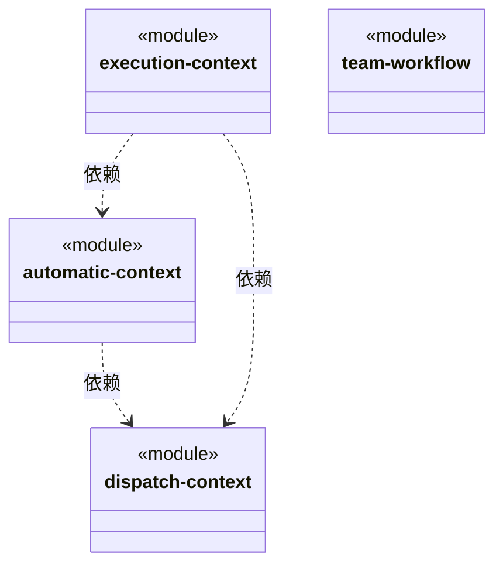

# src/logic/execution/context 架构

## 设计意图

根据明确选择的角色、模块和 Workflow 生成执行上下文。自动范围、主会话与成员任务分别解析，共用冻结知识边界，内置规范从本版本代码常量取得并按正文版本复核，不在这里启动模型或持有执行状态。

## 主要组成

| 组成 | 定位 |
| --- | --- |
| [automatic-context](automatic-context.ts) | 解析自动模式的隐式全项目范围，复用真实模块的 Workflow 与知识边界。 |
| [dispatch-context](dispatch-context.ts) | 解析主会话内置身份，以及正式派发所需的角色知识与多模块绑定。 |
| [execution-context](execution-context.ts) | 为已派发成员任务冻结完整执行知识和各模块可选 Workflow 程序约定，并在启动、恢复或未启动依赖替换前复核基线。 |
| [team-workflow](team-workflow.ts) | 调度引擎：将明确选择的模块、叶子 Agent 和本模块 Workflow 装配为执行任务。 |

<!-- architecture:generated:start -->

## 架构关系

[上层设计](../ARCHITECTURE.md)

<!-- architecture:generated:end -->
