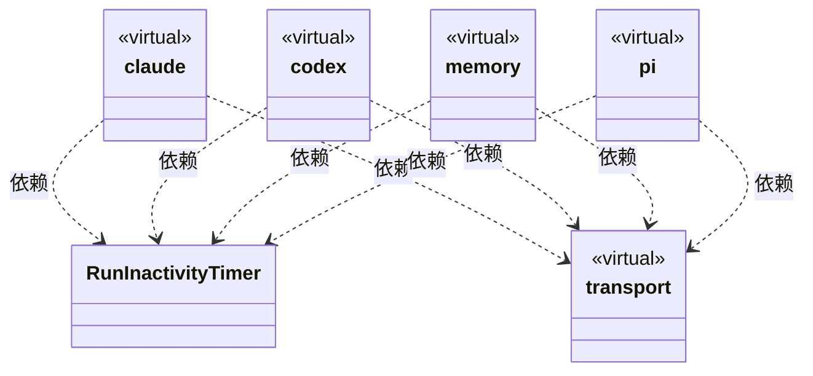
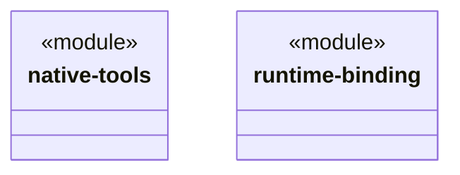

# src/logic/execution/engines 架构

## 设计意图

将不同模型引擎适配为统一执行协议。各引擎独立封装会话与工具差异，共用传输能力、无进展计时和运行包绑定；具体选择由上层装配完成。

## 主要组成

| 组成 | 定位 |
| --- | --- |
| [RunInactivityTimer](run-inactivity.ts) | 官方引擎共用的无进展计时器；适配器识别真实增量，工具事件复用统一协议。 |
| [runtime-binding](runtime-binding.ts) | 在具体引擎之外固定原生会话使用的受管 E 包身份，保存在原 agentHome 的私有旁路记录。 |
| [native-tools](native-tools.ts) | 向宿主托管引擎提供已有文件/命令工具操作，复用 Pi SDK 的独立工具实现而不创建 Pi Loop。 |

<!-- architecture:generated:start -->

## 架构关系

标注为 `virtual` 的节点是直接子模块的虚拟类封装；内部设计沿下方入口阅读。

### 关系组 1

### 关系组 2

### 跨图协作

- [codex](codex/ARCHITECTURE.md)（图 1）→ [native-tools](native-tools.ts)（图 2）：依赖。

## 子模块

| 虚拟封装 | 整体职责 |
| --- | --- |
| [claude](claude/ARCHITECTURE.md) | 把 Claude Agent SDK 接入统一执行协议，封装原生会话、事件和工具门禁。运行环境由宿主提供，业务工具通过可信能力接入，不向外提供通用 MCP 服务。 |
| [codex](codex/ARCHITECTURE.md) | 把 Codex 运行包接入统一执行协议。引擎适配负责会话和事件转换，RPC 对象负责进程通信；账号、安装和任务派发由外层负责。 |
| [memory](memory/ARCHITECTURE.md) | 实现结合生成模型与向量检索的记忆执行循环。MemoryEngine 组织回合与受控知识工具，会话与派生缓存分别保存，正式知识经注入端口访问。 |
| [pi](pi/ARCHITECTURE.md) | 把 Pi 运行包接入统一执行协议。引擎适配协调会话、模型和工具，RPC 对象隔离进程协议，业务权限与预算通过注入端口约束。 |
| [transport](transport/ARCHITECTURE.md) | 引擎 HTTP 请求预算与计量适配。通过 Logic budget/rules 的 RequestBudgetPort 预占、结算或记录未知结果；网络实现与稳定模型端口分离，保留各引擎错误和取消语义。 |

[上层设计](../ARCHITECTURE.md)

<!-- architecture:generated:end -->
