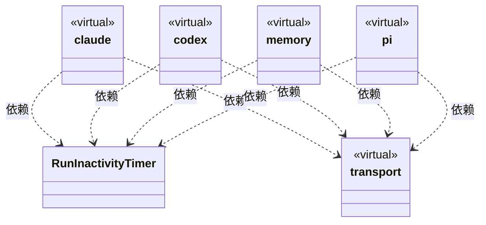
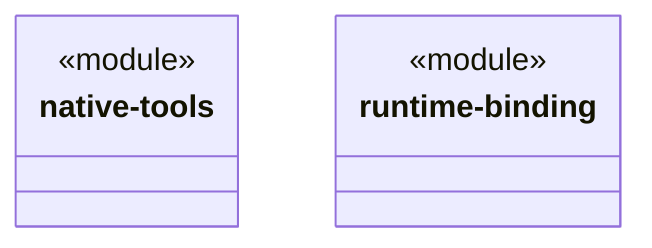

# src/logic/execution/engines 架构

## 设计意图

将不同供应商和专业循环适配到统一执行协议，隔离会话、工具和传输差异。

各引擎子模块独立管理自身原生状态，`transport` 提供请求预算与计量适配；本层共享无进展计时、运行包绑定与原生工具装配。真实进展由适配器识别，包身份在运行前冻结，具体实现选择仍属于上层 assembly。

## 主要组成

| 组成 | 定位 |
| --- | --- |
| [RunInactivityTimer](run-inactivity.ts) | 官方引擎共用的无进展计时器；适配器识别真实增量，工具事件复用统一协议。 |
| [runtime-binding](runtime-binding.ts) | 在具体引擎之外固定原生会话使用的受管 E 包身份，保存在原 agentHome 的私有旁路记录。 |
| [native-tools](native-tools.ts) | 向宿主托管引擎提供已有文件/命令工具操作，复用 Pi SDK 的独立工具实现而不创建 Pi Loop。 |

## 现状与目标边界

当前 [run-inactivity.ts](run-inactivity.ts)、[runtime-binding.ts](runtime-binding.ts) 和 [native-tools.ts](native-tools.ts) 仍是父层共享实现，分别负责计时、受管包绑定与原生工具装配。目标是按这三类变化原因形成明确共享边界，父层仅组合引擎与公共适配；不能因工具实现来自 Pi SDK 就将其他引擎视为 Pi 子类。迁移需核实各适配器的超时、会话身份和工具取消语义。

<!-- architecture:generated:start -->

## 架构关系

标注为 `virtual` 的节点是直接子模块的虚拟类封装；内部设计沿下方入口阅读。

### 关系组 1：RunInactivityTimer

### 关系组 2：native-tools

### 跨图协作

按引用方归并目标，保留全部跨图关系；分图只用于阅读，不表示新增模块或依赖边界。

| 引用方 | 关系 | 目标 |
| --- | --- | --- |
| [codex](codex/ARCHITECTURE.md)（图 1） | 依赖 | [native-tools](native-tools.ts)（图 2） |

## 子模块

| 虚拟封装 | 整体职责 |
| --- | --- |
| [claude](claude/ARCHITECTURE.md) | 把 Claude Agent SDK 的会话、事件与工具调用转换为宿主统一执行协议。 |
| [codex](codex/ARCHITECTURE.md) | 通过 Codex App Server 实现统一引擎生命周期，隔离进程协议与宿主业务工具。 |
| [memory](memory/ARCHITECTURE.md) | 实现生成模型与向量检索协作的知识记忆循环，使正式知识与可重建缓存分离。 |
| [pi](pi/ARCHITECTURE.md) | 把 Pi 运行包的会话、模型请求和工具事件适配为宿主统一执行协议。 |
| [transport](transport/ARCHITECTURE.md) | 将模型 HTTP 传输接到请求预算账本，保留发送、用量和未知结果的真实边界。 |

[上层设计](../ARCHITECTURE.md)

<!-- architecture:generated:end -->
