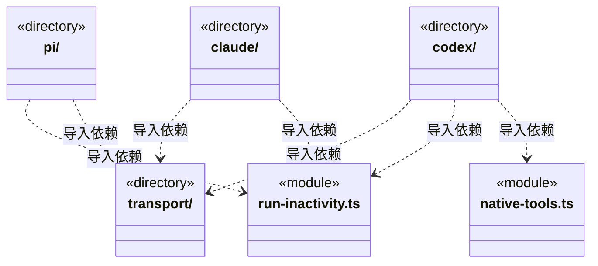
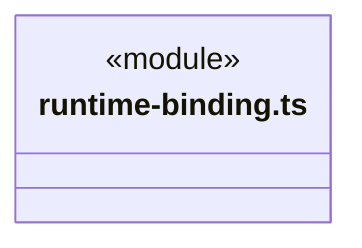
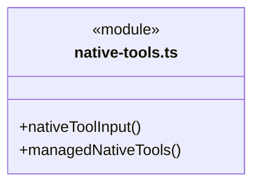
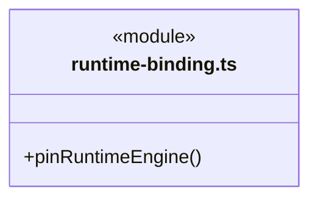
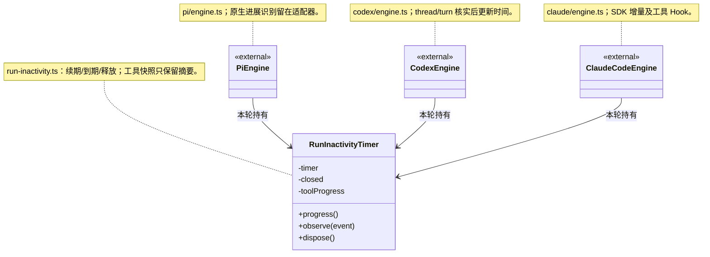

# src/logic/execution/engines 架构

## 目录定位

执行域的具体引擎适配边界：Pi、Claude、Codex 及其共享 HTTP 预算传输和原生工具加载。依赖 Logic 引擎/模型契约，由 execution/assembly 选择并注入；不持有任务派发与应用存储。 runtime-binding 在 agentHome 固定原生会话的 E 摘要；包变化时拒绝无兼容依据的恢复，历史不删除、不自动迁移。 可组合 utility 通用入口的分帧与在途集合，不依赖其 Node 入口或其他基础方案。

本文描述当前实现。通过分析目录边界后维护的 [源码架构脚本](../../../../scripts/source-architecture.mjs) 同步清单和声明；代码变更时仍须核对职责、关键成员与关系。

## 代码清单

| 文件 | 当前职责 |
| --- | --- |
| [native-tools.ts](native-tools.ts) | 向宿主托管引擎提供已有文件/命令工具操作，复用 Pi SDK 的独立工具实现而不创建 Pi Loop。 |
| [run-inactivity.ts](run-inactivity.ts) | 三种引擎共用的无进展计时器；适配器识别原生增量，工具事件复用统一协议。 |
| [runtime-binding.ts](runtime-binding.ts) | 在具体引擎之外固定原生会话使用的受管 E 包身份，保存在原 agentHome 的私有旁路记录。 |

## 架构类图

各图中的同名节点表示同一目录边界；跨组及完整直接依赖如下（无边不代表继承）：

- `claude` → `run-inactivity.ts`：导入。
- `claude` → `transport`：导入。
- `codex` → `native-tools.ts`：导入。
- `codex` → `run-inactivity.ts`：导入。
- `codex` → `transport`：导入。
- `pi` → `transport`：导入。
- `pi` → `run-inactivity.ts`：导入。

### native-tools.ts 公开入口

### runtime-binding.ts 公开入口

## 子目录导航

- [claude/](claude/ARCHITECTURE.md)：Claude Agent SDK 适配、内部工具门禁与真实原生会话生命周期；环境和账号归 CBIM，工具复用上层契约，不提供对外 MCP。原生工具开关只读可信能力的 disableNativeTools 策略，不认识具体业务工具槽位。 SDK 入口可由签名 E 包提供，仍限制适配器支持的版本，账号/历史目录不随缓存迁移。
- [codex/](codex/ARCHITECTURE.md)：Codex App Server 的受管进程、双向 RPC、真实 thread/turn、Responses 代理与动态工具；固定 CLI 和私有账号目录，内置执行关闭，工具经宿主授权、预算结算及同一回执；宿主原生工具目录按可信能力的 disableNativeTools 策略收窄。 原生 EXE 与 Pi 宿主工具库分别使用可信受管包，不重新编译或借用外部客户端。
- [pi/](pi/ARCHITECTURE.md)：Pi 协议、临时桥与运行参数；插入在原生状态查询后复核取消，发送后只凭queued回复确认，不自动重试。工具经一次性gate授权并校验结果；结构验证仅在正式成员有冻结要求及真实端口时公开。受控续执行在启动及加载原生会话后再核冻结证明，回传作为custom数据，不冒充用户授权。 范围模式只注册cbim工具，转发受限读取与隔离Node的原调用身份。 主角色提示要求未配置自定义岗位时自己执行；内置默认执行角色已退役，不能登记后绕过主会话。 受控文件工具仅在真实端口存在时安装，维持桥接容量及调用授权，工具结果和实际文件操作终态分别校验。 CLI 入口由宿主固定包解析；进程、工具门禁与会话验证保持原协议。
- [transport/](transport/ARCHITECTURE.md)：引擎 HTTP 请求预算与计量适配。通过 Logic budget/rules 的 RequestBudgetPort 预占、结算或记录未知结果；网络实现与稳定模型端口分离，保留各引擎错误和取消语义。

[返回上层](../ARCHITECTURE.md)。

每次修改本目录代码，同步维护文件头、关键契约说明及本图。未实现的治理、证据验收和自动编排能力不列入当前类图。

## 设计契约 v1 与落地范围

以下内容区分已接通能力与后续设计；以各节的实现状态为准，不将目标图当作现状图。维护源：[CONTRACT.md](CONTRACT.md)；生成类图时同步附加，勿直接修改本附录。

# 受管引擎包与原生历史

## 通用机制组合

Pi/Codex RPC 的文本缓冲由 `core/utility` 的 LineFramer 持有，协议策略留在各适配器；Pi 按 UTF-16 长度、Codex 按 UTF-8 字节保留原限额，完整空白帧/CR/未终止尾部按原规则处理。Codex 的工具调用与 RPC 处理使用实例 InFlightOperations；通知链、停止接单、取消、原请求身份及真实进程退出仍归引擎。引擎只允许依赖 utility 通用公开入口，不访问其他基础方案或其私有实现。

## 按执行进展续期

`turnTimeoutMs` 保留参数名、范围和持久化格式，含义改为连续无可观察进展的毫秒数，缺省 30 分钟；整轮累计时长不再触发此超时。既有数据不迁移，新启动/显式恢复的运行按新规则使用原选项，已经运行的旧进程不会热切换。

`RunInactivityTimer` 是 Pi、Codex、Claude Code 三个真实消费者共用的计时机制，只拥有本轮 timer 和工具快照摘要。适配器自行识别原生文本、推理及参数增量；统一消息与工具开始、完成、新的非空输出续期。空输出、重复工具快照、状态刷新和自动重试通知不续期。没有可观察输出的长命令仍可能达到无进展上限；这里不根据 CPU、模型自述或“进程还在”推断进展。

原生协议识别留在各适配器，共享计时器不认识供应商、不调用工具或重试。推理只触发时间更新，不保存/公开正文。正常结束、失败、停止和关闭释放 timer；过期后迟到事件不能复活窗口。无进展中断沿原关闭、排空、日志结算路径处理，在途操作保持未知，不自动重放。

此边界由本次重复硬超时缺陷提炼，接口及实现仍属稳定候选，变化频率没有统计依据。新增引擎只组合 `progress/observe/dispose` 并映射自身协议；新增进展类型修改其所属协议适配或公共事件判定，不修改任务调度核心。原生 RPC 单请求超时、工具自身超时及资源排空限制不由此计时器代替。

具体适配器仍依赖 Core，调度装配选择适配器。EngineRuntimeResolver 由可信主进程注入，返回完整验证后的 root、entry、version、identity；不接受 renderer、模型或工作区提供下载路径。开发/CLI 未注入时保留原依赖解析方式。

Pi 的 CLI、Claude Agent SDK 和 Codex EXE 使用预编译依赖包；用户机器不执行 npm install 或原生编译。当前适配器继续固定 Pi 1.5.0、Claude 0.3.322、Codex 0.167.0，不能仅把远端 version 改为 latest 来升级。Codex 的本机文件工具仍显式依赖受管 Pi 包。

`native-tools.ts` 的 `nativeToolInput` 在 Windows 上将 read/write/edit/find/grep/ls 的单根分隔符路径按工作区解析成完整路径，与授权侧的工作区路径解析一致；不再由 SDK 按宿主进程盘符补齐。原参数不改写，完整盘符路径、UNC、普通相对路径和 POSIX 平台行为保留。这里不解释 Bash/MSYS 挂载表，也不重写命令正文；跨工具传递文件仍优先使用完整 Windows 路径。

程序包与 agentHome 分离；模型账号、凭据和原生历史留在原用户目录。runtime-binding 在 session.bound 前同步保存原生 sessionId 对应的 E 摘要及辅助工具摘要。恢复前先核对；不同摘要不启动新 SDK/EXE 来尝试旧会话。旧整包没有旁路记录时只允许原固定版本迁移，今后提高适配器版本不得同步放宽 legacyVersions。

第一版对不兼容旧会话明确报错并要求新建对话，保留历史；尚未实现按旧会话自动选择旧 E 或跨 E 历史迁移。当前/旧 E 缓存不自动清理，也不把文件留存等同于已验证可恢复。新会话可以使用随新 R 选择的已验证 E。

### 独立工厂制品

pi/claude/codex 各有 package.ts，维护适配器版本 1.0.0，与厂商 SDK 版本分开。scripts/build-engine-adapters.mjs 可按官方 ID 单独生成 adapter.cjs 和 adapter.json；构建结果可在不加载 SDK、不连接模型时实例化与关闭。现有具体适配器继续持有取消、超时续期、原生历史和未知工具行为。源码开发装配使用兼容表；正式构建把适配器写入各自 E 归档，并通过通用加载器读取。
