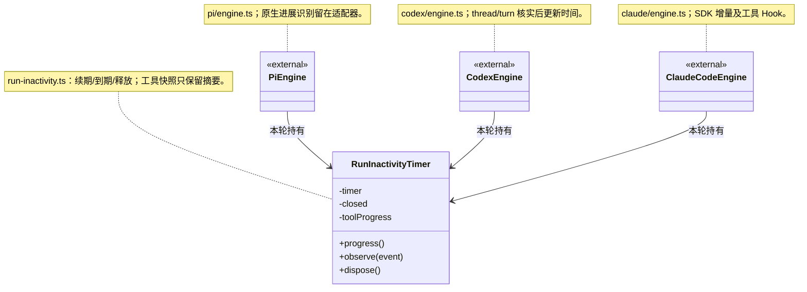

# 受管引擎包与原生历史

## 通用机制组合

Pi/Codex RPC 的文本缓冲由 `core/utility` 的 LineFramer 持有，协议策略留在各适配器；Pi 按 UTF-16 长度、Codex 按 UTF-8 字节保留原限额，完整空白帧/CR/未终止尾部按原规则处理。Codex 的工具调用与 RPC 处理使用实例 InFlightOperations；通知链、停止接单、取消、原请求身份及真实进程退出仍归引擎。引擎只允许依赖 utility 通用公开入口，不访问其他基础方案或其私有实现。

## 按执行进展续期

`turnTimeoutMs` 保留参数名、范围和持久化格式，含义改为连续无可观察进展的毫秒数，缺省 30 分钟；整轮累计时长不再触发此超时。既有数据不迁移，新启动/显式恢复的运行按新规则使用原选项，已经运行的旧进程不会热切换。

`RunInactivityTimer` 是 Pi、Codex、Claude Code 三个真实消费者共用的计时机制，只拥有本轮 timer 和工具快照摘要。适配器自行识别原生文本、推理及参数增量；统一消息与工具开始、完成、新的非空输出续期。空输出、重复工具快照、状态刷新和自动重试通知不续期。没有可观察输出的长命令仍可能达到无进展上限；这里不根据 CPU、模型自述或“进程还在”推断进展。

原生协议识别留在各适配器，共享计时器不认识供应商、不调用工具或重试。推理只触发时间更新，不保存/公开正文。正常结束、失败、停止和关闭释放 timer；过期后迟到事件不能复活窗口。无进展中断沿原关闭、排空、日志结算路径处理，在途操作保持未知，不自动重放。

此边界由本次重复硬超时缺陷提炼，接口及实现仍属稳定候选，变化频率没有统计依据。新增引擎只组合 `progress/observe/dispose` 并映射自身协议；新增进展类型修改其所属协议适配或公共事件判定，不修改任务调度核心。原生 RPC 单请求超时、工具自身超时及资源排空限制不由此计时器代替。

具体适配器仍依赖 Core，调度装配选择适配器。EngineRuntimeResolver 由可信主进程注入，返回完整验证后的 root、entry、version、identity；不接受 renderer、模型或工作区提供下载路径。开发/CLI 未注入时保留原依赖解析方式。

Pi 的 CLI、Claude Agent SDK 和 Codex EXE 使用预编译依赖包；用户机器不执行 npm install 或原生编译。当前适配器继续固定 Pi 1.5.0、Claude 0.3.322、Codex 0.167.0，不能仅把远端 version 改为 latest 来升级。Codex 的本机文件工具仍显式依赖受管 Pi 包。

`native-tools.ts` 的 `nativeToolInput` 在 Windows 上将 read/write/edit/find/grep/ls 的单根分隔符路径按工作区解析成完整路径，与授权侧的工作区路径解析一致；不再由 SDK 按宿主进程盘符补齐。原参数不改写，完整盘符路径、UNC、普通相对路径和 POSIX 平台行为保留。这里不解释 Bash/MSYS 挂载表，也不重写命令正文；跨工具传递文件仍优先使用完整 Windows 路径。

程序包与 agentHome 分离；模型账号、凭据和原生历史留在原用户目录。runtime-binding 在 session.bound 前同步保存原生 sessionId 对应的 E 摘要及辅助工具摘要。恢复前先核对；不同摘要不启动新 SDK/EXE 来尝试旧会话。旧整包没有旁路记录时只允许原固定版本迁移，今后提高适配器版本不得同步放宽 legacyVersions。

第一版对不兼容旧会话明确报错并要求新建对话，保留历史；尚未实现按旧会话自动选择旧 E 或跨 E 历史迁移。当前/旧 E 缓存不自动清理，也不把文件留存等同于已验证可恢复。新会话可以使用随新 R 选择的已验证 E。

### 独立工厂制品

pi/claude/codex 各有 package.ts，维护适配器版本 1.0.0，与厂商 SDK 版本分开。scripts/build-engine-adapters.mjs 可按官方 ID 单独生成 adapter.cjs 和 adapter.json；构建结果可在不加载 SDK、不连接模型时实例化与关闭。现有具体适配器继续持有取消、超时续期、原生历史和未知工具行为。源码开发装配使用兼容表；正式构建把适配器写入各自 E 归档，并通过通用加载器读取。

运行包包装器保留整个依赖闭包引用，真实 close 成功后释放，stop 或失败关闭不释放。历史 schema 1 的 Pi 工具摘要保持 toolsIdentity，其它依赖按名称固定摘要；不改写旧会话内容。
