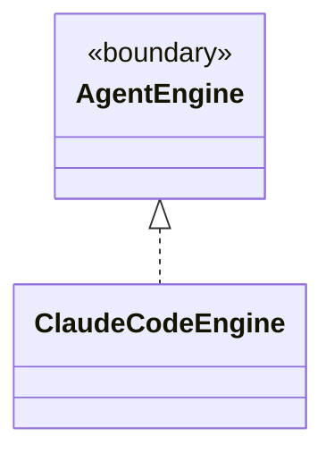

# src/logic/execution/engines/claude 架构

## 设计意图

把 Claude Agent SDK 接入统一执行协议，封装原生会话、事件和工具门禁。运行环境由宿主提供，业务工具通过可信能力接入，不向外提供通用 MCP 服务。

## 主要组成

| 组成 | 定位 |
| --- | --- |
| [ClaudeCodeEngine](engine.ts) | Claude Code 的 AgentEngine 适配器，管理 SDK 与原生会话；目标返工沿合成系统资料输入，不带入新授权。 |

<!-- architecture:generated:start -->

## 架构关系

外部继承／实现边界：[AgentEngine](../../rules/types.ts)。

[上层设计](../ARCHITECTURE.md)

<!-- architecture:generated:end -->
