# src/logic/execution/engines/codex 架构

本目录只维护这一份说明。设计与契约直接编辑本文；文件清单、类图和导航由 [架构脚本](../../../../../scripts/source-architecture.mjs) 更新，生成区域之外的人工说明会保留。

## 封装意图

Codex App Server 的受管进程、双向 RPC、真实 thread/turn、Responses 代理与动态工具；固定 CLI 和私有账号目录，内置执行关闭，工具经宿主授权、预算结算及同一回执；宿主原生工具目录按可信能力的 disableNativeTools 策略收窄。 原生 EXE 与 Pi 宿主工具库分别使用可信受管包，不重新编译或借用外部客户端。

## 类与模块的设计意图

下表依据源码声明及文件头说明定位封装。字段表示该实例持有的状态或协作引用，不表示它拥有被引用服务的生命周期；实际资源责任和调用限制见下文契约及源码注释。

| 类／模块 | 实现形式与实例字段 | 封装依据 |
| --- | --- | --- |
| [binary.ts](binary.ts) | 函数／契约模块 | 直接持有实际子进程才能等待退出；平台二进制与 CLI 版本一起冻结，不借用外部账号或安装。 |
| [CodexEngine](engine.ts) | 实例类；持有 `kind`、`context`、`rpc`、`tools`、`proxy`、`threadId`、`sessionFile`、`turnId`、`startingTurn`、`stopped`、`fatal`、`sessionBound`、`closing`、`inactivity`、`done`、`options` | 参考 Cindy 的双向 RPC 接法；关闭内置执行/外部工具，用既有授权、预算和事件服务持有副作用。 |
| [model-proxy.ts](model-proxy.ts) | 函数／契约模块 | Codex 没有与 CBIM maxTokens 等价的启动字段；在实际发送前补上上限，再交给共用请求账本。 |
| [package.ts](package.ts) | 函数／契约模块 | 宿主提供已冻结依赖和可信端口，App Server 协议与原生工具适配由包独立维护。 |
| [CodexRpc](rpc.ts) | 实例类；持有 `child`、`exit`、`closing`、`failure`、`sequence`、`frames`、`pending`、`handling`、`notifications`、`notify`、`requestHandler`、`failed` | 工具调用需要宿主可靠回包；顺序处理通知但不阻塞响应关联，避免授权等待造成通信死锁。 |
| [session.ts](session.ts) | 函数／契约模块 | App Server 自己分配 UUID；正常恢复和异常收尾共用路径边界与真实 metadata 校验，不能接纳私有目录外的原生历史。 |
| [tools.ts](tools.ts) | 函数／契约模块 | 原生内置工具关闭，每次调用均以 thread/turn/call 身份核对、先结算预算、再授权、保存结果后回包。 |

## 接口设计契约

### Codex 适配边界

#### JSONL 与在途处理

CodexRpc 组合 utility.LineFramer，只对完整非空白帧解析 JSON；完整帧保留 CR 并按 UTF-8 字节计量，尾部也使用原 32 MiB 上限，不交付 EOF 尾部。坏协议、超时、请求关联和进程终止仍归 RPC。通知顺序继续用本地 Promise 链，不能被 InFlightOperations 的无序集合代替。

RPC handling 与 codexTools.active 使用各自 InFlightOperations，只跟踪原处理 Promise 并等待快照。工具 stop/close 仍发出原取消；RPC close 仍先拒绝请求、关闭 stdin、等待真实 child exit，再等处理集合，不把 Promise 完成当成副作用撤销或资源退出。

#### 无进展超时

`CodexEngine.run` 使用共享 [无进展计时器](../ARCHITECTURE.md#contract-按执行进展续期)。公开消息与宿主工具事件续期，原生正文/推理/命令输出增量先核当前 thread/turn；旧轮迟到输出不能续期。停止和 close 释放计时器，超时沿原失败、工具停止和进程排空路径结算；RPC 请求自己的确认期限保持原义。

`CodexEngine` 实现公共 `AgentEngine`。固定 `@openai/codex@0.167.0` 及平台二进制通过 stdio App Server 运行；不使用 PATH 客户端、外部账号、用户 Codex HOME 或 Cindy 的运行进程。依赖方向为装配 → 引擎 → 公共契约，业务调度不进入 RPC 层。

#### 生命周期与原生身份

`CodexRpc` 区分宿主请求、服务端工具请求和顺序通知，响应关联不等待工具授权。协议失败/超时终止原进程，不能重发操作；close 等待进程及已收到处理排空。主会话和成员分别持有自己的 Codex HOME。

新建 thread 由服务端分配 ID，实际回执经 `session.bound` 落盘。成员只在首次 starting→running 采纳该 ID，不能用逻辑 agentSessionId 伪造原生线程。恢复必须核对私有 sessions 目录、完整 JSONL、metadata.id/cwd、文件名及当前工具是否已注册；在 thread/resume 前再次核实完整成员恢复证明。恢复会追加 thread_settings_applied，因此动作后核对实际线程/文件身份，不再将原生自己的追加误当作旧证明损坏。跨引擎主会话恢复目标引擎自己的 ID/文件，并只转交公开历史资料。

thread/start 回执可能先给出 ID/路径，再延迟写入原生文件。正常完成仍及时绑定；失败、取消或超时统一经 `CodexEngine.close`：停止工具、关闭代理、等待 RPC 进程退出与回调排空，再按原回执路径校验并补登记。Runtime 在 close 之后才封存本轮日志，因而不会向旧终态追加登记。成功文件绑定和 close 屏障均去重，重复关闭不追加事件。

只对真实存在且通过上述身份/路径校验的文件登记；不扫描其他 rollout、不伪造路径、不修改原生内容。路径必须是私有 sessions 的真实后代（包含 Windows 分隔符校验）。未落盘保持缺省，无效文件拒绝绑定；运行时仍保留首个执行故障，不用登记成功把中断解释成任务完成。旧已封存日志缺少登记时不会被自动回写；界面提供原运行核实和新对话入口。

#### 工具与权限

启动时关闭原生 shell、编辑、web、MCP、插件、hooks、记忆和额外实验功能；不加载工程 AGENTS 指令。内部 cbim 工具与宿主文件操作注册为 dynamicTools。后者复用固定 Pi SDK 的独立操作，不运行 Pi 循环。

每次请求核对 threadId、turnId、callId 和唯一调用身份；先等本轮已发请求可靠结算，再走 Runtime.beforeTool，保存结果后回包。原生 `request_user_input` 不发布给模型且不处理其宿主请求，用户交互统一走已有 CBIM 工具。冻结范围成员只注册范围端口，不注册文件/命令旁路。只读模式不发布写入/命令工具；原生线程可保存全工具注册信息，但每次实际请求按当前权限投影，并在调用端再次核对。

#### 请求与统计

`model-proxy` 固定供应商目标、模型、当前工具及 max_output_tokens；真实密钥只在父进程。只转发 /responses，远端专用压缩接口未接入时明确失败。启用请求预算则复用共享 reserve/issue/report/unknown 账本。无论是否启用预算，完整 SSE/usage 通过共享解析器核实，断流不补零、不自动重试。

本轮用量来自实际 HTTP 响应求和，不取恢复线程的历史累计数。仅完整成功轮次发布 run-usage；价格来自本轮冻结配置，未知价格保留未知。模型结束仅表示执行回合结束，不是业务验收。

#### 当前边界

支持排队、停止、文本/图片输入、工具调用和同引擎恢复；没有实现运行内插入确认。恢复时新增工具名称需要新建对话，因为 App Server 恢复接口不接受替换 dynamicTools。原生文件含引擎自行保存的私有内容，公开 CBIM 事件只投影助手正文和工具回执，不转发私有推理。测试使用真实二进制与本机确定性模型，不等于线上模型或整包桌面验收。

##### 通用能力注入

工具从 EngineContext.capabilities 的通用工具目录注册；可信能力 disableNativeTools=true 时关闭全部原生文件和命令，不依赖某个业务工具槽位。业务指引作为可信装配说明传入，授权、原调用身份、结果保存与停止顺序保持原协议。

##### 失败后的核实

动态内部工具与宿主原生工具均保留原调用身份；异常转换为统一 outcome JSON，success=false，未知不允许自动重试。成功元数据与原文本并存，不替代业务验收。关闭仍排空原在途调用。

##### 凭据文本替换

精确字符串替换使用后端 utility 的 StringUtils.RedactLiteral，仍由引擎选择凭据及触发路径。Pi 保留 api-key 条件，Claude 无凭据时保留事件引用；JSON 编码后替换与异常路径保持原顺序，不新增凭据搜集、正则或解码规则。

##### RPC 请求关联边界

PendingRequests 只持有 ID 对应回调和时限。Pi 超时取出单项并拒绝，进程可继续；Codex 超时仍 fail 全部请求并终止进程。坏协议、错误脱敏、发送异常及 close 等待进程/通知排空仍由适配器管理。未知或重复回包仍忽略，收到回包先移除后结算，不自动重送。

##### 包工厂

package.ts 导出协议 1、适配器版本 1.0.0 的统一工厂；App Server、模型代理、工具调用和实际 Pi 工具依赖仍由现有适配器封装，构造工厂不启动进程。

受管包工厂从 runtime.dependencies.pi 取得已经固定的工具包，执行装配不再另行解析默认 Pi。开发测试仍可注入 nativeToolsRuntime。

适配包版本为 1.1.1；本次递归预算契约改变了包内代码，必须使用新版本身份。固定依赖、旧包缓存和原生会话身份核验继续生效，不覆盖公开 1.1.0 制品。

#### 共享算法调用边界

本目录通过 Core 公开入口调用 `StringUtils.RedactLiteral`。静态类只承载原算法；本目录继续决定字段、比较器、错误映射及资源生命周期。函数改为静态方法不改变原持久化字节或失败语义。

## 开闭边界

本目录的职责及允许协作由[封装意图](#封装意图)限定，输入输出、状态与失败语义以[接口设计契约](#接口设计契约)为准。扩展从已有公开入口及实际装配位置进入；没有明确可替换契约的部分按真实影响修改和验证，不预建未使用的基类或插件入口。

<!-- architecture:generated:start -->

## 文件清单

| 文件 | 形式 | 当前职责 |
| --- | --- | --- |
| [ARCHITECTURE.md](ARCHITECTURE.md) | 说明文档 | 本目录的文件清单、真实声明、依赖与子封装导航。 |
| [binary.ts](binary.ts) | 源码模块 | 解析 CBIM 随包的固定 Codex 原生 App Server，不启动用户 PATH 中的客户端。 |
| [engine.ts](engine.ts) | 源码模块 | 通过 Codex App Server 管理进程、线程、轮次和动态工具；目标返工明确为系统反馈，不携带用户图片或新授权。 |
| [model-proxy.ts](model-proxy.ts) | 源码模块 | 将 Codex 的 Responses 请求约束为本轮冻结模型、输出上限和已注册工具目录。 |
| [package.ts](package.ts) | 源码模块 | Codex 官方包的版本化工厂入口。 |
| [rpc.ts](rpc.ts) | 源码模块 | Codex App Server 的双向 JSONL 通信，分别关联宿主请求、原生请求和通知。 |
| [session.ts](session.ts) | 源码模块 | 核实 Codex 实际 rollout 的路径、原生身份、工作区与持久化动态工具目录。 |
| [tools.ts](tools.ts) | 源码模块 | 把 Codex dynamic tool 请求路由到 CBIM 知识/执行工具及已有宿主文件操作。 |

## 架构类图

成员标记：`+` 公开、`-` 私有、`#` 受保护、`$` 静态；构造函数单独列出。文档和资源仅在文件清单中导航，不作为代码节点。

### binary.ts

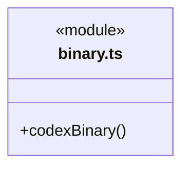

直接依赖：[../../rules/engine-runtime.ts](../../rules/engine-runtime.ts)。

### engine.ts

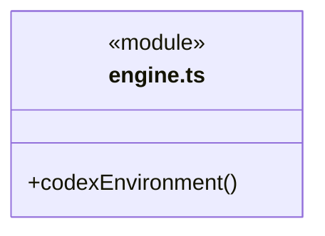

成员 1/2（同名节点为同一声明，跨图合并阅读）。

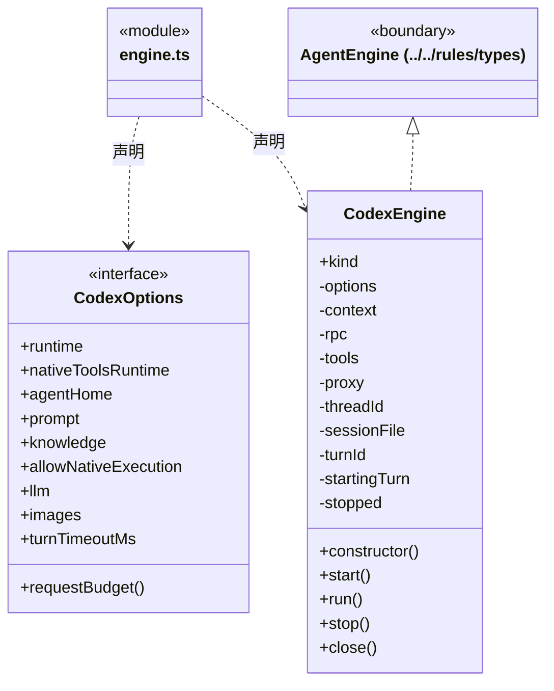

成员 2/2（同名节点为同一声明，跨图合并阅读）。

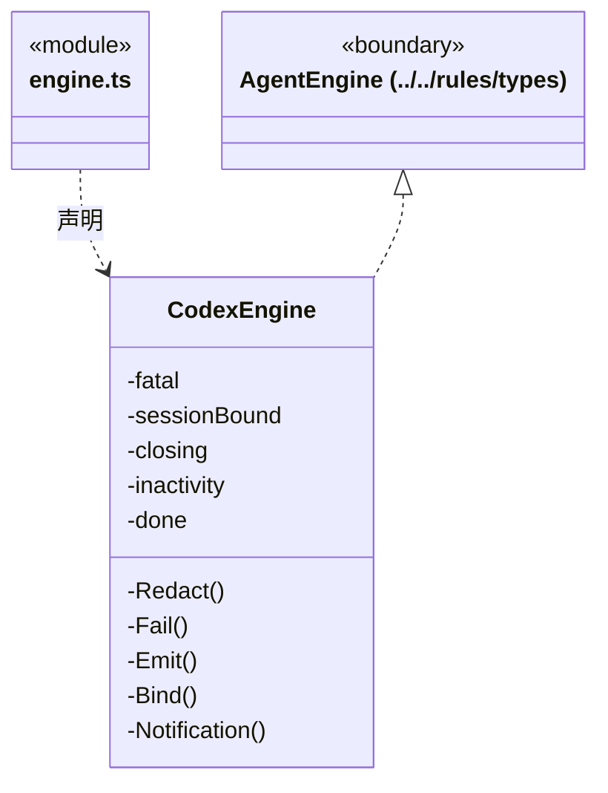

继承／实现来源：`AgentEngine` → [../../rules/types.ts](../../rules/types.ts)。
直接依赖：[../../../../core/utility/index.ts](../../../../core/utility/index.ts)、[../../../budget/rules/request-budget.ts](../../../budget/rules/request-budget.ts)、[../../../engines/index.ts](../../../engines/index.ts)、[binary.ts](binary.ts)、[model-proxy.ts](model-proxy.ts)、[rpc.ts](rpc.ts)、[session.ts](session.ts)、[tools.ts](tools.ts)、[../native-tools.ts](../native-tools.ts)、[../run-inactivity.ts](../run-inactivity.ts)、[../../rules/engine-instructions.ts](../../rules/engine-instructions.ts)、[../../rules/engine-runtime.ts](../../rules/engine-runtime.ts)、[../../rules/engine-tools.ts](../../rules/engine-tools.ts)、[../../rules/types.ts](../../rules/types.ts)。

### model-proxy.ts

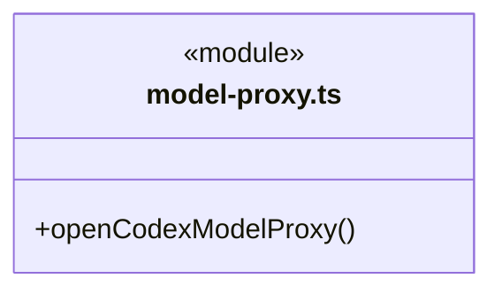

直接依赖：[../../../budget/rules/request-budget.ts](../../../budget/rules/request-budget.ts)、[tools.ts](tools.ts)、[../transport/request-budget-transport.ts](../transport/request-budget-transport.ts)、[../transport/request-budget-usage.ts](../transport/request-budget-usage.ts)、[../../../models/index.ts](../../../models/index.ts)。

### package.ts

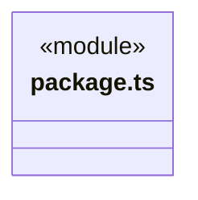
直接依赖：[../../../engines/index.ts](../../../engines/index.ts)、[engine.ts](engine.ts)、[../../rules/engine-adapter.ts](../../rules/engine-adapter.ts)。

### rpc.ts

成员 1/2（同名节点为同一声明，跨图合并阅读）。

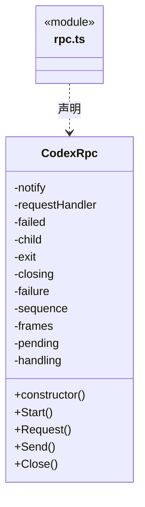

成员 2/2（同名节点为同一声明，跨图合并阅读）。

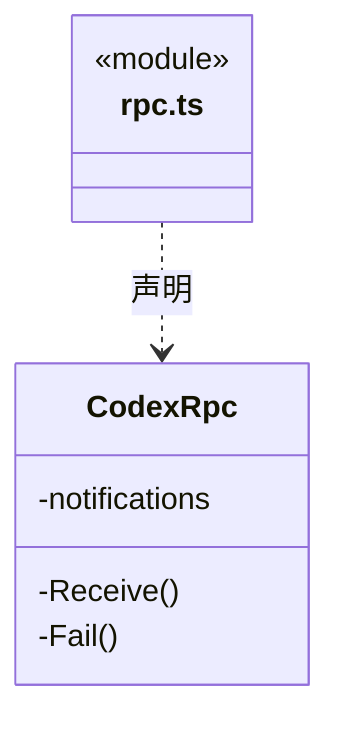

直接依赖：[../../../../core/utility/index.ts](../../../../core/utility/index.ts)。

### session.ts

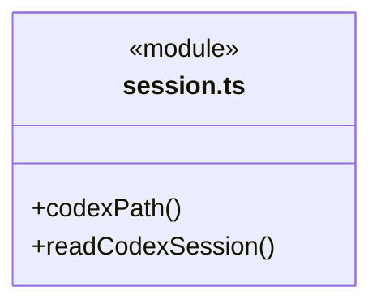

### tools.ts

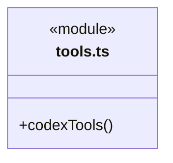

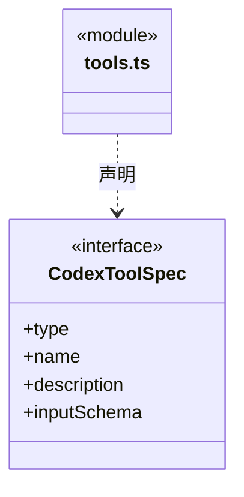

直接依赖：[../../../../core/utility/index.ts](../../../../core/utility/index.ts)、[../../rules/engine-tools.ts](../../rules/engine-tools.ts)、[../../rules/types.ts](../../rules/types.ts)、[../../../tools/rules/native-tools.ts](../../../tools/rules/native-tools.ts)、[../../../tools/rules/outcome.ts](../../../tools/rules/outcome.ts)、[../../../tools/rules/results.ts](../../../tools/rules/results.ts)。

### 本目录调用边界

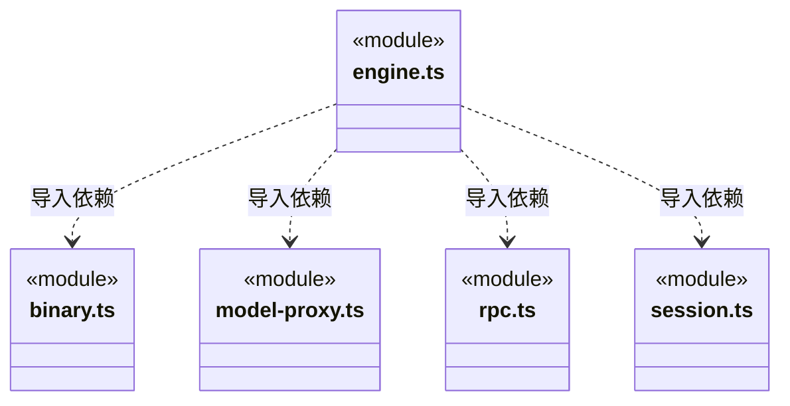

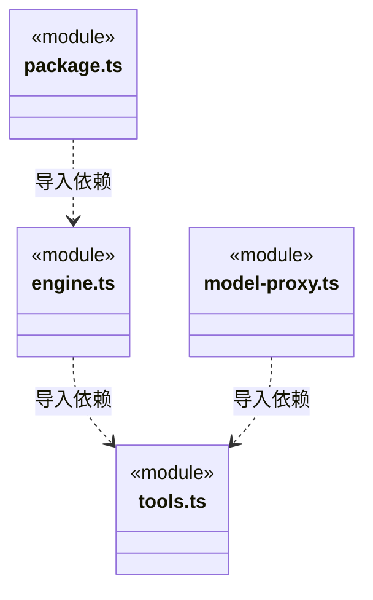

## 子目录导航

无子目录。

[返回上层](../ARCHITECTURE.md)。

每次修改本目录代码，同步维护文件头、关键契约说明及本图。未实现的治理、证据验收和自动编排能力不列入当前类图。

<!-- architecture:generated:end -->
