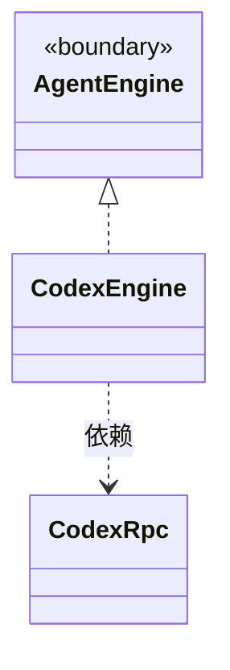

# src/logic/execution/engines/codex 架构

## 设计意图

把 Codex 运行包接入统一执行协议。引擎适配负责会话和事件转换，RPC 对象负责进程通信；账号、安装和任务派发由外层负责。

## 主要组成

| 组成 | 定位 |
| --- | --- |
| [CodexEngine](engine.ts) | 通过 Codex App Server 管理进程、线程、轮次和动态工具；目标返工明确为系统反馈，不携带用户图片或新授权。 |
| [CodexRpc](rpc.ts) | Codex App Server 的双向 JSONL 通信，分别关联宿主请求、原生请求和通知。 |

<!-- architecture:generated:start -->

## 架构关系

外部继承／实现边界：[AgentEngine](../../rules/types.ts)。

[上层设计](../ARCHITECTURE.md)

<!-- architecture:generated:end -->
