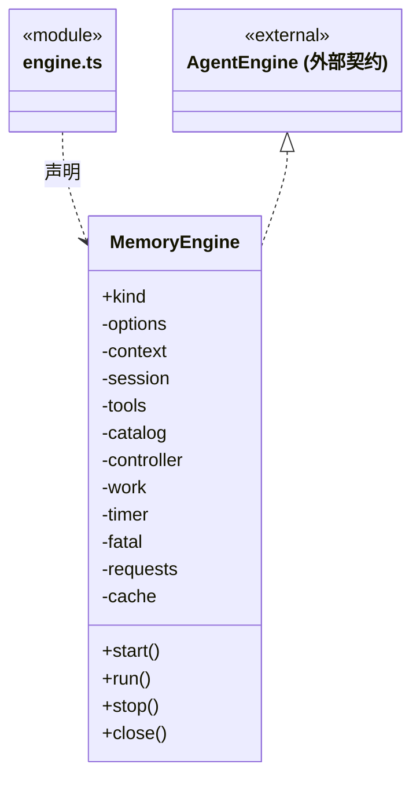
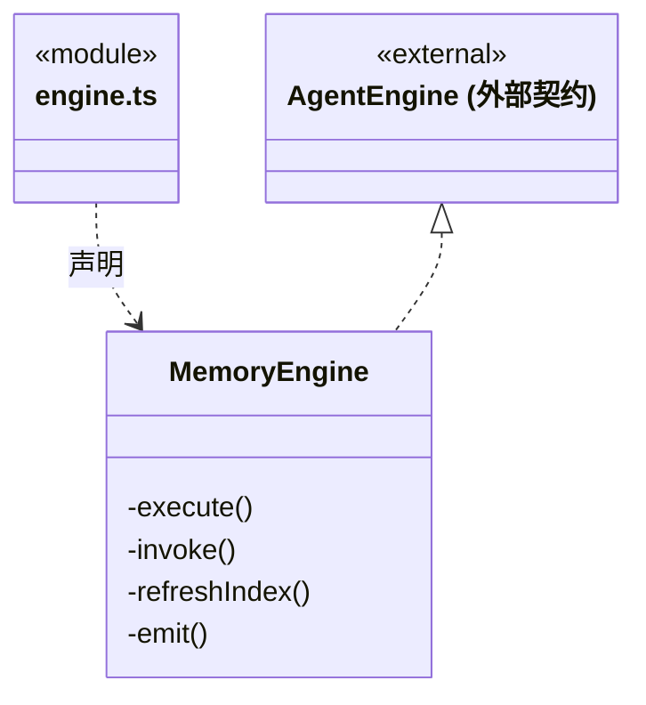
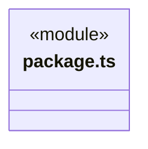
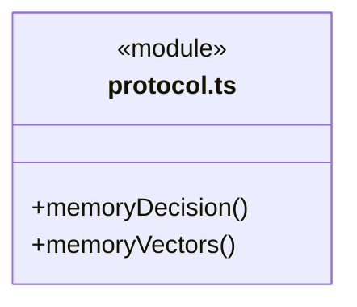
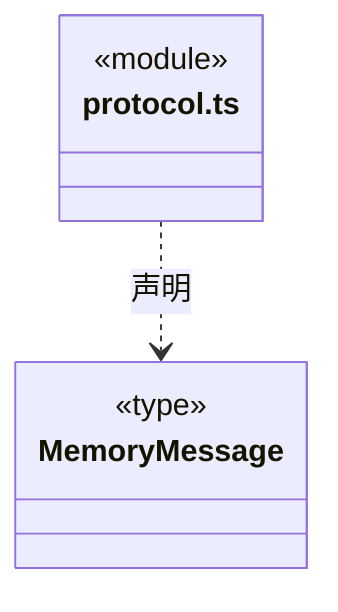
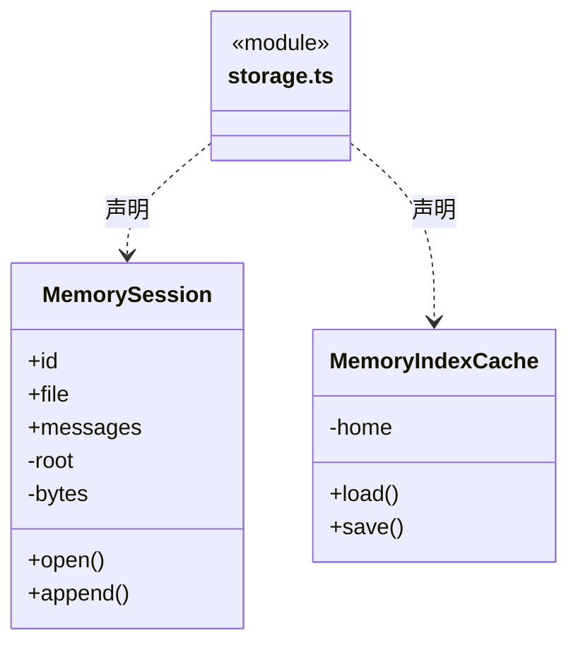
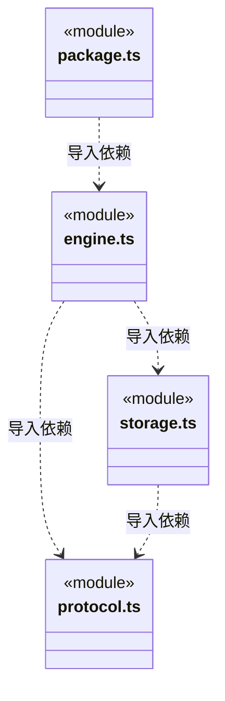

# src/logic/execution/engines/memory 架构

## 目录定位

官方自定义记忆 Loop：生成/向量双模型、受控知识工具、八回合限额与无进展中断；私有会话先同步，未知历史拒绝重放，派生向量缓存按完整代际隔离。

本文描述当前实现。通过分析目录边界后维护的 [源码架构脚本](../../../../../scripts/source-architecture.mjs) 同步清单和声明；代码变更时仍须核对职责、关键成员与关系。

## 代码清单

| 文件 | 当前职责 |
| --- | --- |
| [engine.ts](engine.ts) | 官方记忆领域 Agent Loop，使用生成和 embedding 双模型管理受控知识，不依赖厂商 Agent SDK。 |
| [package.ts](package.ts) | CBIM 自定义记忆引擎的独立官方包入口，运行库与适配器同版，无外部 Agent SDK。 |
| [protocol.ts](protocol.ts) | 记忆 Loop 的模型结果与私有对话消息协议，隔离供应商 JSON 与可执行工具决定。 |
| [storage.ts](storage.ts) | 记忆包的私有会话及派生向量缓存；正式知识只能经注入工具访问。 |

## 架构类图

### engine.ts

成员 1/2（同名节点为同一声明，跨图合并阅读）。

成员 2/2（同名节点为同一声明，跨图合并阅读）。

直接依赖：[../../../../core/utility/index.ts](../../../../core/utility/index.ts)、[../../rules/types.ts](../../rules/types.ts)、[../../rules/engine-adapter.ts](../../rules/engine-adapter.ts)、[../../rules/engine-tools.ts](../../rules/engine-tools.ts)、[../../rules/engine-instructions.ts](../../rules/engine-instructions.ts)、[../../../tools/rules/outcome.ts](../../../tools/rules/outcome.ts)、[../../../tools/rules/results.ts](../../../tools/rules/results.ts)、[../../../knowledge/rules/memory-index.ts](../../../knowledge/rules/memory-index.ts)、[../../../budget/rules/model-request-configuration.ts](../../../budget/rules/model-request-configuration.ts)、[../transport/model-json-requests.ts](../transport/model-json-requests.ts)、[../run-inactivity.ts](../run-inactivity.ts)、[protocol.ts](protocol.ts)、[storage.ts](storage.ts)。

### package.ts

直接依赖：[../../../engines/index.ts](../../../engines/index.ts)、[../../rules/engine-adapter.ts](../../rules/engine-adapter.ts)、[engine.ts](engine.ts)。

### protocol.ts

直接依赖：[../../../../core/utility/index.ts](../../../../core/utility/index.ts)。

### storage.ts

直接依赖：[../../../../core/platform/node/files/index.ts](../../../../core/platform/node/files/index.ts)、[../../ports/identity.ts](../../ports/identity.ts)、[../../rules/types.ts](../../rules/types.ts)、[../../../knowledge/rules/memory-index.ts](../../../knowledge/rules/memory-index.ts)、[protocol.ts](protocol.ts)。

### 本目录调用边界

## 子目录导航

无子目录。

[返回上层](../ARCHITECTURE.md)。

每次修改本目录代码，同步维护文件头、关键契约说明及本图。未实现的治理、证据验收和自动编排能力不列入当前类图。

## 设计契约 v1 与落地范围

以下内容区分已接通能力与后续设计；以各节的实现状态为准，不将目标图当作现状图。维护源：[CONTRACT.md](CONTRACT.md)；生成类图时同步附加，勿直接修改本附录。

# 记忆领域 Loop

本包导出协议 1、版本 1.1.0 的 memory 工厂，无第三方 Agent SDK。primary 必须是 OpenAI Chat 兼容的生成模型；embedding 为必填向量角色，使用独立连接、维度、输入容量与价格。编译时声明随包保存，加载先核对主协议与必填角色，不将新声明应用到不同旧包。兼容表示允许选型，实际模型的工具调用和向量质量必须另行验证。当前只接受文本，不提供原生文件/命令、图片或用户插入。

`start` 捕获可信工具目录、准备私有会话并持久化 session.bound，不发送模型请求。`run` 每实例仅一次：经 beforeTool 读取完整知识 → 按来源和向量模型形成索引 → 查询向量/带出处检索 → 至多八次生成决定。每次最多一个工具，所有工具先持久化授权后调用，再持久化回执；重复相同模型工具请求、任何失败或未知结果立即停止，不重试也不重启任务。系统转交反馈不当成新增用户授权。模型正文在可靠用量结算后才进入消息或工具决定。

真实生成完成与工具事件续期无进展计时器，此外本轮有 30 分钟总上限；JSON 响应中尚未解析的网络字节不被当作已完成的模型工作。停止中止实际模型请求和工具端口，关闭等待请求及事件收口。上限不是运行器的自动重启信号。

正式知识只经 CBIM 原有工具修改，保留权限、revision、预览/提交与幂等回执。摘要要求引用来源并默认保留原文；删除/覆盖依用户明确目标及原授权，不新增隐含授权。知识写入已返回后，重新读取并生成新代向量索引；失败报告“知识写入工具已返回，向量索引尚未同步”，保留原工具 ID、知识事实及预算未知状态，不再执行原提交。

`agentHome/sessions/<nativeId>.jsonl` 保存 CBIM 版本 1 会话头和追加消息，头绑定 engine/id/工作区/任务/根目录；每条 fsync 后才继续。1 MiB 上限、完整尾行、原生路径与消息/工具/回合顺序逐项核实。只有完整结束的历史可恢复；未完成或损坏的历史明确拒绝，需要核实后开启新上下文，不修复后自动续跑。成员恢复还调用原冻结证明复核；统一原生指纹读取器按静态目录的 nativeHistoryFormat 核验。

`agentHome/memory-index/<key>.json` 仅存派生向量；来源原文始终来自本轮授权快照。key 绑定完整来源版本、模型公开配置、维度和分块策略。完整新代通过维度/数量/数值校验、同步临时文件后原子切换；旧代保留，缺失才生成，损坏不静默删除重建。每代最多 128 个 768 字符片段，缓存 16 MiB；输入还按 UTF-8 字节做保守容量保护，真实 token 用量仍以供应商报告为准。大规模分块、缓存清理、历史压缩迁移和跨包自动恢复不在首版实现中。

本地完整应用测试使用真实知识事务、实际 HTTP 与预算账本，但供应商返回由隔离测试服务生成；它证明契约及失败行为，不证明某个外部模型的质量或认证可用。包构建和冷壳字节隔离已有回归；尚未公开发布或安装到用户生产数据。
