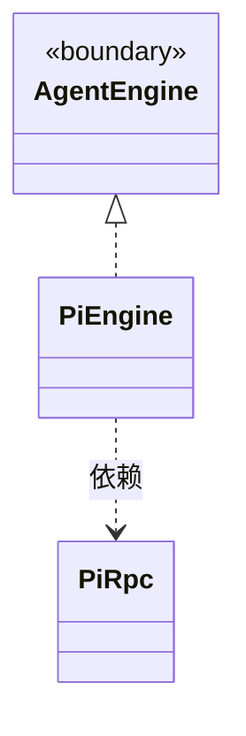

# src/logic/execution/engines/pi 架构

## 设计意图

把 Pi 运行包接入统一执行协议。引擎适配协调会话、模型和工具，RPC 对象隔离进程协议，业务权限与预算通过注入端口约束。

## 主要组成

| 组成 | 定位 |
| --- | --- |
| [PiEngine](engine.ts) | Pi 引擎适配器，负责隔离配置、原生会话校验及事件转换；成员回传、人工决定和目标返工均走可信系统输入。 |
| [PiRpc](rpc.ts) | 大脑 执行层：PiRpc：JSONL 拆包、命令关联、超时与进程结束处理。 |

<!-- architecture:generated:start -->

## 架构关系

外部继承／实现边界：[AgentEngine](../../rules/types.ts)。

[上层设计](../ARCHITECTURE.md)

<!-- architecture:generated:end -->
