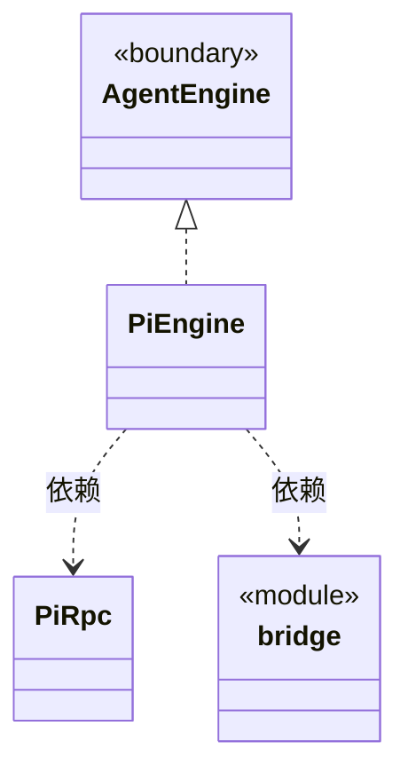

# src/logic/execution/engines/pi 架构

## 设计意图

把 Pi 运行包的会话、模型请求和工具事件适配为宿主统一执行协议。

`PiEngine` 管理隔离配置、原生历史和事件转换，`PiRpc` 处理 JSONL 分帧、请求关联及进程结束，桥与预算启动适配连接宿主端口。成员结果和目标返工以可信系统输入进入，不能变成新用户授权。

## 主要组成

| 组成 | 定位 |
| --- | --- |
| [PiEngine](engine.ts) | Pi 引擎适配器，负责隔离配置、原生会话校验及事件转换；成员回传、人工决定和目标返工均走可信系统输入。 |
| [PiRpc](rpc.ts) | 持有单个 Pi 进程的 JSONL 通信、命令关联、超时与结束处理。 |
| [bridge](bridge.ts) | 连接 Pi 进程侧工具协议与宿主的可信能力。 |

<!-- architecture:generated:start -->

## 架构关系

外部继承／实现边界：[AgentEngine](../../rules/types.ts)。

[上层设计](../ARCHITECTURE.md)

<!-- architecture:generated:end -->
