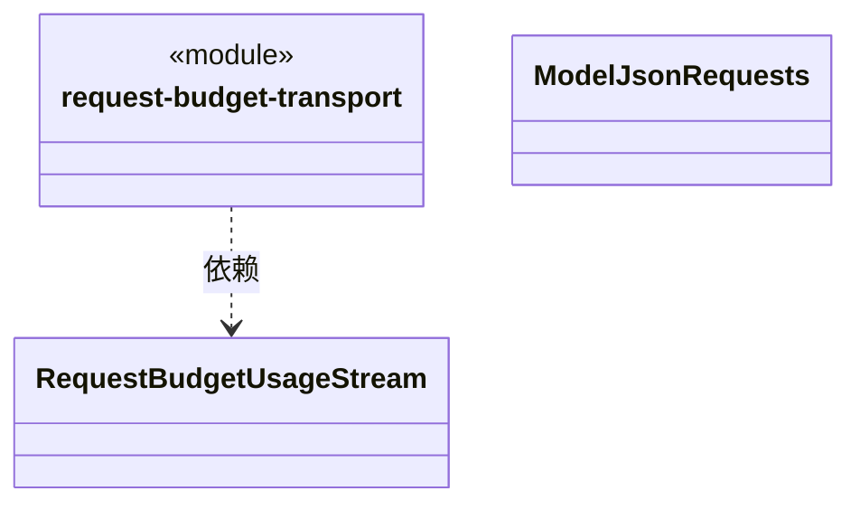

# src/logic/execution/engines/transport 架构

## 设计意图

将模型 HTTP 传输接到请求预算账本，保留发送、用量和未知结果的真实边界。

`request-budget-transport` 在真实 I/O 前后调用预算端口；`RequestBudgetUsageStream` 解析支持的 SSE 用量并延迟交付终态，`ModelJsonRequests` 提供非流式生成与向量请求。身份、冻结价格及结算事务来自装配方，网络异常不等于请求免费。

## 主要组成

| 组成 | 定位 |
| --- | --- |
| [ModelJsonRequests](model-json-requests.ts) | 自定义领域 Loop 的非流式生成/向量请求，复用逐请求预算与冻结模型快照。 |
| [RequestBudgetUsageStream](request-budget-usage.ts) | 严格读取三种受支持 SSE 协议的请求用量，并暂存终态帧供可靠结算后交付。 |
| [request-budget-transport](request-budget-transport.ts) | 围绕实际 HTTP 请求组织预占、发送意图、用量与未知结算。 |

<!-- architecture:generated:start -->

## 架构关系

[上层设计](../ARCHITECTURE.md)

<!-- architecture:generated:end -->
