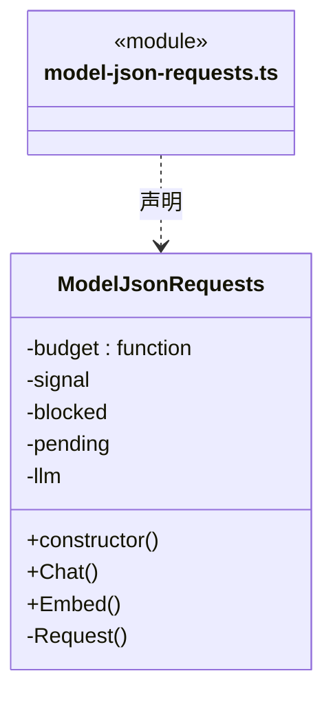
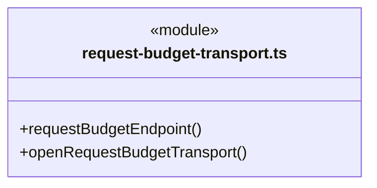
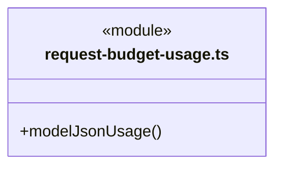
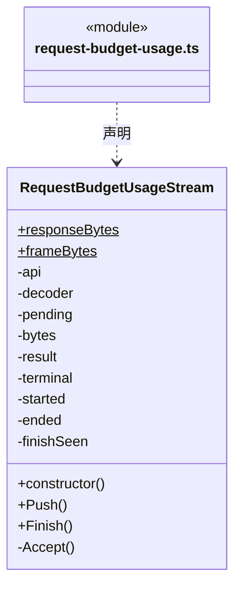
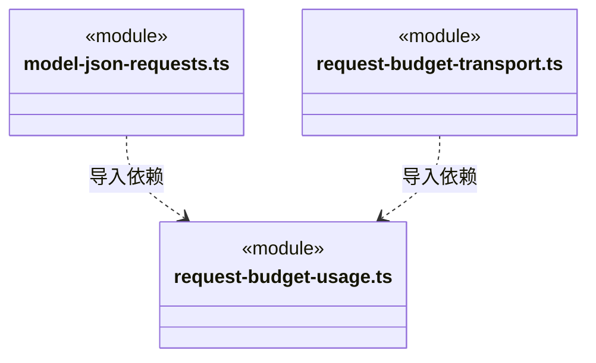

# src/logic/execution/engines/transport 架构

本目录只维护这一份说明。设计与契约直接编辑本文；文件清单、类图和导航由 [架构脚本](../../../../../scripts/source-architecture.mjs) 更新，生成区域之外的人工说明会保留。

## 封装意图

引擎 HTTP 请求预算与计量适配。通过 Logic budget/rules 的 RequestBudgetPort 预占、结算或记录未知结果；网络实现与稳定模型端口分离，保留各引擎错误和取消语义。

## 类与模块的设计意图

下表依据源码声明及文件头说明定位封装。字段表示该实例持有的状态或协作引用，不表示它拥有被引用服务的生命周期；实际资源责任和调用限制见下文契约及源码注释。

| 类／模块 | 实现形式与实例字段 | 封装依据 |
| --- | --- | --- |
| [ModelJsonRequests](model-json-requests.ts) | 实例类；持有 `blocked`、`pending`、`llm`、`budget`、`signal` | 一轮独占；即使调用者捕获错误，也不能换角色继续发送。无预算策略时仍检查协议、容量与用量。 |
| [request-budget-transport.ts](request-budget-transport.ts) | 函数／契约模块 | 真实供应商凭据仅在父进程，路径/模型/输出上限固定，仅接受生成操作；终态先落盘再交付，断流与退出不靠猜测释放额度。 |
| [RequestBudgetUsageStream](request-budget-usage.ts) | 实例类；持有 `decoder`、`pending`、`bytes`、`result`、`terminal`、`started`、`ended`、`finishSeen`、`api` | 单个响应一份解析器；限制按原始字节计，UTF-8 损坏、额外终态或终态后数据均不接受。 |

## 接口设计契约

### 模型流中断诊断

`RequestBudgetUsageStream` 只暂存可靠终态，不将 response.incomplete 或 response.failed 当作完成。已知 max_output_tokens、content_filter 和通用未完成/失败分别返回固定的 Fault；错误正文由本地定义，不透传供应商任意信息。预算传输保留这些可信诊断，同时保持原未知预留、阻断后续请求及工具的规则。

输出上限提示建议核实已有工具回执后继续、按需要分段生成或调整模型输出上限，不自动提高上限、拼接工具参数、重试或重放写入。未知原因明确未知；旧日志中已丢失的供应商原因无法追溯补造。工具恢复与会话绑定仍由各引擎负责，此解析器不执行文件事务，也不保证正在进行的磁盘写入具备原子性。

##### 生成与向量协议边界

现有 SSE 代理只接受生成预算模型，明确拒绝 openai-embeddings，避免将无输出请求交给生成用量解析器。ModelJsonRequests 提供独立非流式 Chat/embedding 请求：两个角色共享单轮停止屏障，预算快照精确核对，先预留、issue、同步 assertSend 再发网，完整 JSON 用量结算后才返回正文。发送前取消保存 not_sent；发送后缺失用量保留 unknown，无重试。未启用逐请求预算的运行沿原策略不创建账本，但仍验证协议、容量和用量，不补零。

单轮仅允许一个在途 JSON 请求，正文 4 MiB、响应 8 MiB；HTTP 重定向拒绝，任意供应商错误不透传凭据。取消信号由引擎生命周期提供；此传输不自行续期或调度任务。模型端点复用模型公共校验，不读取引擎或用户网络配置。

非流式 embedding 输入另以 UTF-8 字节数作保守容量保护，超过冻结 inputTokens 先拒绝；该保护不是 tokenizer，实际报告仍须可靠结算且不能超过容量。

## 开闭边界

本目录的职责及允许协作由[封装意图](#封装意图)限定，输入输出、状态与失败语义以[接口设计契约](#接口设计契约)为准。扩展从已有公开入口及实际装配位置进入；没有明确可替换契约的部分按真实影响修改和验证，不预建未使用的基类或插件入口。

<!-- architecture:generated:start -->

## 文件清单

| 文件 | 形式 | 当前职责 |
| --- | --- | --- |
| [ARCHITECTURE.md](ARCHITECTURE.md) | 说明文档 | 本目录的文件清单、真实声明、依赖与子封装导航。 |
| [model-json-requests.ts](model-json-requests.ts) | 源码模块 | 自定义领域 Loop 的非流式生成/向量请求，复用逐请求预算与冻结模型快照。 |
| [request-budget-transport.ts](request-budget-transport.ts) | 源码模块 | 每运行创建只接受随机令牌的本机供应商代理，逐 HTTP 尝试预留并结算预算。 |
| [request-budget-usage.ts](request-budget-usage.ts) | 源码模块 | 严格读取三种受支持 SSE 协议的请求用量，并暂存终态帧供可靠结算后交付。 |

## 架构类图

成员标记：`+` 公开、`-` 私有、`#` 受保护、`$` 静态；`function` 为函数值成员，`get`／`set` 为访问器。调用／构造／索引签名按匿名签名列出，不虚构方法名；`global.` 表示全局声明补充，非运行时嵌套类。构造函数单独列出，运行时私有字段保留 `#`。文档和资源仅在文件清单中导航，不作为代码节点。

### model-json-requests.ts

[查看源码](model-json-requests.ts)。

直接依赖：[../../../budget/rules/model-request-budget-rules.ts](../../../budget/rules/model-request-budget-rules.ts)、[../../../budget/rules/model-request-configuration.ts](../../../budget/rules/model-request-configuration.ts)、[../../../budget/rules/request-budget.ts](../../../budget/rules/request-budget.ts)、[../../../engines/index.ts](../../../engines/index.ts)、[request-budget-usage.ts](request-budget-usage.ts)、[../../../models/index.ts](../../../models/index.ts)。

### request-budget-transport.ts

[查看源码](request-budget-transport.ts)。

直接依赖：[../../../../core/errors.ts](../../../../core/errors.ts)、[../../../budget/rules/model-request-budget-rules.ts](../../../budget/rules/model-request-budget-rules.ts)、[../../../budget/rules/request-budget.ts](../../../budget/rules/request-budget.ts)、[request-budget-usage.ts](request-budget-usage.ts)、[../../../models/index.ts](../../../models/index.ts)、[../../../team/rules/workspace-member-rules.ts](../../../team/rules/workspace-member-rules.ts)。

### request-budget-usage.ts

[查看源码](request-budget-usage.ts)。

直接依赖：[../../../../core/errors.ts](../../../../core/errors.ts)、[../../../budget/rules/model-request-budget.ts](../../../budget/rules/model-request-budget.ts)。

### 本目录调用边界

## 子目录导航

无子目录。

[返回上层](../ARCHITECTURE.md)。

每次修改本目录代码，同步维护文件头、关键契约说明及本图。未实现的治理、证据验收和自动编排能力不列入当前类图。

<!-- architecture:generated:end -->
