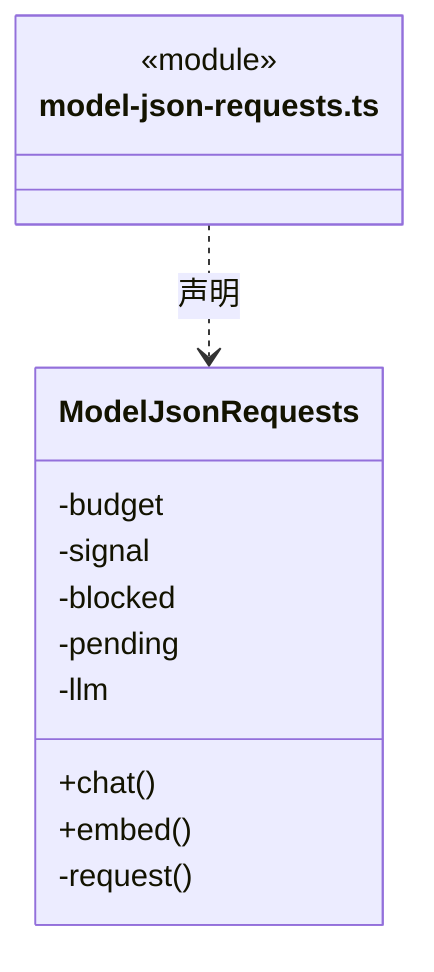
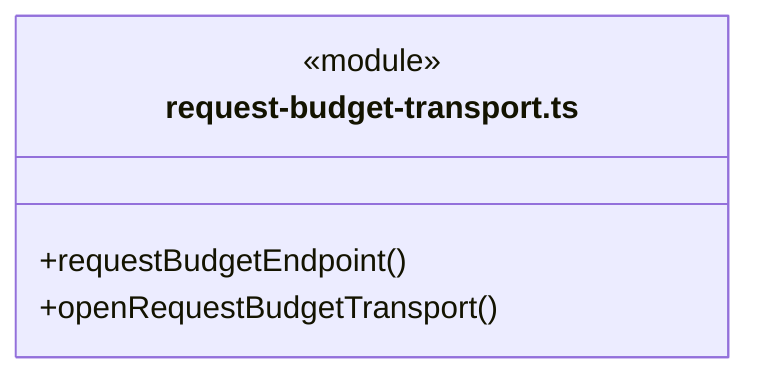
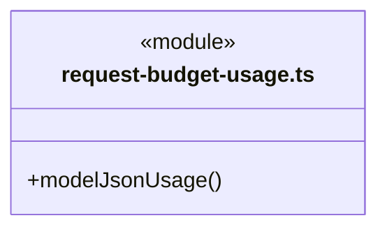
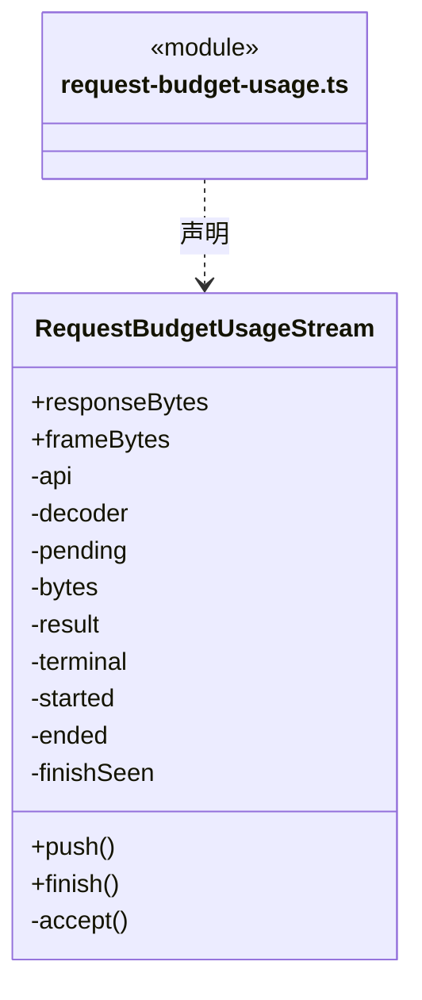
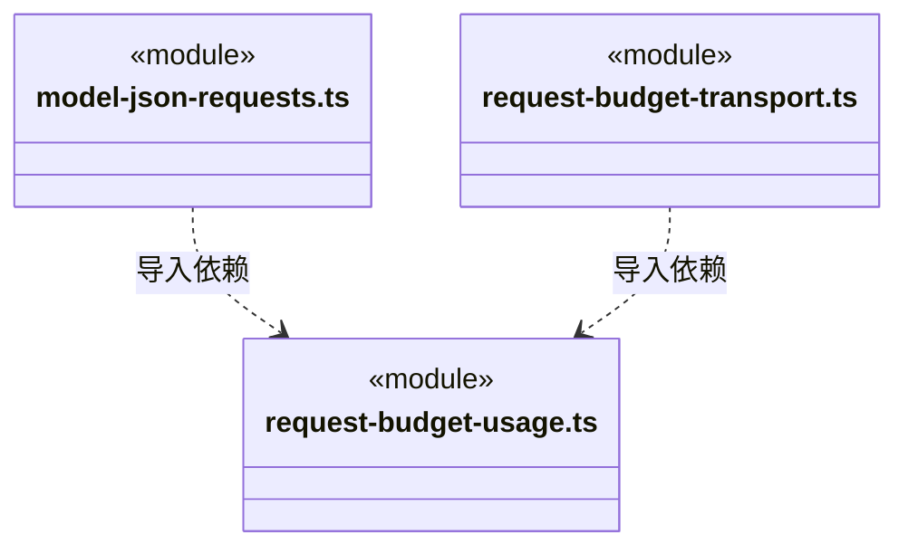

# src/logic/execution/engines/transport 架构

## 目录定位

引擎 HTTP 请求预算与计量适配。通过 Logic budget/rules 的 RequestBudgetPort 预占、结算或记录未知结果；网络实现与稳定模型端口分离，保留各引擎错误和取消语义。

本文描述当前实现。通过分析目录边界后维护的 [源码架构脚本](../../../../../scripts/source-architecture.mjs) 同步清单和声明；代码变更时仍须核对职责、关键成员与关系。

## 代码清单

| 文件 | 当前职责 |
| --- | --- |
| [model-json-requests.ts](model-json-requests.ts) | 自定义领域 Loop 的非流式生成/向量请求，复用逐请求预算与冻结模型快照。 |
| [request-budget-transport.ts](request-budget-transport.ts) | 每运行创建只接受随机令牌的本机供应商代理，逐 HTTP 尝试预留并结算预算。 |
| [request-budget-usage.ts](request-budget-usage.ts) | 严格读取三种受支持 SSE 协议的请求用量，并暂存终态帧供可靠结算后交付。 |

## 架构类图

### model-json-requests.ts

直接依赖：[../../../engines/index.ts](../../../engines/index.ts)、[../../../budget/rules/request-budget.ts](../../../budget/rules/request-budget.ts)、[../../../budget/rules/model-request-configuration.ts](../../../budget/rules/model-request-configuration.ts)、[../../../budget/rules/model-request-budget-rules.ts](../../../budget/rules/model-request-budget-rules.ts)、[../../../models/index.ts](../../../models/index.ts)、[request-budget-usage.ts](request-budget-usage.ts)。

### request-budget-transport.ts

直接依赖：[../../../models/index.ts](../../../models/index.ts)、[../../../budget/rules/request-budget.ts](../../../budget/rules/request-budget.ts)、[request-budget-usage.ts](request-budget-usage.ts)、[../../../budget/rules/model-request-budget-rules.ts](../../../budget/rules/model-request-budget-rules.ts)、[../../../../core/errors.ts](../../../../core/errors.ts)、[../../../team/rules/workspace-member-rules.ts](../../../team/rules/workspace-member-rules.ts)。

### request-budget-usage.ts

直接依赖：[../../../budget/rules/model-request-budget.ts](../../../budget/rules/model-request-budget.ts)、[../../../../core/errors.ts](../../../../core/errors.ts)。

### 本目录调用边界

## 子目录导航

无子目录。

[返回上层](../ARCHITECTURE.md)。

每次修改本目录代码，同步维护文件头、关键契约说明及本图。未实现的治理、证据验收和自动编排能力不列入当前类图。

## 设计契约 v1 与落地范围

以下内容区分已接通能力与后续设计；以各节的实现状态为准，不将目标图当作现状图。维护源：[CONTRACT.md](CONTRACT.md)；生成类图时同步附加，勿直接修改本附录。

# 模型流中断诊断

`RequestBudgetUsageStream` 只暂存可靠终态，不将 response.incomplete 或 response.failed 当作完成。已知 max_output_tokens、content_filter 和通用未完成/失败分别返回固定的 Fault；错误正文由本地定义，不透传供应商任意信息。预算传输保留这些可信诊断，同时保持原未知预留、阻断后续请求及工具的规则。

输出上限提示建议核实已有工具回执后继续、按需要分段生成或调整模型输出上限，不自动提高上限、拼接工具参数、重试或重放写入。未知原因明确未知；旧日志中已丢失的供应商原因无法追溯补造。工具恢复与会话绑定仍由各引擎负责，此解析器不执行文件事务，也不保证正在进行的磁盘写入具备原子性。

### 生成与向量协议边界

现有 SSE 代理只接受生成预算模型，明确拒绝 openai-embeddings，避免将无输出请求交给生成用量解析器。ModelJsonRequests 提供独立非流式 Chat/embedding 请求：两个角色共享单轮停止屏障，预算快照精确核对，先预留、issue、同步 assertSend 再发网，完整 JSON 用量结算后才返回正文。发送前取消保存 not_sent；发送后缺失用量保留 unknown，无重试。未启用逐请求预算的运行沿原策略不创建账本，但仍验证协议、容量和用量，不补零。

单轮仅允许一个在途 JSON 请求，正文 4 MiB、响应 8 MiB；HTTP 重定向拒绝，任意供应商错误不透传凭据。取消信号由引擎生命周期提供；此传输不自行续期或调度任务。模型端点复用模型公共校验，不读取引擎或用户网络配置。
