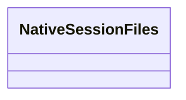

# src/logic/execution/platform 架构

## 设计意图

原生会话文件归属与工作区工具路径保护；业务隔离平台归 file-operations，系统加密归 Core。

## 主要组成

| 组成 | 定位 |
| --- | --- |
| [NativeSessionFiles](native-session-files.ts) | 在本工作区受管会话目录内按官方声明的原生格式核实已关闭上下文，供成员检查点与续执行使用。 |

<!-- architecture:generated:start -->

## 架构关系

[上层设计](../ARCHITECTURE.md)

<!-- architecture:generated:end -->
