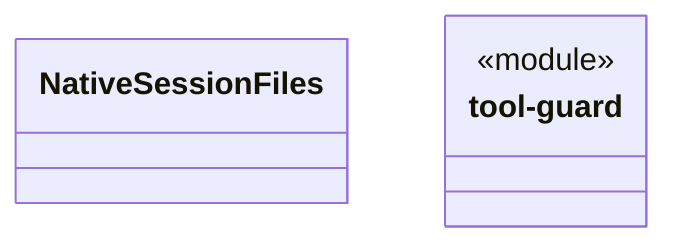

# src/logic/execution/platform 架构

## 设计意图

核实受管原生会话文件与工作区工具路径，为续执行和工具访问提供本机边界。

`NativeSessionFiles` 按已声明格式读取关闭后的原生上下文，`tool-guard` 核实工具路径与受保护区域。模块不决定业务检查点可否继续；实际文件操作与隔离进程属于 file-operations，系统密钥属于 Core。

## 主要组成

| 组成 | 定位 |
| --- | --- |
| [NativeSessionFiles](native-session-files.ts) | 在本工作区受管会话目录内按官方声明的原生格式核实已关闭上下文，供成员检查点与续执行使用。 |
| [tool-guard](tool-guard.ts) | 核实工具访问路径，拒绝越出工作区或进入受保护目录。 |

<!-- architecture:generated:start -->

## 架构关系

[上层设计](../ARCHITECTURE.md)

<!-- architecture:generated:end -->
