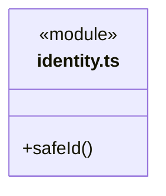

# src/logic/execution/ports 架构

## 目录定位

执行及工作区身份格式校验；不拥有路径授权、磁盘访问或应用生命周期。

本文描述当前实现。通过分析目录边界后维护的 [源码架构脚本](../../../../scripts/source-architecture.mjs) 同步清单和声明；代码变更时仍须核对职责、关键成员与关系。

## 代码清单

| 文件 | 当前职责 |
| --- | --- |
| [identity.ts](identity.ts) | 运行记录路径中任务和执行标识的格式检查。 |

## 架构类图

### identity.ts

## 子目录导航

无子目录。

[返回上层](../ARCHITECTURE.md)。

每次修改本目录代码，同步维护文件头、关键契约说明及本图。未实现的治理、证据验收和自动编排能力不列入当前类图。

## 设计契约 v1 与落地范围

以下内容区分已接通能力与后续设计；以各节的实现状态为准，不将目标图当作现状图。维护源：[CONTRACT.md](CONTRACT.md)；生成类图时同步附加，勿直接修改本附录。

# 执行身份契约

identity.ts 定义执行记录及工作区身份的合法形式。safeId 拒绝不合法的标识；它是业务路径安全的前置条件，不代表路径已经授权。标识的生成时机和存储生命周期属于调用方。
