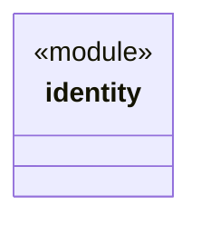

# src/logic/execution/ports 架构

## 设计意图

保存引擎运行端口及协议适配。平台进程退出和工具回执保持原有契约，Office 生命周期由 projects 的实例编排负责。

## 主要组成

| 组成 | 定位 |
| --- | --- |
| [identity](identity.ts) | 运行记录路径中任务和执行标识的格式检查。 |

<!-- architecture:generated:start -->

## 架构关系

[上层设计](../ARCHITECTURE.md)

<!-- architecture:generated:end -->
