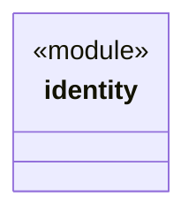

# src/logic/execution/ports 架构

## 设计意图

集中校验用于运行目录定位的工作区、任务和运行标识格式，避免调用方拼接未验证标识。

`identity` 是无状态函数集合，只判断标识结构，不读取磁盘。格式合法不能证明路径授权、目录归属或实例仍有效，这些条件由存储与工作区服务继续核实。

## 主要组成

| 组成 | 定位 |
| --- | --- |
| [identity](identity.ts) | 运行记录路径中任务和执行标识的格式检查。 |

<!-- architecture:generated:start -->

## 架构关系

[上层设计](../ARCHITECTURE.md)

<!-- architecture:generated:end -->
