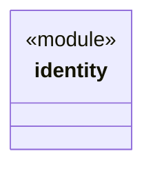

# src/logic/execution/ports 架构

## 设计意图

执行及工作区身份格式校验；不拥有路径授权、磁盘访问或应用生命周期。

## 主要组成

| 组成 | 定位 |
| --- | --- |
| [identity](identity.ts) | 运行记录路径中任务和执行标识的格式检查。 |

<!-- architecture:generated:start -->

## 架构关系

[上层设计](../ARCHITECTURE.md)

<!-- architecture:generated:end -->
