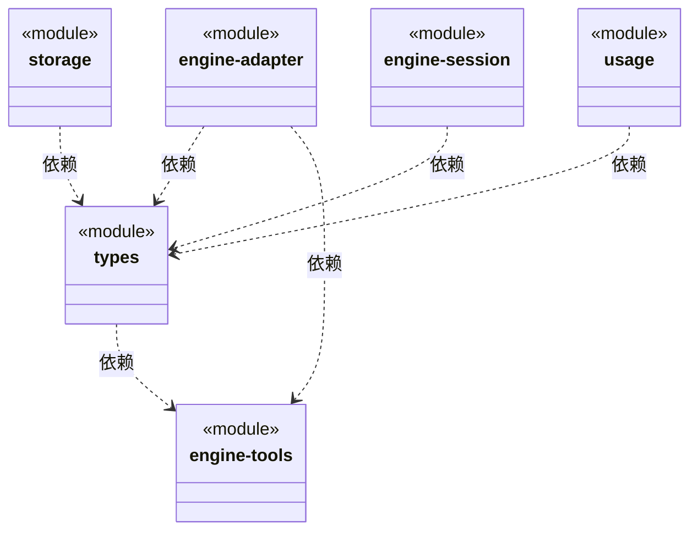
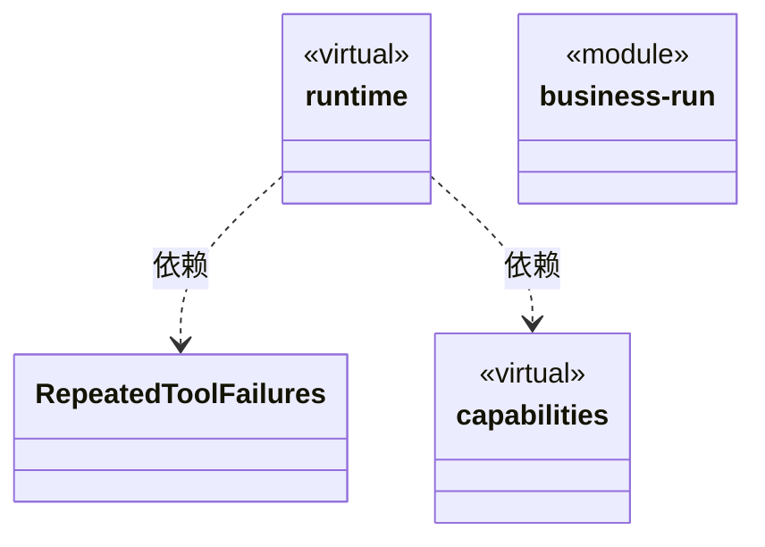

# src/logic/execution/rules 架构

## 设计意图

定义引擎无关的任务、事件、工具和存储协议，组合运行机制与受控能力而不认识具体 SDK。

本层契约连接装配、日志与引擎；`runtime` 管理一次执行的生命周期，`capabilities` 将可信身份和副作用端口封装成短期门禁。历史绑定、输入来源、失败诊断和计量纯规则保留事实，不能从模型结束或工具返回推断业务验收。

## 主要组成

| 组成 | 定位 |
| --- | --- |
| [RepeatedToolFailures](repeated-tool-failures.ts) | 按本轮真实调用顺序识别同工具同参数的连续三次失败。 |
| [types](types.ts) | 引擎无关的任务、事件、摘要与可信能力契约。 |
| [engine-adapter](engine-adapter.ts) | 版本化引擎工厂协议及创建前兼容检查，不授权任意包加载。 |
| [storage](storage.ts) | 循环所需的可靠日志和任务目录端口。 |
| [engine-tools](engine-tools.ts) | 将已注入能力组合成 SDK 与自研循环共用的目录和调用端口。 |
| [engine-session](engine-session.ts) | 选择可靠原生历史或公开上下文交接，不重放操作。 |
| [business-run](business-run.ts) | 递归业务调用的持久身份与冻结知识，关联原执行记录。 |
| [usage](usage.ts) | 从同轮已去重事件计算公开用量和上下文事实。 |

## 现状与目标边界

当前父层协议、纯规则与 `runtime`、`capabilities` 子模块并存，[index.ts](index.ts) 还公开运行时入口。这是现存结构，目录名 rules 不能证明其整个依赖闭包都是无状态纯规则。目标是将稳定协议、纯判断与运行实现明确分开，父层只表达组合；迁移须区分纯类型消费者和真实循环消费者，保持日志、授权和终态边界。

<!-- architecture:generated:start -->

## 架构关系

标注为 `virtual` 的节点是直接子模块的虚拟类封装；内部设计沿下方入口阅读。

### 关系组 1：types

### 关系组 2：runtime

### 跨图协作

按引用方归并目标，保留全部跨图关系；分图只用于阅读，不表示新增模块或依赖边界。

| 引用方 | 关系 | 目标 |
| --- | --- | --- |
| [capabilities](capabilities/ARCHITECTURE.md)（图 2） | 依赖 | [types](types.ts)（图 1）、[engine-tools](engine-tools.ts)（图 1） |
| [runtime](runtime/ARCHITECTURE.md)（图 2） | 依赖 | [types](types.ts)（图 1）、[storage](storage.ts)（图 1）、[engine-session](engine-session.ts)（图 1） |

## 子模块

| 虚拟封装 | 整体职责 |
| --- | --- |
| [capabilities](capabilities/ARCHITECTURE.md) | 在单次运行内把冻结身份、授权和真实平台能力封装为受控工具入口。 |
| [runtime](runtime/ARCHITECTURE.md) | 驱动一次引擎无关执行的回合、工具门禁、日志与终态，保持过程事实可恢复和可核实。 |

[上层设计](../ARCHITECTURE.md)

<!-- architecture:generated:end -->
