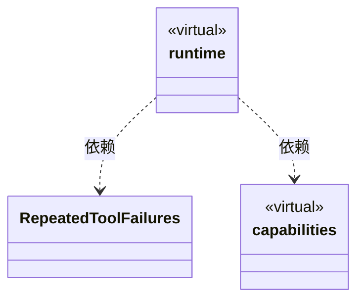

# src/logic/execution/rules 架构

## 设计意图

提供引擎无关的运行协议与工具协调规则。runtime 封装循环机制，capabilities 封装具体执行能力；它们通过明确端口协作，具体引擎由上层装配选择。

## 主要组成

| 组成 | 定位 |
| --- | --- |
| [RepeatedToolFailures](repeated-tool-failures.ts) | 按本轮真实调用顺序识别同工具同参数的连续三次失败。 |

<!-- architecture:generated:start -->

## 架构关系

标注为 `virtual` 的节点是直接子模块的虚拟类封装；内部设计沿下方入口阅读。

## 子模块

| 虚拟封装 | 整体职责 |
| --- | --- |
| [capabilities](capabilities/ARCHITECTURE.md) | 执行模块内部的成员能力组合与受控工具门面。把冻结 Workflow、身份、证据和平台端口投影为可调用能力；不把工具发现或模型完成当作授权与业务验收。 |
| [runtime](runtime/ARCHITECTURE.md) | 驱动一次执行的回合、事件、工具调用与输出验证。LoopRuntime 组合领域规则和能力端口，维护运行过程，不承担应用装配或引擎安装。 |

[上层设计](../ARCHITECTURE.md)

<!-- architecture:generated:end -->
