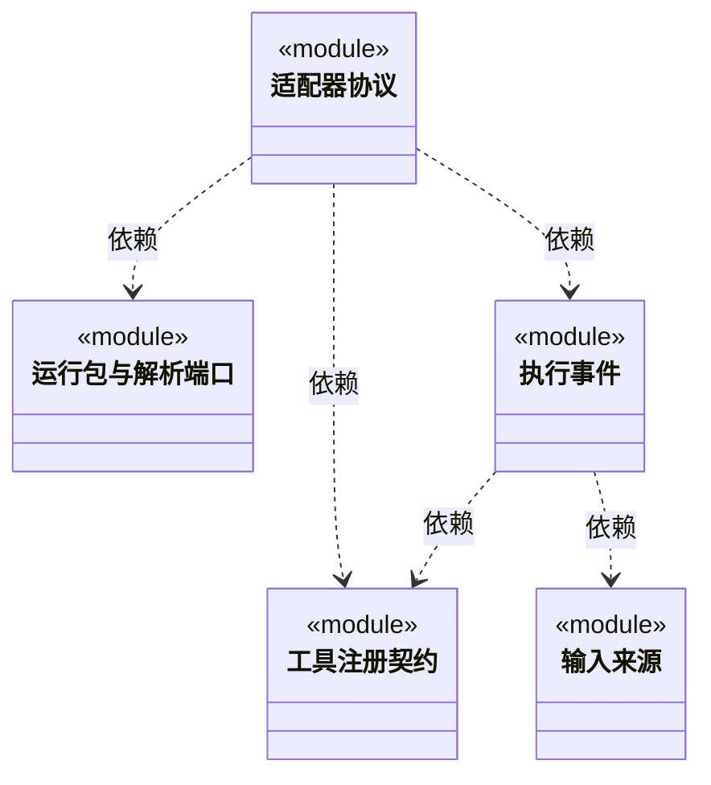

# 引擎运行包契约

## 设计意图

以固定制品身份、SDK 与适配器入口描述单次装配结果。运行包由可信宿主解析，不能由模型或公开任务参数指定路径；引用只在引擎真正关闭后释放。

## 主要组成

| 组成 | 定位 |
| --- | --- |
| [运行包与解析端口](engine-runtime.ts) | 定义 EngineRuntimePackage、依赖快照及 EngineRuntimeResolver；retain 释放幂等但不代表停止请求已完成。 |

| [适配器协议](engine-adapter.ts) | 校验独立引擎工厂身份、协议与公开能力声明。 |
| [工具注册契约](engine-tools.ts) | 统一工具列表、调用和审批回调的端口。 |
| [执行事件](types.ts) | 引擎事件、任务输入和终态的数据协议；不包含旧执行调度器。 |
| [输入来源](input-source.ts) | 区分可信追加输入与系统交接，避免模型伪造来源。 |

<!-- architecture:generated:start -->

## 架构关系

[上层设计](../ARCHITECTURE.md)

<!-- architecture:generated:end -->
