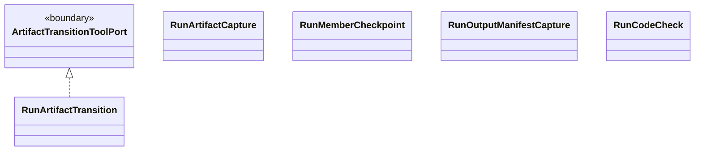
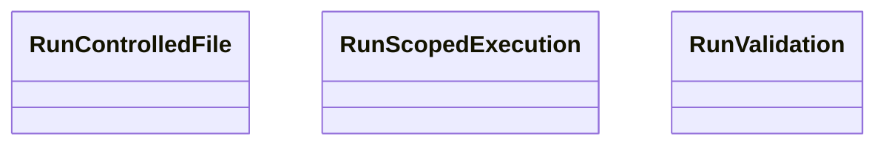

# src/logic/execution/rules/capabilities 架构

## 设计意图

在单次运行内把冻结身份、授权和真实平台能力封装为受控工具入口。

各 `Run*` 对象分别维护采集、检查点、验证、受控写入或隔离执行的短期门闩，经可信日志保存阶段和回执。调用方只取得对应工具能力，不取得原平台句柄；授权完成、记录可靠和资源排空均需分别核实。

## 主要组成

| 组成 | 定位 |
| --- | --- |
| [RunArtifactCapture](artifact-capture.ts) | 成员运行的短时文件采集门闩，绑定真实授权、进度、知识基线与 canonical 事件。 |
| [RunMemberCheckpoint](member-checkpoint.ts) | 成员单次合作式停泊的运行时门闩，沿真实工具授权保存非终结检查点请求。 |
| [RunOutputManifestCapture](output-manifest-capture.ts) | 成员本轮完整产物采集的短期门闩，冻结 Workflow 范围并将真实观察可靠写入 canonical。 |
| [RunArtifactTransition](run-artifact-transition.ts) | 正式成员删除/移动工具的唯一授权、写前核实和可靠阶段记录，平台副作用只通过此运行端口。 |
| [RunCodeCheck](run-code-check.ts) | 单轮成员的代码检查门闩，连接冻结命令、权限完成后的真实平台与可信日志。 |
| [RunControlledFile](run-controlled-file.ts) | 正式成员受控文件工具的单次授权与短门闩，平台写入只经过此可信运行端口。 |
| [RunScopedExecution](run-scoped-execution.ts) | 冻结范围工具的 Runtime 一次授权、短门闩和实际退出屏障。 |
| [RunValidation](run-validation.ts) | 正式成员的 JSON/CSV/PNG 验证短门闩，连接冻结要求、原文件或完整集合身份及平台同字节读取。 |

<!-- architecture:generated:start -->

## 架构关系

### 关系组 1：ArtifactTransitionToolPort

### 关系组 2：RunControlledFile

外部继承／实现边界：[ArtifactTransitionToolPort](../../../file-operations/rules/artifact-transition.ts)。

[上层设计](../ARCHITECTURE.md)

<!-- architecture:generated:end -->
