# src/logic/execution/rules/capabilities 架构

本目录只维护这一份说明。设计与契约直接编辑本文；文件清单、类图和导航由 [架构脚本](../../../../../scripts/source-architecture.mjs) 更新，生成区域之外的人工说明会保留。

## 封装意图

执行模块内部的成员能力组合与受控工具门面。把冻结 Workflow、身份、证据和平台端口投影为可调用能力；不把工具发现或模型完成当作授权与业务验收。

## 类与模块的设计意图

下表依据源码声明及文件头说明定位封装。字段表示该实例持有的状态或协作引用，不表示它拥有被引用服务的生命周期；实际资源责任和调用限制见下文契约及源码注释。

| 类／模块 | 实现形式与实例字段 | 封装依据 |
| --- | --- | --- |
| [RunArtifactCapture](artifact-capture.ts) | 实例类；持有 `tools`、`events`、`reserved`、`controller`、`binding`、`port`、`context` | 每个运行独立拥有；门闩直到本工具结束或拒绝才释放，bridge丢失结束事件时保留阻断直到收尾。 |
| [RunMemberCheckpoint](member-checkpoint.ts) | 实例类；持有 `tools`、`events`、`reserved`、`staged`、`controller`、`binding`、`port`、`context` | 每个获可信剩余额度的运行只提供一次；续执行可保存下一段，历史失败请求不能伪装新检查点。 |
| [member-tool-capabilities.ts](member-tool-capabilities.ts) | 函数／契约模块 | 具体工具类型、调用参数差异和业务指引属于能力装配，公共上下文与各引擎无需增加业务专用字段。 |
| [RunOutputManifestCapture](output-manifest-capture.ts) | 实例类；持有 `tools`、`events`、`controller`、`reserved`、`deliveryOwner`、`reading`、`bindings`、`binding`、`scopes`、`port`、`context` | 全目录读取跨多个 await；审批前预占，读取及保存前后核停止、进度和知识，不能把竞争中的局部集合当完整证据。 |
| [RunArtifactTransition](run-artifact-transition.ts) | 实例类；持有 `events`、`controller`、`pending`、`unverified`、`reserved`、`binding`、`scopes`、`manifests`、`port`、`context` | 模型只选冻结要求和原清单；先保存 prepared/executing 再操作，未知结果保持本轮读/求助屏障。 |
| [RunCodeCheck](run-code-check.ts) | 实例类；持有 `controller`、`events`、`reserved`、`generations`、`bindings`、`identity`、`knowledgeRevision`、`port`、`context` | 整组检查只占一次命令代次；并发工具、停止、知识漂移或进度变化不能跨过检查窗口。 |
| [RunControlledFile](run-controlled-file.ts) | 实例类；持有 `reserved`、`unverified`、`controller`、`pending`、`scopeId`、`binding`、`port`、`assertReady` | 授权来自 Runtime 自身可靠 allowed 追加返回值，不信任引擎 emit；调用失败后整轮只保留读取与求助，只有可信未写证明才能解除屏障。停止须排空实际文件进程。 |
| [RunScopedExecution](run-scoped-execution.ts) | 实例类；持有 `controller`、`pending`、`physicalUnknown`、`reserved`、`scope`、`port`、`assertReady` | 模型只能消费原 allowed 记录绑定的参数；事件伪造、并发工具、迟到批准与停止不能另开隔离进程。 |
| [RunValidation](run-validation.ts) | 实例类；持有 `tools`、`events`、`reserved`、`deliveryReading`、`generations`、`controller`、`binding`、`bindings`、`artifacts`、`files`、`context` | 一轮一实例；真实 validation 调用结束释放其锁，交付复核拥有独立 finally 生命周期。 |

## 接口设计契约

### 运行能力的在途与退出边界

RunControlledFile、RunScopedExecution、RunArtifactTransition 分别持有 utility.InFlightOperations，跟踪已经发出的原端口 Promise，drain 等待调用时快照。基础集合不改变一次性授权、原参数 hash、事件顺序、短门闩或 unknown 写屏障，也不接管取消控制器。

Promise settled 仅代表调用返回。三种能力继续执行各自平台 drain，保持物理退出未确认时的错误与占用；RunScopedExecution 的 physicalUnknown、受控写 confirmNotApplied、产物阶段及验收规则留在原能力。基础库不得自动重发、补偿或释放工作区租约。

#### 未核实受控写之后的同调用求助

RunControlledFile.Guard 在原写结果未知后允许 cbim_ask_user_question，沿既有 Agent 问答端口交给直接调用方；回答不清除 unverified 集合，也不授予新写入、命令或交付。原生只读与旧 cbim_task_help 保留原语义，最终仍记录 run.interrupted 及原 unverifiedControlledCalls。

## 开闭边界

本目录的职责及允许协作由[封装意图](#封装意图)限定，输入输出、状态与失败语义以[接口设计契约](#接口设计契约)为准。扩展从已有公开入口及实际装配位置进入；没有明确可替换契约的部分按真实影响修改和验证，不预建未使用的基类或插件入口。

<!-- architecture:generated:start -->

## 文件清单

| 文件 | 形式 | 当前职责 |
| --- | --- | --- |
| [ARCHITECTURE.md](ARCHITECTURE.md) | 说明文档 | 本目录的文件清单、真实声明、依赖与子封装导航。 |
| [artifact-capture.ts](artifact-capture.ts) | 源码模块 | 成员运行的短时文件采集门闩，绑定真实授权、进度、知识基线与 canonical 事件。 |
| [member-checkpoint.ts](member-checkpoint.ts) | 源码模块 | 成员单次合作式停泊的运行时门闩，沿真实工具授权保存非终结检查点请求。 |
| [member-tool-capabilities.ts](member-tool-capabilities.ts) | 源码模块 | 把本轮真实任务、产物、验证及受控执行能力适配为引擎统一端口。 |
| [output-manifest-capture.ts](output-manifest-capture.ts) | 源码模块 | 成员本轮完整产物采集的短期门闩，冻结 Workflow 范围并将真实观察可靠写入 canonical。 |
| [run-artifact-transition.ts](run-artifact-transition.ts) | 源码模块 | 正式成员删除/移动工具的唯一授权、写前核实和可靠阶段记录，平台副作用只通过此运行端口。 |
| [run-code-check.ts](run-code-check.ts) | 源码模块 | 单轮成员的代码检查门闩，连接冻结命令、权限完成后的真实平台与可信日志。 |
| [run-controlled-file.ts](run-controlled-file.ts) | 源码模块 | 正式成员受控文件工具的单次授权与短门闩，平台写入只经过此可信运行端口。 |
| [run-scoped-execution.ts](run-scoped-execution.ts) | 源码模块 | 冻结范围工具的 Runtime 一次授权、短门闩和实际退出屏障。 |
| [run-validation.ts](run-validation.ts) | 源码模块 | 正式成员的 JSON/CSV/PNG 验证短门闩，连接冻结要求、原文件或完整集合身份及平台同字节读取。 |

## 架构类图

成员标记：`+` 公开、`-` 私有、`#` 受保护、`$` 静态；构造函数单独列出。文档和资源仅在文件清单中导航，不作为代码节点。

### artifact-capture.ts

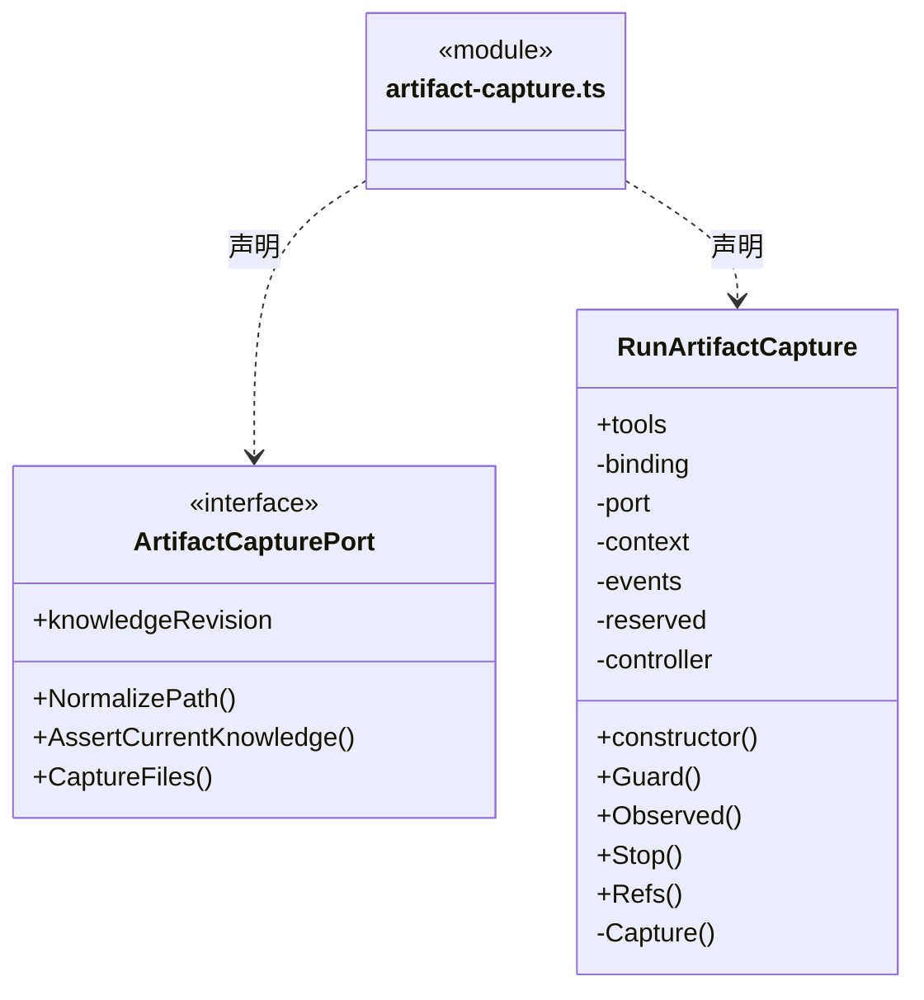

直接依赖：[../../../../core/errors.ts](../../../../core/errors.ts)、[../../../evidence/rules/artifact-tools.ts](../../../evidence/rules/artifact-tools.ts)、[../../../evidence/rules/artifact-baseline.ts](../../../evidence/rules/artifact-baseline.ts)、[../../../evidence/rules/artifact-evidence.ts](../../../evidence/rules/artifact-evidence.ts)、[../../../evidence/rules/progress.ts](../../../evidence/rules/progress.ts)、[../member-run.ts](../member-run.ts)、[../types.ts](../types.ts)。

### member-checkpoint.ts

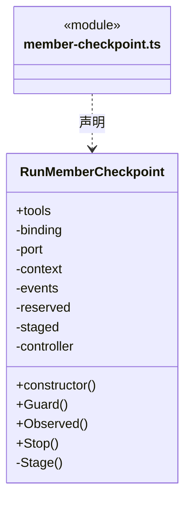

直接依赖：[../../../../core/errors.ts](../../../../core/errors.ts)、[../../../tasks/rules/member-checkpoint-tools.ts](../../../tasks/rules/member-checkpoint-tools.ts)、[../../../tasks/rules/member-checkpoint.ts](../../../tasks/rules/member-checkpoint.ts)、[../../../tasks/rules/member-checkpoint-evidence.ts](../../../tasks/rules/member-checkpoint-evidence.ts)、[../member-run.ts](../member-run.ts)、[../types.ts](../types.ts)、[artifact-capture.ts](artifact-capture.ts)、[../../../evidence/rules/progress.ts](../../../evidence/rules/progress.ts)。

### member-tool-capabilities.ts

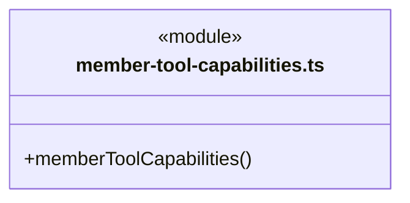

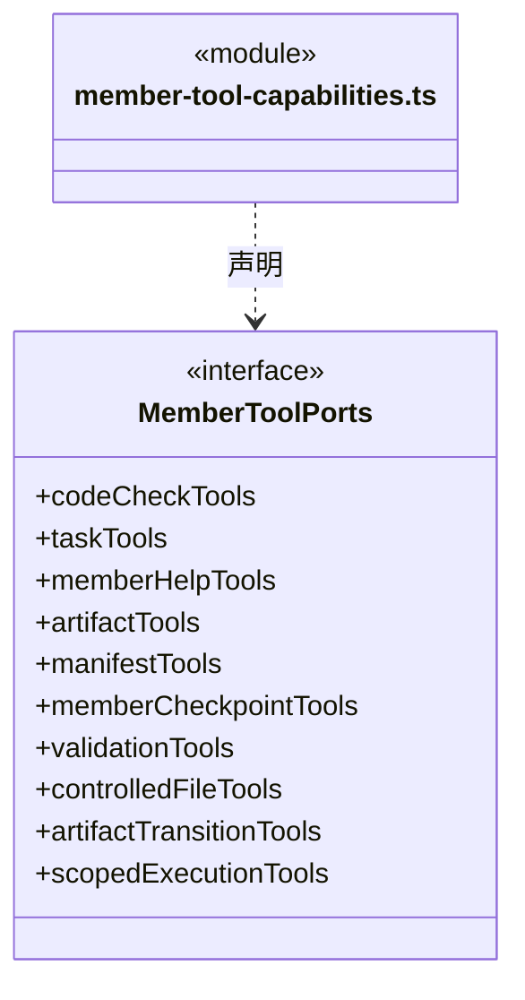

直接依赖：[../engine-tools.ts](../engine-tools.ts)、[run-code-check.ts](run-code-check.ts)、[../../../evidence/rules/progress-tools.ts](../../../evidence/rules/progress-tools.ts)、[../../../tasks/rules/member-help-tools.ts](../../../tasks/rules/member-help-tools.ts)、[../../../evidence/rules/artifact-tools.ts](../../../evidence/rules/artifact-tools.ts)、[../../../evidence/rules/output-manifest-tools.ts](../../../evidence/rules/output-manifest-tools.ts)、[../../../tasks/rules/member-checkpoint-tools.ts](../../../tasks/rules/member-checkpoint-tools.ts)、[../../../evidence/rules/validation-tools.ts](../../../evidence/rules/validation-tools.ts)、[run-controlled-file.ts](run-controlled-file.ts)、[../../../file-operations/rules/artifact-transition.ts](../../../file-operations/rules/artifact-transition.ts)、[run-scoped-execution.ts](run-scoped-execution.ts)。

### output-manifest-capture.ts

成员 1/2（同名节点为同一声明，跨图合并阅读）。

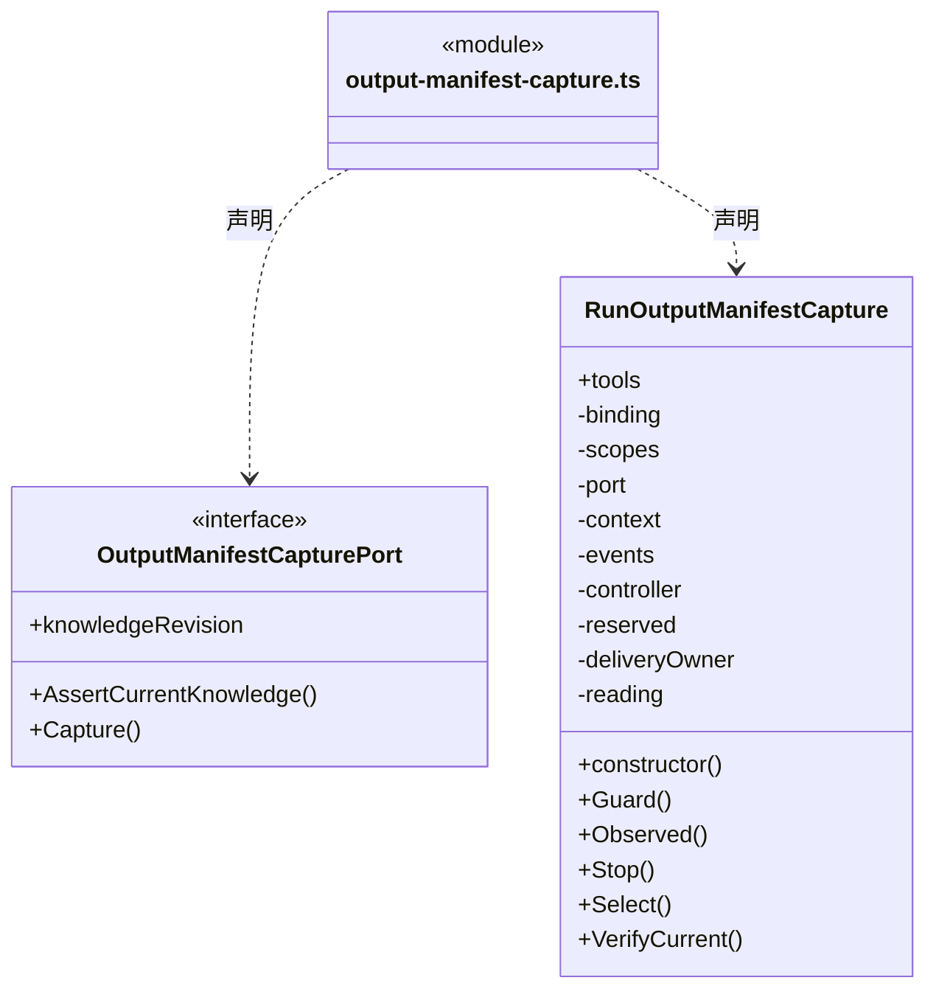

成员 2/2（同名节点为同一声明，跨图合并阅读）。

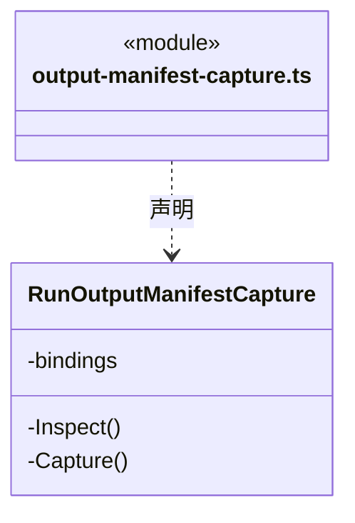

直接依赖：[../../../../core/errors.ts](../../../../core/errors.ts)、[../../../workspace/rules/artifact-scope.ts](../../../workspace/rules/artifact-scope.ts)、[../../../evidence/rules/output-manifest-tools.ts](../../../evidence/rules/output-manifest-tools.ts)、[../../../evidence/rules/output-manifest.ts](../../../evidence/rules/output-manifest.ts)、[../../../evidence/rules/complete-output-evidence.ts](../../../evidence/rules/complete-output-evidence.ts)、[../../../evidence/rules/output-manifest-evidence.ts](../../../evidence/rules/output-manifest-evidence.ts)、[../../../file-operations/rules/artifact-transition-evidence.ts](../../../file-operations/rules/artifact-transition-evidence.ts)、[../../../evidence/rules/artifact-evidence.ts](../../../evidence/rules/artifact-evidence.ts)、[../../../evidence/rules/progress.ts](../../../evidence/rules/progress.ts)、[../member-run.ts](../member-run.ts)、[../types.ts](../types.ts)。

### run-artifact-transition.ts

成员 1/2（同名节点为同一声明，跨图合并阅读）。

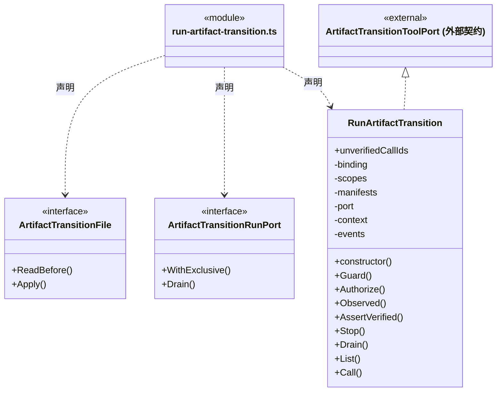

成员 2/2（同名节点为同一声明，跨图合并阅读）。

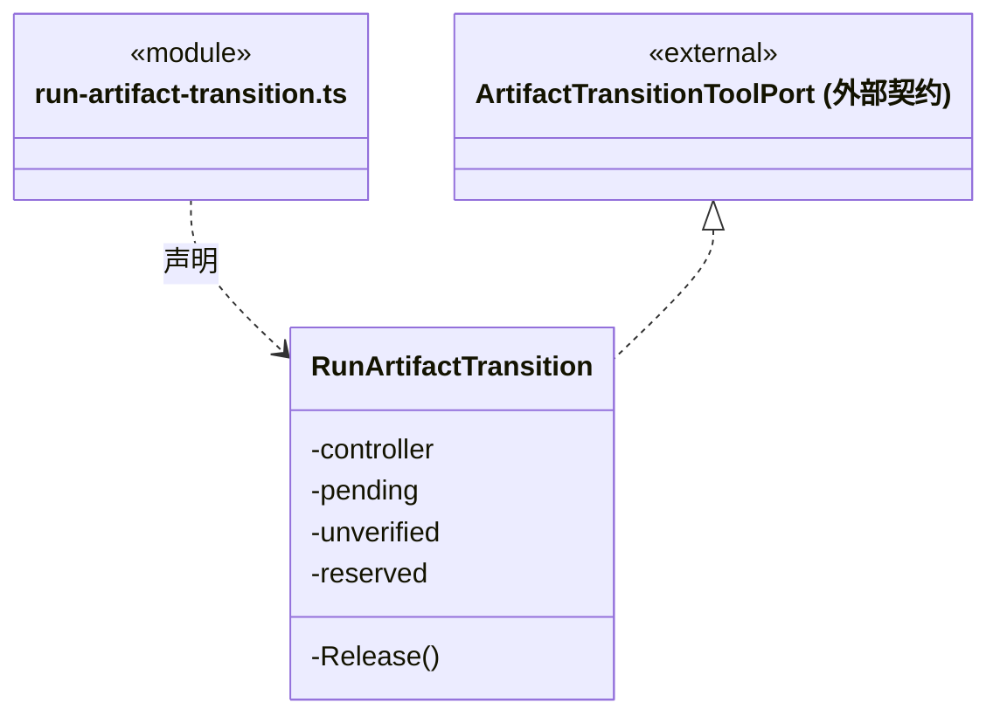

直接依赖：[../../../../core/utility/index.ts](../../../../core/utility/index.ts)、[../../../../core/platform/node/serialization.ts](../../../../core/platform/node/serialization.ts)、[../../../../core/errors.ts](../../../../core/errors.ts)、[../../../tools/rules/results.ts](../../../tools/rules/results.ts)、[../../../workspace/rules/artifact-scope.ts](../../../workspace/rules/artifact-scope.ts)、[../../../file-operations/rules/artifact-transition.ts](../../../file-operations/rules/artifact-transition.ts)、[../../../file-operations/rules/artifact-transition-evidence.ts](../../../file-operations/rules/artifact-transition-evidence.ts)、[../../../evidence/rules/output-manifest-evidence.ts](../../../evidence/rules/output-manifest-evidence.ts)、[../../../evidence/rules/output-manifest.ts](../../../evidence/rules/output-manifest.ts)、[output-manifest-capture.ts](output-manifest-capture.ts)、[../member-run.ts](../member-run.ts)、[../types.ts](../types.ts)。

### run-code-check.ts

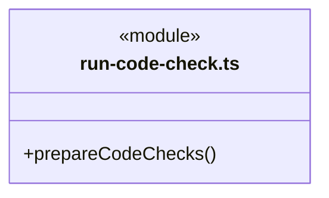

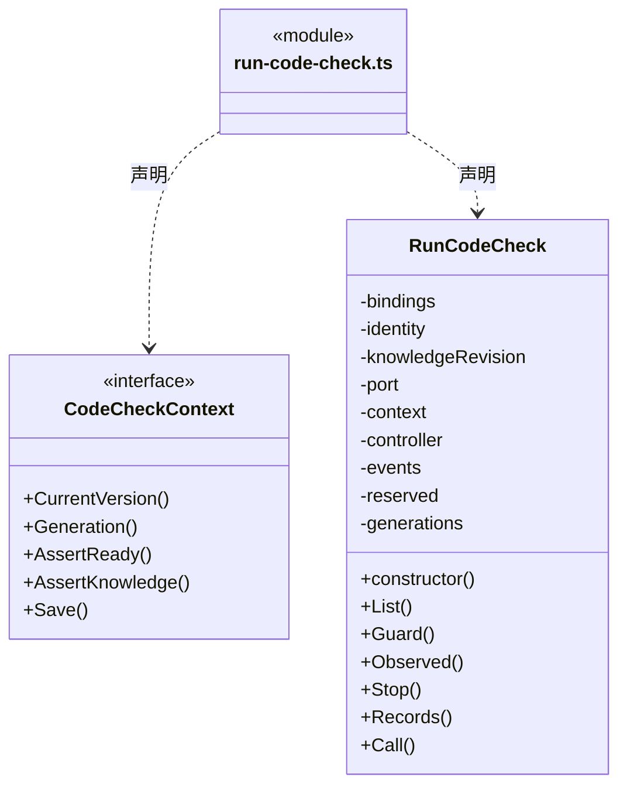

直接依赖：[../../../../core/errors.ts](../../../../core/errors.ts)、[../../../workspace/rules/code-check.ts](../../../workspace/rules/code-check.ts)、[../../../workspace/rules/artifact-scope.ts](../../../workspace/rules/artifact-scope.ts)、[../../../evidence/rules/output-manifest-evidence.ts](../../../evidence/rules/output-manifest-evidence.ts)、[../../../evidence/rules/code-check.ts](../../../evidence/rules/code-check.ts)、[../types.ts](../types.ts)。

### run-controlled-file.ts

成员 1/2（同名节点为同一声明，跨图合并阅读）。

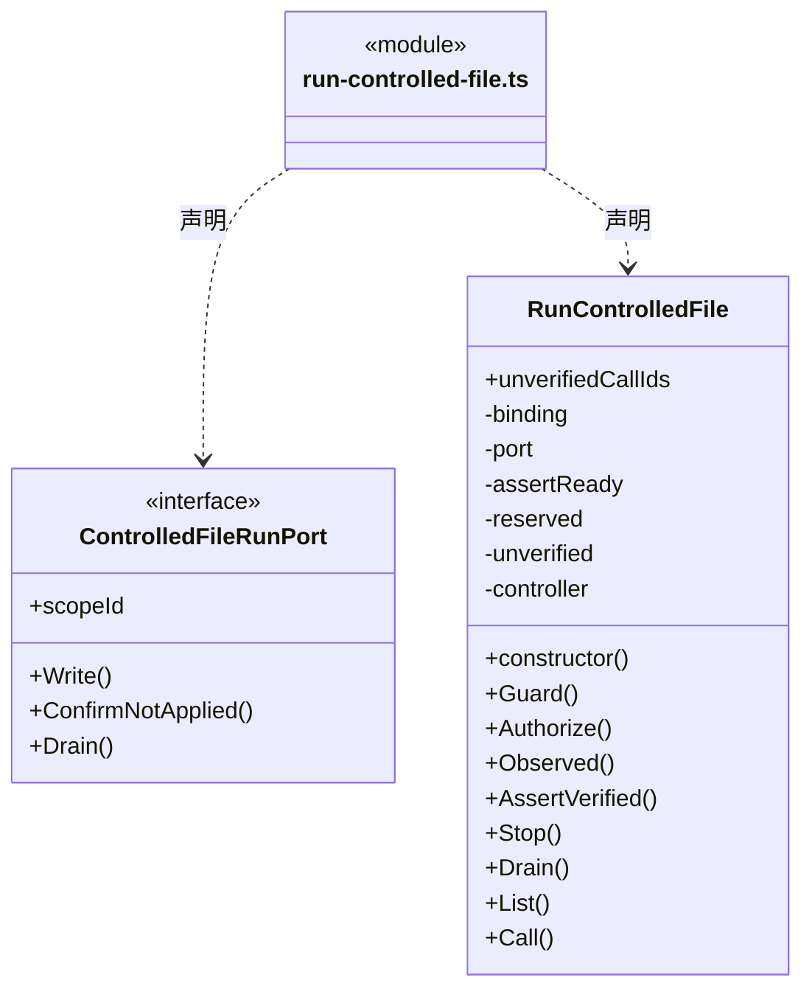

成员 2/2（同名节点为同一声明，跨图合并阅读）。

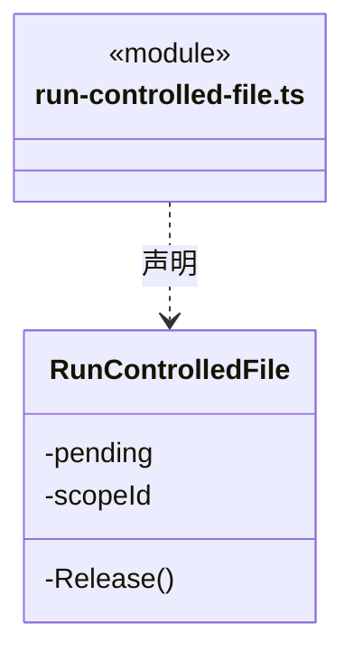

直接依赖：[../../../../core/utility/index.ts](../../../../core/utility/index.ts)、[../../../../core/platform/node/serialization.ts](../../../../core/platform/node/serialization.ts)、[../../../../core/errors.ts](../../../../core/errors.ts)、[../../../tools/rules/results.ts](../../../tools/rules/results.ts)、[../../../file-operations/rules/controlled-file-operation.ts](../../../file-operations/rules/controlled-file-operation.ts)、[../../../file-operations/rules/controlled-file-rules.ts](../../../file-operations/rules/controlled-file-rules.ts)。

### run-scoped-execution.ts

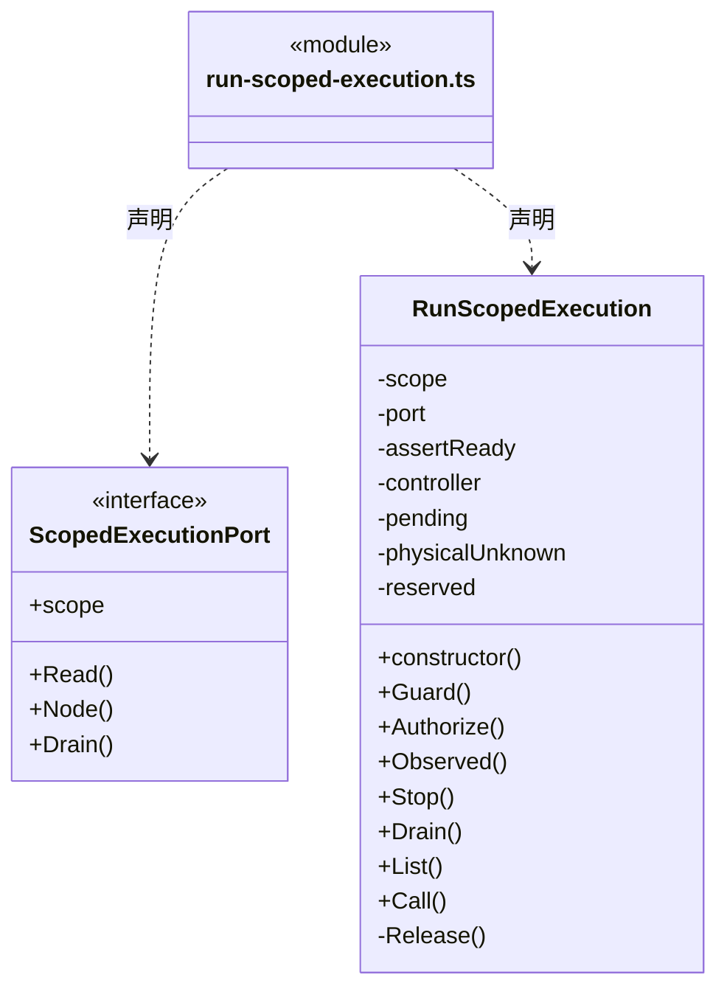

直接依赖：[../../../../core/utility/index.ts](../../../../core/utility/index.ts)、[../../../../core/platform/node/serialization.ts](../../../../core/platform/node/serialization.ts)、[../../../../core/errors.ts](../../../../core/errors.ts)、[../../../tools/rules/results.ts](../../../tools/rules/results.ts)、[../../../file-operations/rules/scoped-execution.ts](../../../file-operations/rules/scoped-execution.ts)、[../../../workspace/rules/execution-scope.ts](../../../workspace/rules/execution-scope.ts)、[../../../file-operations/rules/controlled-file-operation.ts](../../../file-operations/rules/controlled-file-operation.ts)、[../../../file-operations/rules/isolated-execution-recovery.ts](../../../file-operations/rules/isolated-execution-recovery.ts)。

### run-validation.ts

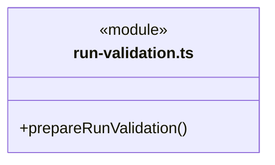

成员 1/2（同名节点为同一声明，跨图合并阅读）。

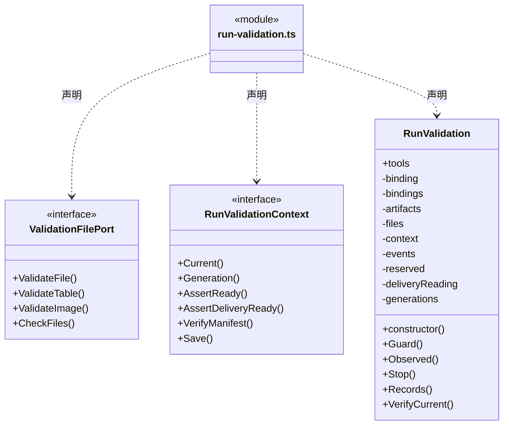

成员 2/2（同名节点为同一声明，跨图合并阅读）。

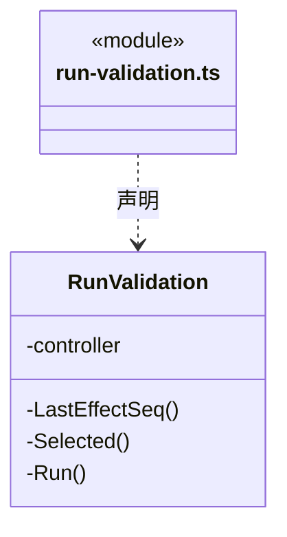

直接依赖：[../../../../core/errors.ts](../../../../core/errors.ts)、[../../../workspace/rules/json-validation-schema.ts](../../../workspace/rules/json-validation-schema.ts)、[../../../workspace/rules/csv-validation-schema.ts](../../../workspace/rules/csv-validation-schema.ts)、[../../../workspace/rules/png-validation-schema.ts](../../../workspace/rules/png-validation-schema.ts)、[../../../evidence/rules/artifact-baseline.ts](../../../evidence/rules/artifact-baseline.ts)、[../../../evidence/rules/artifact-evidence.ts](../../../evidence/rules/artifact-evidence.ts)、[../../../evidence/rules/output-manifest-evidence.ts](../../../evidence/rules/output-manifest-evidence.ts)、[../../../evidence/rules/output-manifest.ts](../../../evidence/rules/output-manifest.ts)、[../../../evidence/rules/complete-output-evidence.ts](../../../evidence/rules/complete-output-evidence.ts)、[../../../workspace/rules/artifact-scope.ts](../../../workspace/rules/artifact-scope.ts)、[../../../evidence/rules/validation.ts](../../../evidence/rules/validation.ts)、[../../../evidence/rules/validation-tools.ts](../../../evidence/rules/validation-tools.ts)、[../../../evidence/rules/validation-evidence.ts](../../../evidence/rules/validation-evidence.ts)、[../../../tasks/rules/execution-context.ts](../../../tasks/rules/execution-context.ts)、[../../../evidence/rules/progress.ts](../../../evidence/rules/progress.ts)、[artifact-capture.ts](artifact-capture.ts)、[../member-run.ts](../member-run.ts)、[../types.ts](../types.ts)。

### 本目录调用边界

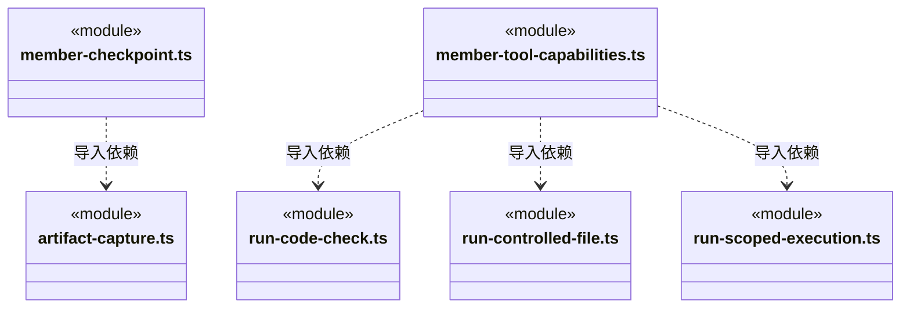

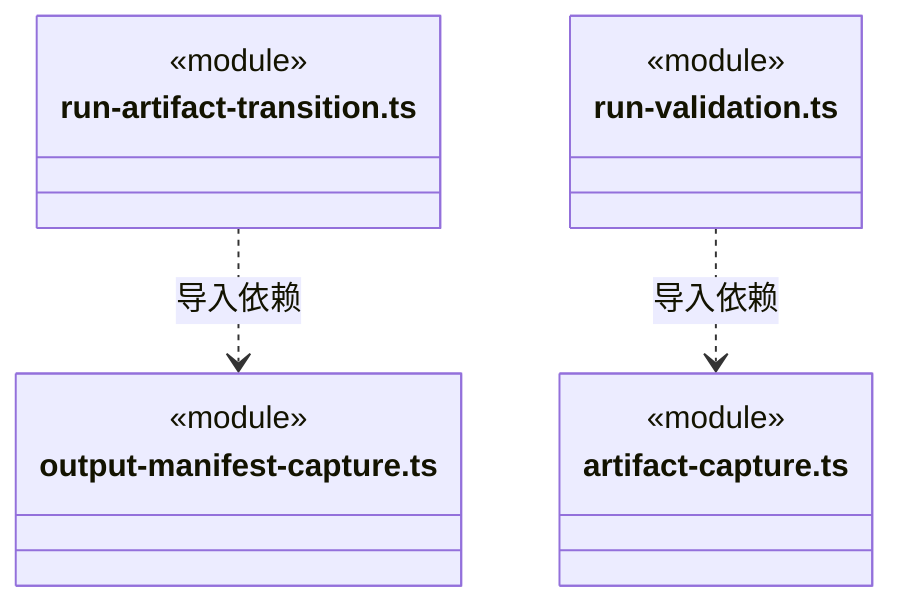

## 子目录导航

无子目录。

[返回上层](../ARCHITECTURE.md)。

每次修改本目录代码，同步维护文件头、关键契约说明及本图。未实现的治理、证据验收和自动编排能力不列入当前类图。

<!-- architecture:generated:end -->
