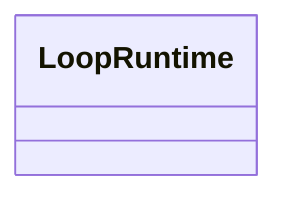

# src/logic/execution/rules/runtime 架构

## 设计意图

驱动一次引擎无关执行的回合、工具门禁、日志与终态，保持过程事实可恢复和可核实。

`LoopRuntime` 持有任务租约与运行状态，组合引擎、存储和可信能力端口，先保存必要事实再继续副作用。停止需要收束在途能力；未知结果保留中断语义，不自动重放。应用装配、包安装和目标验收在外层完成。

## 主要组成

| 组成 | 定位 |
| --- | --- |
| [LoopRuntime](runtime.ts) | LoopRuntime 持有任务租约、工具授权与终态；业务 Agent 启动关联父工具，使用递归求助，历史交接保持独立。 |

<!-- architecture:generated:start -->

## 架构关系

[上层设计](../ARCHITECTURE.md)

<!-- architecture:generated:end -->
