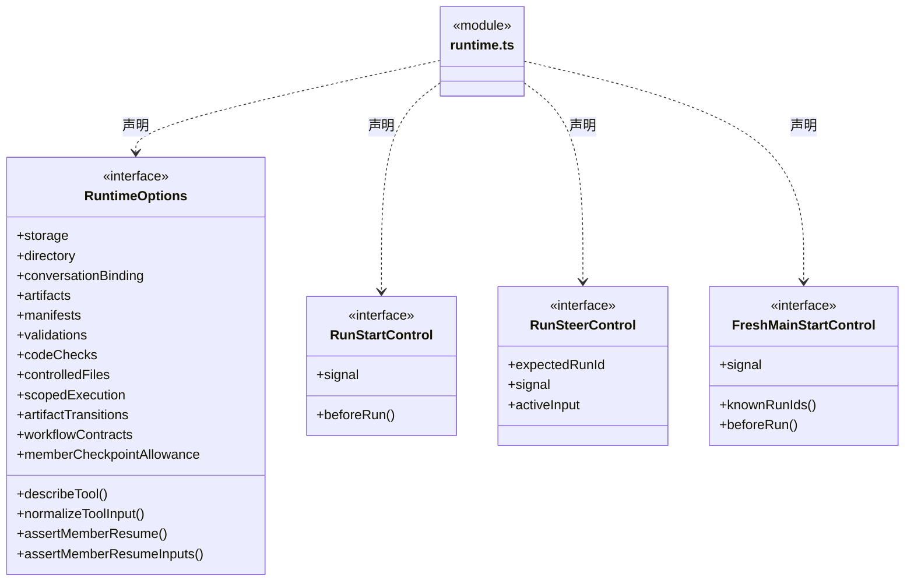
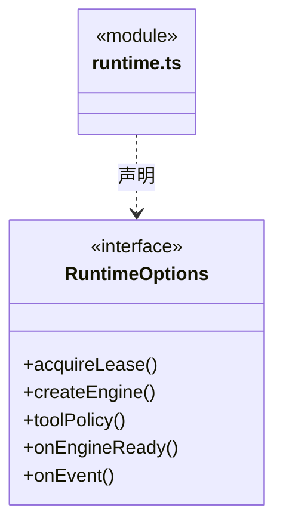
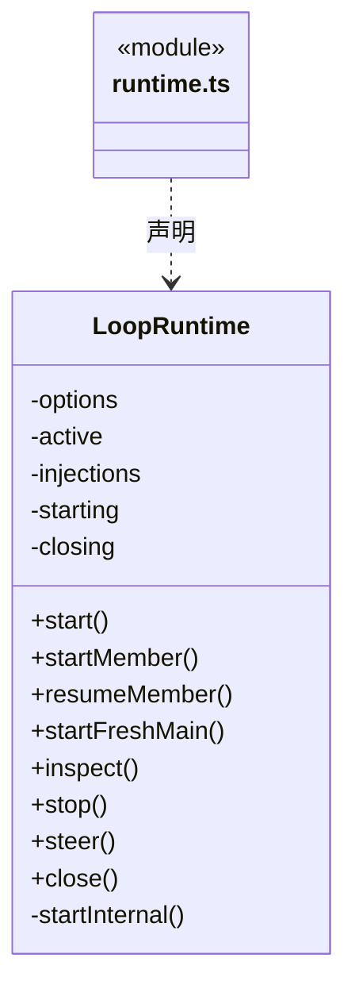

# src/logic/execution/rules/runtime 架构

## 目录定位

执行模块内部运行机制：回合驱动、事件、工具协调、输出验证与计量。继续依赖领域规则与能力，迁移不拆分运行状态所有权；依赖过密仍是独立治理项。

本文描述当前实现。通过分析目录边界后维护的 [源码架构脚本](../../../../../scripts/source-architecture.mjs) 同步清单和声明；代码变更时仍须核对职责、关键成员与关系。

## 代码清单

| 文件 | 当前职责 |
| --- | --- |
| [runtime.ts](runtime.ts) | LoopRuntime 持有任务租约、工具授权与终态；显式续聊由会话选择器核实原生恢复或无交互失败重试。 |

## 架构类图

### runtime.ts

成员 1/2（同名节点为同一声明，跨图合并阅读）。

成员 2/2（同名节点为同一声明，跨图合并阅读）。

直接依赖：[../engine-session.ts](../engine-session.ts)、[../../ports/identity.ts](../../ports/identity.ts)、[../storage.ts](../storage.ts)、[../../../tools/rules/receipts.ts](../../../tools/rules/receipts.ts)、[../../../evidence/rules/progress-tools.ts](../../../evidence/rules/progress-tools.ts)、[../../../tasks/rules/member-help-tools.ts](../../../tasks/rules/member-help-tools.ts)、[../../../evidence/rules/artifact-tools.ts](../../../evidence/rules/artifact-tools.ts)、[../../../tasks/rules/member-checkpoint-tools.ts](../../../tasks/rules/member-checkpoint-tools.ts)、[../capabilities/member-checkpoint.ts](../capabilities/member-checkpoint.ts)、[../../../tasks/rules/member-checkpoint.ts](../../../tasks/rules/member-checkpoint.ts)、[../../../tasks/rules/member-checkpoint-evidence.ts](../../../tasks/rules/member-checkpoint-evidence.ts)、[../../../../core/platform/node/serialization.ts](../../../../core/platform/node/serialization.ts)、[../capabilities/artifact-capture.ts](../capabilities/artifact-capture.ts)、[../capabilities/run-code-check.ts](../capabilities/run-code-check.ts)、[../../../evidence/rules/code-check.ts](../../../evidence/rules/code-check.ts)、[../capabilities/output-manifest-capture.ts](../capabilities/output-manifest-capture.ts)、[../../../workspace/rules/artifact-scope.ts](../../../workspace/rules/artifact-scope.ts)、[../../../evidence/rules/output-manifest.ts](../../../evidence/rules/output-manifest.ts)、[../../../evidence/rules/complete-output-evidence.ts](../../../evidence/rules/complete-output-evidence.ts)、[../capabilities/run-validation.ts](../capabilities/run-validation.ts)、[../capabilities/member-tool-capabilities.ts](../capabilities/member-tool-capabilities.ts)、[../capabilities/run-scoped-execution.ts](../capabilities/run-scoped-execution.ts)、[../../../workspace/rules/execution-scope.ts](../../../workspace/rules/execution-scope.ts)、[../../../file-operations/rules/scoped-execution.ts](../../../file-operations/rules/scoped-execution.ts)、[../repeated-tool-failures.ts](../repeated-tool-failures.ts)、[../../../tools/rules/outcome.ts](../../../tools/rules/outcome.ts)、[../../../tools/rules/native-tools.ts](../../../tools/rules/native-tools.ts)、[../capabilities/run-controlled-file.ts](../capabilities/run-controlled-file.ts)、[../../../file-operations/rules/controlled-file-operation.ts](../../../file-operations/rules/controlled-file-operation.ts)、[../capabilities/run-artifact-transition.ts](../capabilities/run-artifact-transition.ts)、[../../../file-operations/rules/artifact-transition.ts](../../../file-operations/rules/artifact-transition.ts)、[../../../evidence/rules/validation.ts](../../../evidence/rules/validation.ts)、[../member-run.ts](../member-run.ts)、[../input-source.ts](../input-source.ts)、[../conversation-binding.ts](../conversation-binding.ts)、[../types.ts](../types.ts)、[../../../tools/rules/policy/tool-policy.ts](../../../tools/rules/policy/tool-policy.ts)、[../../../tasks/rules/execution-context.ts](../../../tasks/rules/execution-context.ts)、[../../../evidence/rules/workflow-evidence.ts](../../../evidence/rules/workflow-evidence.ts)、[../../../../core/errors.ts](../../../../core/errors.ts)、[../../../tools/rules/input-validation.ts](../../../tools/rules/input-validation.ts)、[../../../tasks/rules/scope-active-input.ts](../../../tasks/rules/scope-active-input.ts)、[../../../tasks/rules/scope-active-input-rules.ts](../../../tasks/rules/scope-active-input-rules.ts)、[../../../tools/rules/types.ts](../../../tools/rules/types.ts)。

## 子目录导航

无子目录。

[返回上层](../ARCHITECTURE.md)。

每次修改本目录代码，同步维护文件头、关键契约说明及本图。未实现的治理、证据验收和自动编排能力不列入当前类图。

## 设计契约 v1 与落地范围

以下内容区分已接通能力与后续设计；以各节的实现状态为准，不将目标图当作现状图。维护源：[CONTRACT.md](CONTRACT.md)；生成类图时同步附加，勿直接修改本附录。

## 执行前缺参

beforeTool 分类/授权之前的 Schema 错误使用 toolInputError 转为字段说明，保存原 Fault 错误码并返回 rejected。工具尚未放行，不能将其解释为未知写入。该路径不重发调用、不补业务参数；原 Workflow/权限/停止/证据失效逻辑保持，执行后的失败依然沿未知结果规则处理。

normalizeToolInput 是可信同步预解析端口：先解析缺省参数，再以相同 input 写 proposed、授权与回执，只有变更时追加 originalInput 保留模型输入。解析失败保留原请求并进入拒绝路径；不能按当前身份重新解释历史日志。知识执行服务绑定同一实例并再次断言，不跨实例切换。此安排保留 originalKnowledgeWrite 从原 proposed 核实知识事务的能力。

## 指定话题补充与排空

主轮整话题补充使用带 interruptionId 的 user-continuation。仅此分支可续接安全 cancelled；beforeRun 必须消费原持久等待，其他可信接续仍要求 completed。日志尾行、未决工具、主对话绑定和原生文件校验全部保留；运行管理器等待旧 runtime 清理完成再创建新轮。
