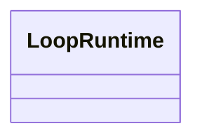

# src/logic/execution/rules/runtime 架构

## 设计意图

驱动一次执行的回合、事件、工具调用与输出验证。LoopRuntime 组合领域规则和能力端口，维护运行过程，不承担应用装配或引擎安装。

## 主要组成

| 组成 | 定位 |
| --- | --- |
| [LoopRuntime](runtime.ts) | LoopRuntime 持有任务租约、工具授权与终态；业务 Agent 启动关联父工具，使用递归求助，历史交接保持独立。 |

<!-- architecture:generated:start -->

## 架构关系

[上层设计](../ARCHITECTURE.md)

<!-- architecture:generated:end -->
