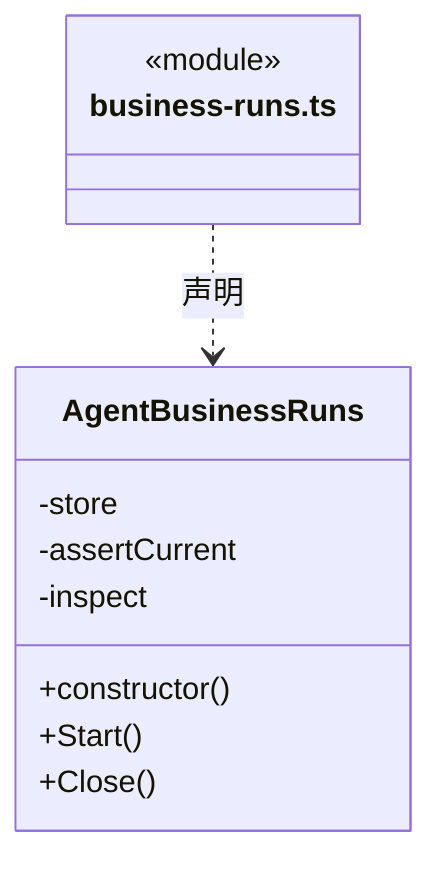
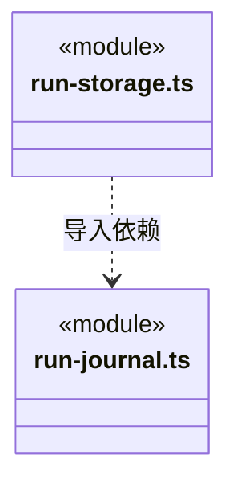

# src/logic/execution/storage 架构

本目录只维护这一份说明。设计与契约直接编辑本文；文件清单、类图和导航由 [架构脚本](../../../../scripts/source-architecture.mjs) 更新，生成区域之外的人工说明会保留。

## 封装意图

运行日志、运行内输入和游标文件实现；按 logic/execution/rules 的 RunStorage 等端口提供持久化，保留追加、未知和恢复语义。

## 类与模块的设计意图

下表依据源码声明及文件头说明定位封装。字段表示该实例持有的状态或协作引用，不表示它拥有被引用服务的生命周期；实际资源责任和调用限制见下文契约及源码注释。

| 类／模块 | 实现形式与实例字段 | 封装依据 |
| --- | --- | --- |
| [AgentBusinessRuns](business-runs.ts) | 实例类；持有 `store`、`assertCurrent`、`inspect` | 受控文件与隔离报告复用同一运行身份；重启只读原事实，不创建派发任务或自动补结算。 |
| [RunJournal](run-journal.ts) | 实例类；持有 `tail`、`events`、`directory`、`task`、`runId` | 只追加的运行事实来源；事件可靠落盘后才返回，观察者由上层运行时通知。 |
| [FileRunStorage](run-storage.ts) | 实例类；无实例字段声明 | 应用装配的文件存储；实例不缓存历史，查询总是核验已落盘日志。 |

## 接口设计契约

### run-storage 持久化契约

##### 运行日志的只读完整性诊断

`RunJournal.Read` 仅解析完整行并报告 `logIntegrity.partialTail`，保留未完成尾行的原始字节、不截断或修复。零字节文件返回 `RUN_LOG_EMPTY`；结构、绑定或 JSON 损坏返回 `RUN_LOG_INVALID`，错误不包含原始片段。文件系统错误保留系统码，缺失日志不能解释为未执行。正常读取依旧重建可信回执、未知工具与终态，完成前缀不代表尾行也完整。

`session.bound` 可以先只登记原生线程 ID，稍后再确认文件。缺少 `sessionFile` 保持缺省，不能调用 `String(undefined)` 伪造恢复路径；已存在的非字符串或空路径拒绝为坏记录。历史读取不回写任何字节，是否可显式继续由执行层依据完整终态、工具和输出记录决定，日志层不自动启动或猜测原生文件。

#### 递归业务身份登记

business-runs 从原 canonical 验证父工具授权、首次带 limits 的引用以及逐层 run.started.agentCall。等待／恢复可重复报告同一引用，但不可换绑；原日志缺失、尾行不完整或父运行已有终态均拒绝启动。普通中间 Agent 不要求旧派发记录。装配验证工作区及根路径，登记器验证任务、运行及同根链。

登记写入原 DispatchStore，active 仅表示启动意图已保存，不保证模型已经开始。closed 仅由真实 Runtime.close 后提交，重启不自动猜测结算。已有 closed 重复关闭不写日志，保存未知原样上抛，调用方保留准入。

## 开闭边界

本目录的职责及允许协作由[封装意图](#封装意图)限定，输入输出、状态与失败语义以[接口设计契约](#接口设计契约)为准。扩展从已有公开入口及实际装配位置进入；没有明确可替换契约的部分按真实影响修改和验证，不预建未使用的基类或插件入口。

<!-- architecture:generated:start -->

## 文件清单

| 文件 | 形式 | 当前职责 |
| --- | --- | --- |
| [ARCHITECTURE.md](ARCHITECTURE.md) | 说明文档 | 本目录的文件清单、真实声明、依赖与子封装导航。 |
| [business-runs.ts](business-runs.ts) | 源码模块 | 将递归业务的启动意图和实际排空提交到已有工作区事务日志。 |
| [run-journal.ts](run-journal.ts) | 源码模块 | 本机事件日志顺序追加并 fsync，按真实可选的原生路径重建摘要和未确认工具。 |
| [run-storage.ts](run-storage.ts) | 源码模块 | 将本机运行目录和 RunJournal 装配为大脑及调度共享的存储端口。 |

## 架构类图

成员标记：`+` 公开、`-` 私有、`#` 受保护、`$` 静态；构造函数单独列出。文档和资源仅在文件清单中导航，不作为代码节点。

### business-runs.ts

直接依赖：[../../../core/errors.ts](../../../core/errors.ts)、[../../dispatch/rules/dispatch-storage.ts](../../dispatch/rules/dispatch-storage.ts)、[../rules/business-run.ts](../rules/business-run.ts)、[../../agents/contracts.ts](../../agents/contracts.ts)、[../rules/types.ts](../rules/types.ts)、[../rules/business-run-invariants.ts](../rules/business-run-invariants.ts)。

### run-journal.ts

直接依赖：[../rules/types.ts](../rules/types.ts)、[../../tools/rules/types.ts](../../tools/rules/types.ts)、[../rules/member-run.ts](../rules/member-run.ts)、[../rules/input-source.ts](../rules/input-source.ts)、[../rules/conversation-binding.ts](../rules/conversation-binding.ts)、[../../../core/errors.ts](../../../core/errors.ts)。

### run-storage.ts

直接依赖：[../rules/storage.ts](../rules/storage.ts)、[../../tasks/rules/types.ts](../../tasks/rules/types.ts)、[../ports/identity.ts](../ports/identity.ts)、[run-journal.ts](run-journal.ts)。

### 本目录调用边界

## 子目录导航

无子目录。

[返回上层](../ARCHITECTURE.md)。

每次修改本目录代码，同步维护文件头、关键契约说明及本图。未实现的治理、证据验收和自动编排能力不列入当前类图。

<!-- architecture:generated:end -->
