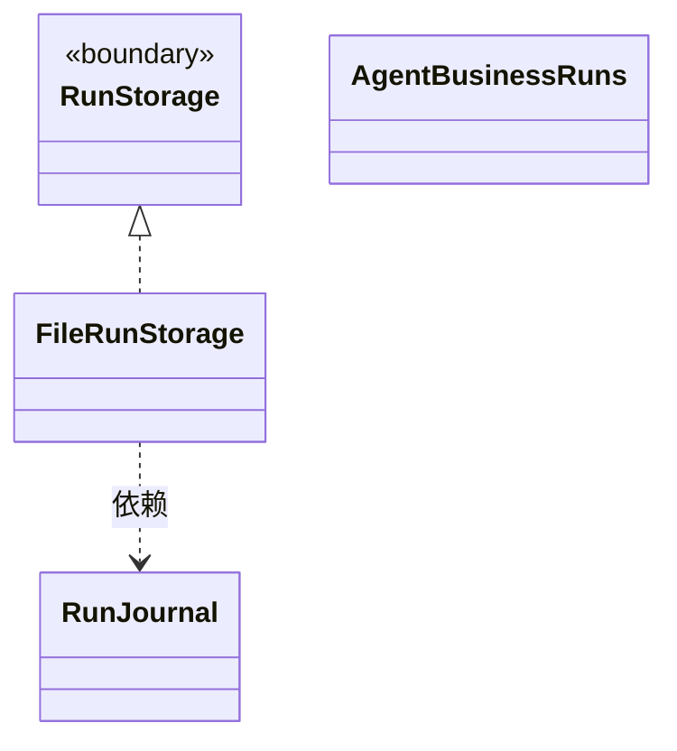

# src/logic/execution/storage 架构

## 设计意图

运行日志、运行内输入和游标文件实现；按 logic/execution/rules 的 RunStorage 等端口提供持久化，保留追加、未知和恢复语义。

## 主要组成

| 组成 | 定位 |
| --- | --- |
| [AgentBusinessRuns](business-runs.ts) | 将递归业务的启动意图和实际排空提交到已有工作区事务日志。 |
| [RunJournal](run-journal.ts) | 本机事件日志顺序追加并 fsync，按真实可选的原生路径重建摘要和未确认工具。 |
| [FileRunStorage](run-storage.ts) | 将本机运行目录和 RunJournal 装配为大脑及调度共享的存储端口。 |

<!-- architecture:generated:start -->

## 架构关系

外部继承／实现边界：[RunStorage](../rules/storage.ts)。

[上层设计](../ARCHITECTURE.md)

<!-- architecture:generated:end -->
