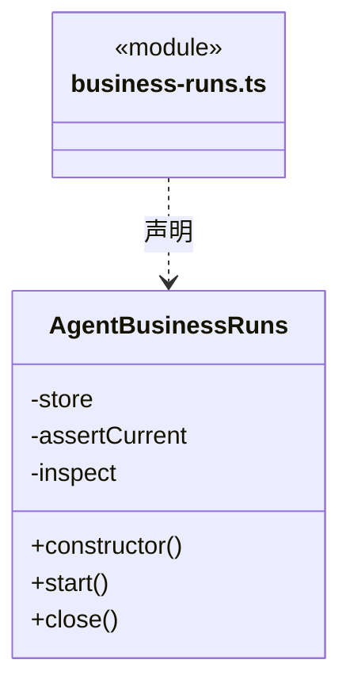
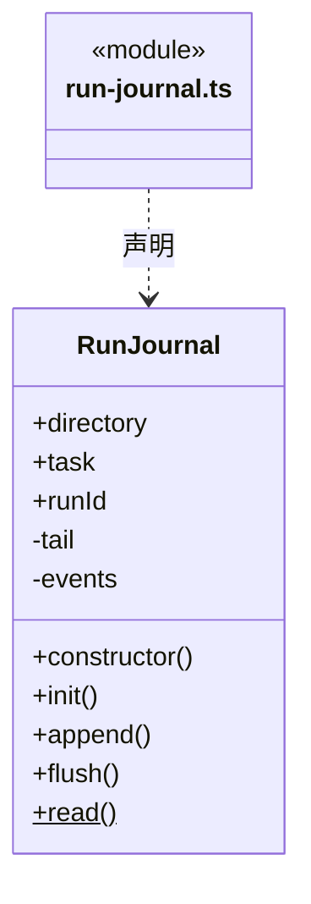
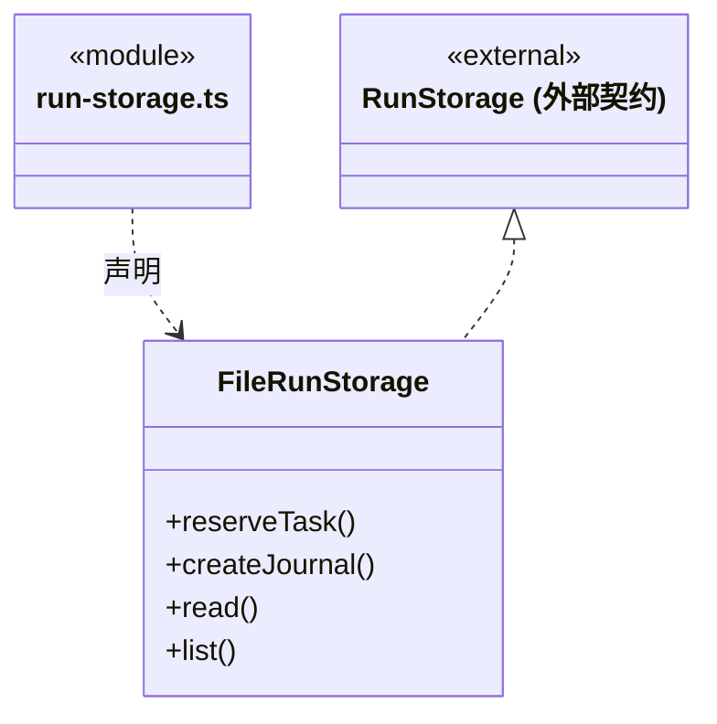
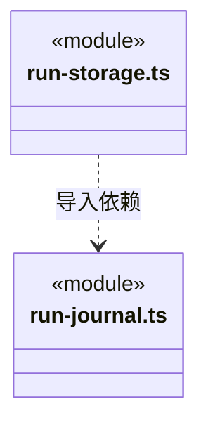

# src/logic/execution/storage 架构

## 目录定位

运行日志、运行内输入和游标文件实现；按 logic/execution/rules 的 RunStorage 等端口提供持久化，保留追加、未知和恢复语义。

本文描述当前实现。通过分析目录边界后维护的 [源码架构脚本](../../../../scripts/source-architecture.mjs) 同步清单和声明；代码变更时仍须核对职责、关键成员与关系。

## 文件清单

| 文件 | 形式 | 当前职责 |
| --- | --- | --- |
| [ARCHITECTURE.md](ARCHITECTURE.md) | 说明文档 | 本目录的文件清单、真实声明、依赖与子封装导航。 |
| [CONTRACT.md](CONTRACT.md) | 说明文档 | 人工维护的职责、接口契约、状态所有权与扩展边界；在本文末尾同步附加。 |
| [business-runs.ts](business-runs.ts) | 源码模块 | 将递归业务的启动意图和实际排空提交到已有工作区事务日志。 |
| [run-journal.ts](run-journal.ts) | 源码模块 | 本机事件日志顺序追加并 fsync，按真实可选的原生路径重建摘要和未确认工具。 |
| [run-storage.ts](run-storage.ts) | 源码模块 | 将本机运行目录和 RunJournal 装配为大脑及调度共享的存储端口。 |

## 架构类图

成员标记：`+` 公开、`-` 私有、`#` 受保护、`$` 静态；构造函数单独列出。文档和资源仅在文件清单中导航，不作为代码节点。

### business-runs.ts

直接依赖：[../../../core/errors.ts](../../../core/errors.ts)、[../../dispatch/rules/dispatch-storage.ts](../../dispatch/rules/dispatch-storage.ts)、[../rules/business-run.ts](../rules/business-run.ts)、[../../agents/contracts.ts](../../agents/contracts.ts)、[../rules/types.ts](../rules/types.ts)、[../rules/business-run-invariants.ts](../rules/business-run-invariants.ts)。

### run-journal.ts

直接依赖：[../rules/types.ts](../rules/types.ts)、[../../tools/rules/types.ts](../../tools/rules/types.ts)、[../rules/member-run.ts](../rules/member-run.ts)、[../rules/input-source.ts](../rules/input-source.ts)、[../rules/conversation-binding.ts](../rules/conversation-binding.ts)、[../../../core/errors.ts](../../../core/errors.ts)。

### run-storage.ts

直接依赖：[../rules/storage.ts](../rules/storage.ts)、[../../tasks/rules/types.ts](../../tasks/rules/types.ts)、[../ports/identity.ts](../ports/identity.ts)、[run-journal.ts](run-journal.ts)。

### 本目录调用边界

## 子目录导航

无子目录。

[返回上层](../ARCHITECTURE.md)。

每次修改本目录代码，同步维护文件头、关键契约说明及本图。未实现的治理、证据验收和自动编排能力不列入当前类图。

## 设计契约 v1 与落地范围

以下内容区分已接通能力与后续设计；以各节的实现状态为准，不将目标图当作现状图。维护源：[CONTRACT.md](CONTRACT.md)；生成类图时同步附加，勿直接修改本附录。

# run-storage 持久化契约

### 运行日志的只读完整性诊断

`RunJournal.read` 仅解析完整行并报告 `logIntegrity.partialTail`，保留未完成尾行的原始字节、不截断或修复。零字节文件返回 `RUN_LOG_EMPTY`；结构、绑定或 JSON 损坏返回 `RUN_LOG_INVALID`，错误不包含原始片段。文件系统错误保留系统码，缺失日志不能解释为未执行。正常读取依旧重建可信回执、未知工具与终态，完成前缀不代表尾行也完整。

`session.bound` 可以先只登记原生线程 ID，稍后再确认文件。缺少 `sessionFile` 保持缺省，不能调用 `String(undefined)` 伪造恢复路径；已存在的非字符串或空路径拒绝为坏记录。历史读取不回写任何字节，是否可显式继续由执行层依据完整终态、工具和输出记录决定，日志层不自动启动或猜测原生文件。

## 递归业务身份登记

business-runs 从原 canonical 验证父工具授权、首次带 limits 的引用以及逐层 run.started.agentCall。等待／恢复可重复报告同一引用，但不可换绑；原日志缺失、尾行不完整或父运行已有终态均拒绝启动。普通中间 Agent 不要求旧派发记录。装配验证工作区及根路径，登记器验证任务、运行及同根链。

登记写入原 DispatchStore，active 仅表示启动意图已保存，不保证模型已经开始。closed 仅由真实 Runtime.close 后提交，重启不自动猜测结算。已有 closed 重复关闭不写日志，保存未知原样上抛，调用方保留准入。
