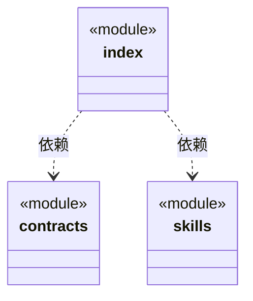

# src/logic/feedback 架构

## 设计意图

保存工具范围使用的反馈数据契约。旧反馈提交服务已退役，本目录不发起 GitHub 请求。

## 主要组成

| 组成 | 定位 |
| --- | --- |
| [contracts](contracts.ts) | CBIM 反馈 Skill、可信 GitHub 端口和桌面登录共用的纯协议。 |
| [index](index.ts) | 反馈输入、格式化、可信目标和公开连接状态的纯业务入口。 |
| [skills](skills.ts) | 反馈流程的代码常量，由所属业务模块维护，供内置资料查询或结构校验使用。 |

<!-- architecture:generated:start -->

## 架构关系

[上层设计](../ARCHITECTURE.md)

<!-- architecture:generated:end -->
