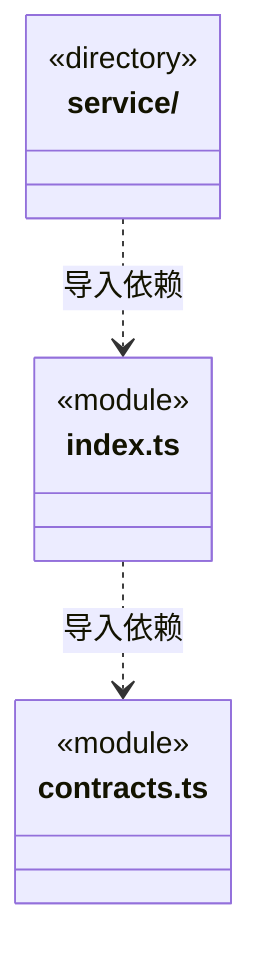
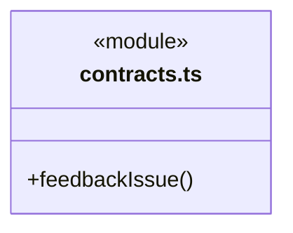

# src/logic/feedback 架构

## 目录定位

反馈输入、确定性正文、可信范围与公开连接契约；纯入口不加载持久化、网络或原生锁。

本文描述当前实现。通过分析目录边界后维护的 [源码架构脚本](../../../scripts/source-architecture.mjs) 同步清单和声明；代码变更时仍须核对职责、关键成员与关系。

## 代码清单

| 文件 | 当前职责 |
| --- | --- |
| [contracts.ts](contracts.ts) | CBIM 反馈 Skill、可信 GitHub 端口和桌面登录共用的纯协议。 |
| [index.ts](index.ts) | 反馈输入、格式化、可信目标和公开连接状态的纯业务入口。 |

## 架构类图

各图中的同名节点表示同一目录边界；跨组及完整直接依赖如下（无边不代表继承）：

- `index.ts` → `contracts.ts`：导入。
- `service` → `index.ts`：导入。

### contracts.ts 公开入口

## 子目录导航

- [service/](service/ARCHITECTURE.md)：GitHub 设备授权、加密连接和提交账本；有界 HTTP、先落盘后提交、未知结果只核实，宿主负责装配和关闭。

[返回上层](../ARCHITECTURE.md)。

每次修改本目录代码，同步维护文件头、关键契约说明及本图。未实现的治理、证据验收和自动编排能力不列入当前类图。

## 设计契约 v1 与落地范围

以下内容区分已接通能力与后续设计；以各节的实现状态为准，不将目标图当作现状图。维护源：[CONTRACT.md](CONTRACT.md)；生成类图时同步附加，勿直接修改本附录。

# 反馈业务纯契约

公开入口为 index.ts；工具参数、正文格式和可信范围由本域拥有，网络、持久化和授权生命周期由 service 负责。Core 不认识反馈业务，Logic 不反向导入旧工具或 Main。

githubFeedbackScopeSchema 从旧工具范围文件迁入本域，字段及校验不变。旧 scope-schema 组合并重导出同一 Schema，以保持日志与工具授权的既有协议；范围不是授权动作。bridge/contracts/github-feedback.ts 只具名转接配置 Schema 和公开状态，不公开提交端口或服务。

### GitHub 反馈纯协议

`contracts.ts` 定义 BUG／需求的严格字段、最小 submitted 回执、已绑定目标端口及公开设置类型。`feedbackIssue` 只排版本次用户字段，保留标记不接受模型指定；不从本层发 HTTP、读凭据或授予权限。实际外部写由主进程实现，GitHub 工具不混入静态链接器注册或知识目录。

反馈输入仅 `kind/summary` 必填，简述不能为空；其他字段可缺省或空白，仍限制类型、长度、保留标记和未知字段。缺失主栏目统一排成“用户未提供”，补充上下文只在非空时输出；已完整填写的旧标题/正文不变。规范化发生在指纹之前，主栏目省略、空白或显式占位可复用同一回执，不自动采集环境或编造事实。

`FeedbackConnectionCheck` 仅表达本机保存的连接、尚待授权回包、过期、代际变化或设置／安全存储故障；不含凭据、设备码或提交记录。`FeedbackAvailability` 由调度层合成本轮实际装配与本机连接事实，两项操作工具必须同时存在或同时缺失。READY 不证明网络可达、权限允许或 Issue 已创建；诊断也不能把原未知提交改判为未发送。

业务字段变化从 contracts.ts 修改，再核对正文指纹、工具输入及历史回执；新增传输实现通过 service 的 GitHubRequest 注入，不能修改未知结果屏障。变化频率未作历史统计，本次只保持已核实的行为边界。
