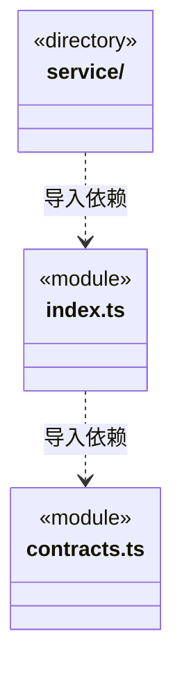
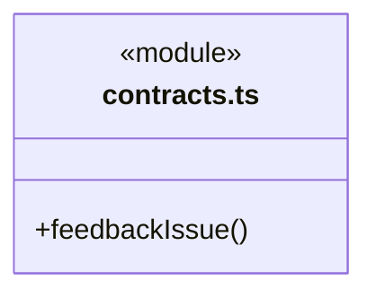
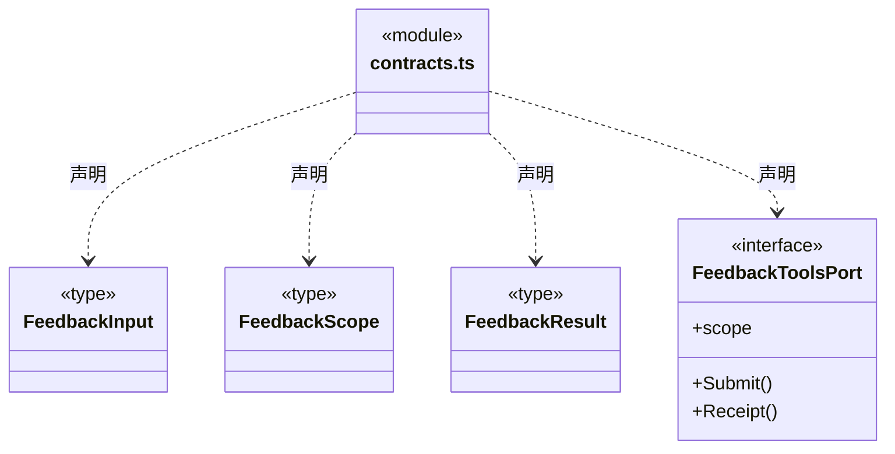
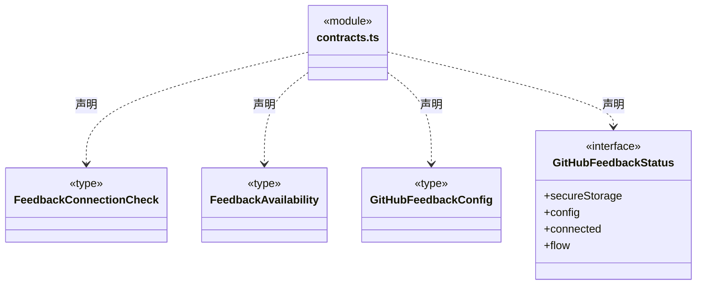
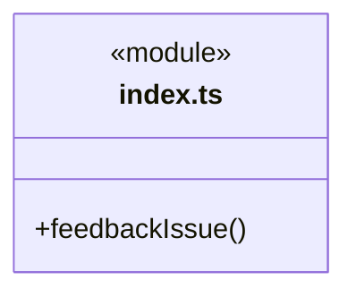

# src/logic/feedback 架构

本目录只维护这一份说明。设计与契约直接编辑本文；文件清单、类图和导航由 [架构脚本](../../../scripts/source-architecture.mjs) 更新，生成区域之外的人工说明会保留。

## 封装意图

反馈输入、确定性正文、可信范围与公开连接契约；纯入口不加载持久化、网络或原生锁。

## 类与模块的设计意图

下表依据源码声明及文件头说明定位封装。字段表示该实例持有的状态或协作引用，不表示它拥有被引用服务的生命周期；实际资源责任和调用限制见下文契约及源码注释。

| 类／模块 | 实现形式与实例字段 | 封装依据 |
| --- | --- | --- |
| [contracts.ts](contracts.ts) | 函数／契约模块 | 模型只填写用户提供的业务上下文；账号、仓库和自动提交授权由本机设置绑定，凭据不进入工具或公开设置。只读诊断将连接事实与本轮工具装配分开，不授予提交权限。 |
| [index.ts](index.ts) | 函数／契约模块 | 工具策略与通信只需业务契约，不加载凭据、文件、网络或原生锁。 |

## 接口设计契约

### 反馈业务纯契约

公开入口为 index.ts；工具参数、正文格式和可信范围由本域拥有，网络、持久化和授权生命周期由 service 负责。Core 不认识反馈业务，Logic 不反向导入旧工具或 Main。

githubFeedbackScopeSchema 从旧工具范围文件迁入本域，字段及校验不变。旧 scope-schema 组合并重导出同一 Schema，以保持日志与工具授权的既有协议；范围不是授权动作。bridge/contracts/github-feedback.ts 只具名转接配置 Schema 和公开状态，不公开提交端口或服务。

##### GitHub 反馈纯协议

`contracts.ts` 定义 BUG／需求的严格字段、最小 submitted 回执、已绑定目标端口及公开设置类型。`feedbackIssue` 只排版本次用户字段，保留标记不接受模型指定；不从本层发 HTTP、读凭据或授予权限。实际外部写由主进程实现，GitHub 工具不混入静态链接器注册或知识目录。

反馈输入仅 `kind/summary` 必填，简述不能为空；其他字段可缺省或空白，仍限制类型、长度、保留标记和未知字段。缺失主栏目统一排成“用户未提供”，补充上下文只在非空时输出；已完整填写的旧标题/正文不变。规范化发生在指纹之前，主栏目省略、空白或显式占位可复用同一回执，不自动采集环境或编造事实。

`FeedbackConnectionCheck` 仅表达本机保存的连接、尚待授权回包、过期、代际变化或设置／安全存储故障；不含凭据、设备码或提交记录。`FeedbackAvailability` 由调度层合成本轮实际装配与本机连接事实，两项操作工具必须同时存在或同时缺失。READY 不证明网络可达、权限允许或 Issue 已创建；诊断也不能把原未知提交改判为未发送。

业务字段变化从 contracts.ts 修改，再核对正文指纹、工具输入及历史回执；新增传输实现通过 service 的 GitHubRequest 注入，不能修改未知结果屏障。变化频率未作历史统计，本次只保持已核实的行为边界。

## 开闭边界

本目录的职责及允许协作由[封装意图](#封装意图)限定，输入输出、状态与失败语义以[接口设计契约](#接口设计契约)为准。扩展从已有公开入口及实际装配位置进入；没有明确可替换契约的部分按真实影响修改和验证，不预建未使用的基类或插件入口。

<!-- architecture:generated:start -->

## 文件清单

| 文件 | 形式 | 当前职责 |
| --- | --- | --- |
| [ARCHITECTURE.md](ARCHITECTURE.md) | 说明文档 | 本目录的文件清单、真实声明、依赖与子封装导航。 |
| [contracts.ts](contracts.ts) | 源码模块 | CBIM 反馈 Skill、可信 GitHub 端口和桌面登录共用的纯协议。 |
| [index.ts](index.ts) | 源码模块 | 反馈输入、格式化、可信目标和公开连接状态的纯业务入口。 |

## 架构类图

成员标记：`+` 公开、`-` 私有、`#` 受保护、`$` 静态；`function` 为函数值成员，`get`／`set` 为访问器。调用／构造／索引签名按匿名签名列出，不虚构方法名；`global.` 表示全局声明补充，非运行时嵌套类。构造函数单独列出，运行时私有字段保留 `#`。文档和资源仅在文件清单中导航，不作为代码节点。

各图中的同名节点表示同一目录边界；跨组及完整直接依赖如下（无边不代表继承）：

- `index.ts` → `contracts.ts`：导入。
- `service` → `index.ts`：导入。

### contracts.ts

[查看源码](contracts.ts)。

### index.ts

[查看源码](index.ts)。

直接依赖：[contracts.ts](contracts.ts)。

## 子目录导航

- [service/](service/ARCHITECTURE.md)：GitHub 设备授权、加密连接和提交账本；有界 HTTP、先落盘后提交、未知结果只核实，宿主负责装配和关闭。

[返回上层](../ARCHITECTURE.md)。

每次修改本目录代码，同步维护文件头、关键契约说明及本图。未实现的治理、证据验收和自动编排能力不列入当前类图。

<!-- architecture:generated:end -->
