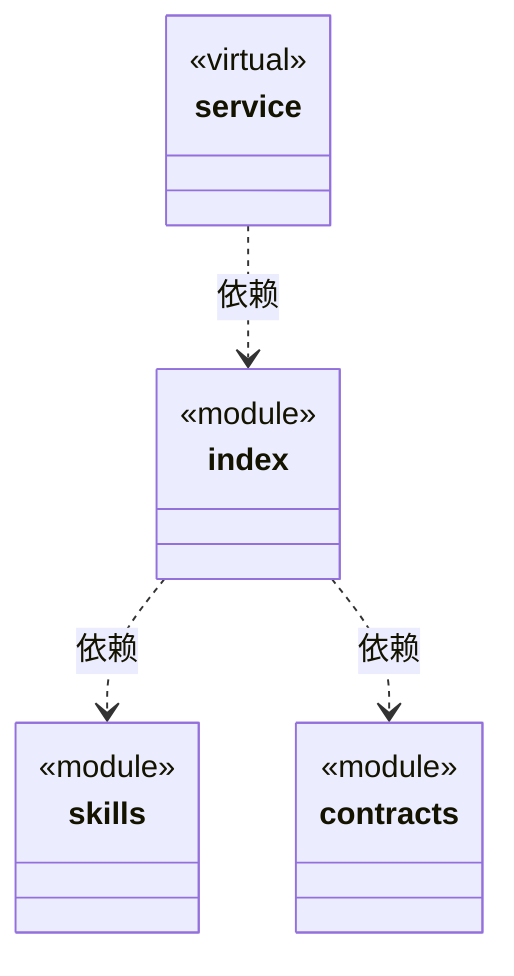

# src/logic/feedback 架构

## 设计意图

定义结构化反馈、可信目标与公开连接状态，把内置流程说明和真实外部提交分开。

`index` 校验输入、生成确定性正文并限制目标，`contracts` 描述调用端口，`skills` 提供随版本发布的只读指引。`service` 才负责授权、持久凭据和提交；读取 Skill 或格式化正文不会创建 GitHub Issue。

## 主要组成

| 组成 | 定位 |
| --- | --- |
| [skills](skills.ts) | 反馈 Skill 的只读正文；不执行提交，权限与真实回执仍由反馈服务维护。 |
| [contracts](contracts.ts) | CBIM 反馈 Skill、可信 GitHub 端口和桌面登录共用的纯协议。 |
| [index](index.ts) | 公开反馈输入、确定性正文格式和可信目标规则。 |

## 现状与目标边界

当前 [index.ts](index.ts) 除转接外还实现输入、正文和可信目标规则，[contracts.ts](contracts.ts)、[skills.ts](skills.ts) 与 service 子模块并存。目标是将纯协议、格式规则与内置指引按本域职责封装，父层只组合这些能力和服务。迁移必须保持正文确定性、Skill 版本与目标限制，不能把授权、持久凭据或网络加载带入纯入口。

<!-- architecture:generated:start -->

## 架构关系

标注为 `virtual` 的节点是直接子模块的虚拟类封装；内部设计沿下方入口阅读。

## 子模块

| 虚拟封装 | 整体职责 |
| --- | --- |
| [service](service/ARCHITECTURE.md) | 管理 GitHub 反馈连接与有持久屏障的提交，区分已发送、失败和结果未知。 |

[上层设计](../ARCHITECTURE.md)

<!-- architecture:generated:end -->
