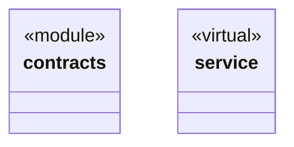

# src/logic/feedback 架构

## 设计意图

反馈输入、确定性正文、可信范围与公开连接契约；纯入口不加载持久化、网络或原生锁。

## 主要组成

| 组成 | 定位 |
| --- | --- |
| [contracts](contracts.ts) | CBIM 反馈 Skill、可信 GitHub 端口和桌面登录共用的纯协议。 |

<!-- architecture:generated:start -->

## 架构关系

标注为 `virtual` 的节点是直接子模块的虚拟类封装；内部设计沿下方入口阅读。

## 子模块

| 虚拟封装 | 整体职责 |
| --- | --- |
| [service](service/ARCHITECTURE.md) | GitHub 设备授权、加密连接和提交账本；有界 HTTP、先落盘后提交、未知结果只核实，宿主负责装配和关闭。 |

[上层设计](../ARCHITECTURE.md)

<!-- architecture:generated:end -->
