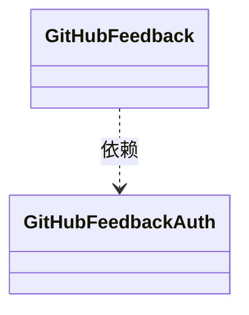

# src/logic/feedback/service 架构

## 设计意图

GitHub 设备授权、加密连接和提交账本；有界 HTTP、先落盘后提交、未知结果只核实，宿主负责装配和关闭。

## 主要组成

| 组成 | 定位 |
| --- | --- |
| [GitHubFeedbackAuth](github-feedback-auth.ts) | 桌面 GitHub Device Flow、账号／仓库绑定和本机加密凭据管理。 |
| [GitHubFeedback](github-feedback.ts) | 将本机会话的结构化反馈直接写入已连接 GitHub 仓库，保存私有原提交凭证。 |

<!-- architecture:generated:start -->

## 架构关系

[上层设计](../ARCHITECTURE.md)

<!-- architecture:generated:end -->
