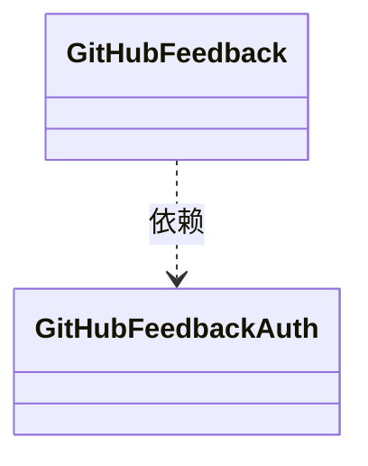

# src/logic/feedback/service 架构

## 设计意图

管理 GitHub 反馈连接与有持久屏障的提交，区分已发送、失败和结果未知。

`GitHubFeedbackAuth` 负责设备授权及加密连接，`GitHubFeedback` 先保存提交意图再调用有界 HTTP，并保留原提交凭证。未知结果只沿原记录核实，不能以新请求静默重发；宿主装配服务并负责关闭。

## 主要组成

| 组成 | 定位 |
| --- | --- |
| [GitHubFeedbackAuth](github-feedback-auth.ts) | 桌面 GitHub Device Flow、账号／仓库绑定和本机加密凭据管理。 |
| [GitHubFeedback](github-feedback.ts) | 将本机会话的结构化反馈直接写入已连接 GitHub 仓库，保存私有原提交凭证。 |

<!-- architecture:generated:start -->

## 架构关系

[上层设计](../ARCHITECTURE.md)

<!-- architecture:generated:end -->
