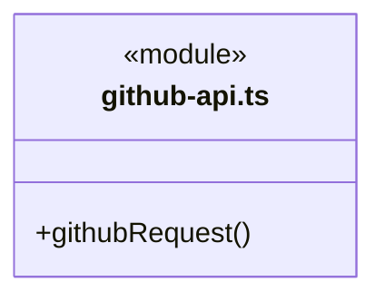
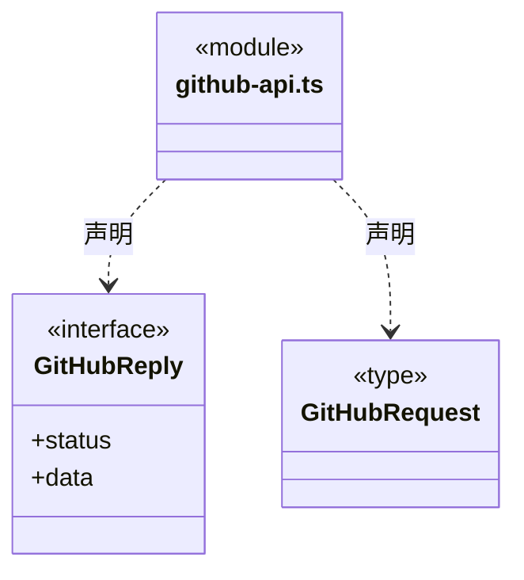
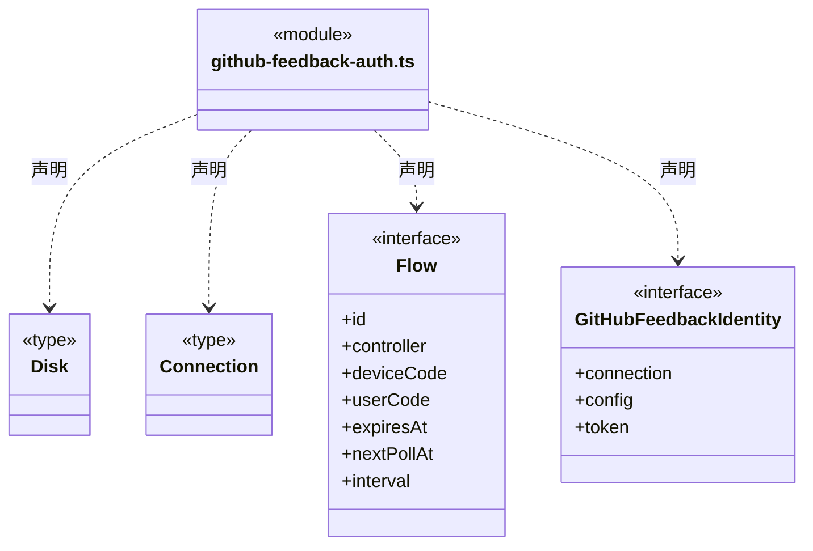
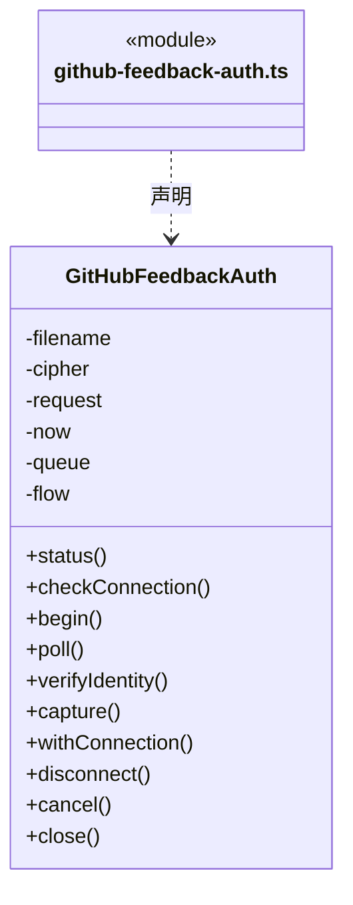
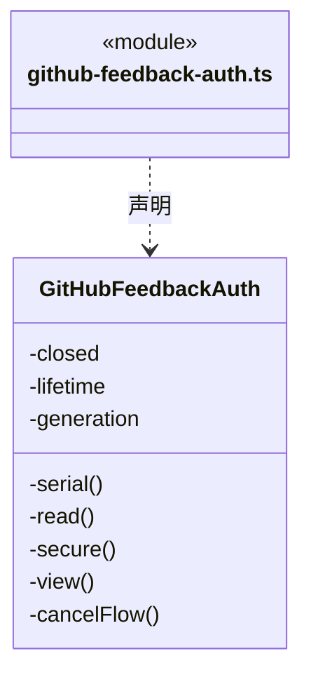
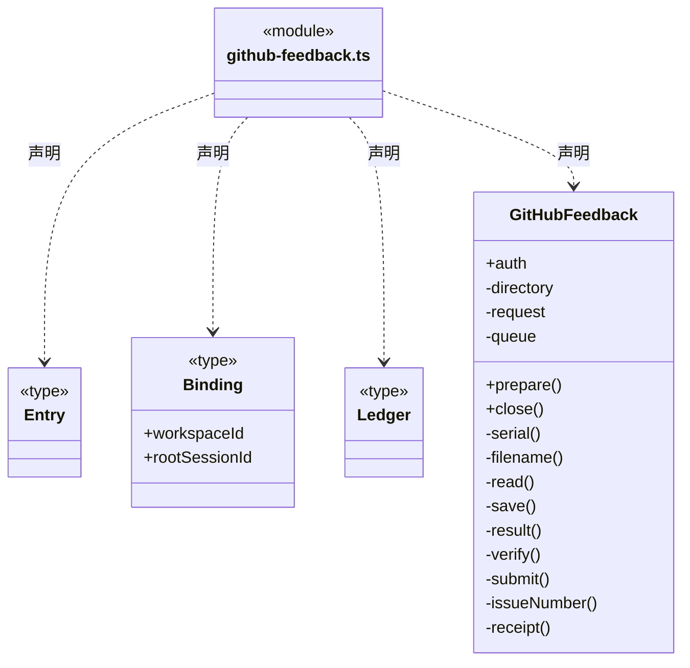
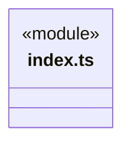
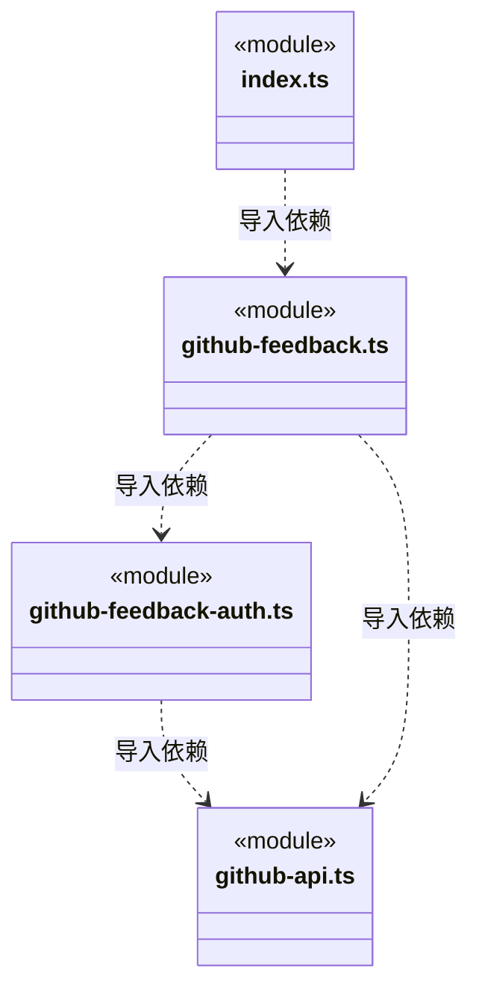
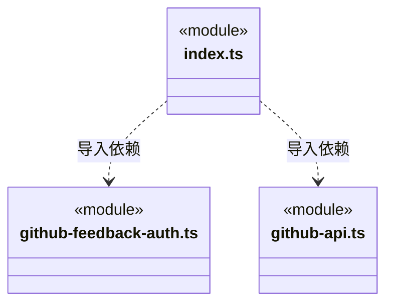

# src/logic/feedback/service 架构

## 目录定位

GitHub 设备授权、加密连接和提交账本；有界 HTTP、先落盘后提交、未知结果只核实，宿主负责装配和关闭。

本文描述当前实现。通过分析目录边界后维护的 [源码架构脚本](../../../../scripts/source-architecture.mjs) 同步清单和声明；代码变更时仍须核对职责、关键成员与关系。

## 代码清单

| 文件 | 当前职责 |
| --- | --- |
| [github-api.ts](github-api.ts) | 主进程直连 GitHub 的有界 JSON 传输，供设备授权和反馈提交共用。 |
| [github-feedback-auth.ts](github-feedback-auth.ts) | 桌面 GitHub Device Flow、账号／仓库绑定和本机加密凭据管理。 |
| [github-feedback.ts](github-feedback.ts) | 将本机会话的结构化反馈直接写入已连接 GitHub 仓库，保存私有原提交凭证。 |
| [index.ts](index.ts) | 反馈服务的宿主入口，公开授权管理与有持久屏障的提交服务。 |

## 架构类图

### github-api.ts

直接依赖：[../../../core/errors.ts](../../../core/errors.ts)、[../../../core/utility/index.ts](../../../core/utility/index.ts)。

### github-feedback-auth.ts

成员 1/2（同名节点为同一声明，跨图合并阅读）。

成员 2/2（同名节点为同一声明，跨图合并阅读）。

直接依赖：[../../../core/platform/node/files/index.ts](../../../core/platform/node/files/index.ts)、[../../../core/errors.ts](../../../core/errors.ts)、[../../../core/platform/node/digest.ts](../../../core/platform/node/digest.ts)、[../../../core/platform/node/locking.ts](../../../core/platform/node/locking.ts)、[../../../core/contracts/secrets.ts](../../../core/contracts/secrets.ts)、[../index.ts](../index.ts)、[github-api.ts](github-api.ts)。

### github-feedback.ts

直接依赖：[../../../core/platform/node/files/index.ts](../../../core/platform/node/files/index.ts)、[../../../core/platform/node/digest.ts](../../../core/platform/node/digest.ts)、[../../../core/errors.ts](../../../core/errors.ts)、[../../../core/contracts/secrets.ts](../../../core/contracts/secrets.ts)、[../index.ts](../index.ts)、[../../../core/platform/node/locking.ts](../../../core/platform/node/locking.ts)、[github-feedback-auth.ts](github-feedback-auth.ts)、[github-api.ts](github-api.ts)。

### index.ts

直接依赖：[github-feedback.ts](github-feedback.ts)、[github-feedback-auth.ts](github-feedback-auth.ts)、[github-api.ts](github-api.ts)。

### 本目录调用边界

## 子目录导航

无子目录。

[返回上层](../ARCHITECTURE.md)。

每次修改本目录代码，同步维护文件头、关键契约说明及本图。未实现的治理、证据验收和自动编排能力不列入当前类图。

## 设计契约 v1 与落地范围

以下内容区分已接通能力与后续设计；以各节的实现状态为准，不将目标图当作现状图。维护源：[CONTRACT.md](CONTRACT.md)；生成类图时同步附加，勿直接修改本附录。

# GitHub 反馈服务

index.ts 向宿主公开 GitHubFeedback/GitHubFeedbackAuth；配置路径、加密实现和应用生命周期由 Main 注入，服务不依赖旧 backend、Bridge、View 或模型业务。GitHubRequest 是有界请求替换端口，生产实现固定 GitHub 主机，不接受模型提供目标。github-api.ts 单独登记 HTTP 逻辑边界与测试模块，供本服务及其传输测试使用；宿主仍只通过 service/index.ts 装配业务。

Auth 拥有连接代际、设备授权会话和配置队列；公开状态不含令牌/device_code，诊断不解密、不联网。授权按 interval/slow_down/过期规则推进；断开或退出取消在途操作，旧绑定不得改投新账号或仓库。系统加密不可用时拒绝保存凭据，不回退明文。

GitHubFeedback 拥有按工作区持久化的提交账本和串行队列，先保存 sending 再执行一次 POST。丢失或不可靠回包保留未知，禁止自动重发；receipt 只匹配原账号、仓库、标记及标题/正文指纹，不查询开发进度。原数据格式、摘要字节、锁 scope 和关闭顺序保持。

原生锁组合 Core platform/node/locking，队列和事务边界仍归各业务服务。错误使用同一 Core Fault，旧异常兼容入口仍指向同一构造器。新增反馈字段应修改纯契约；变更设备授权、凭据和回执策略分别修改 auth 或 github-feedback，不放入共享 Core。

# GitHub HTTP 适配边界

github-api 继续拥有固定地址白名单、方法、令牌、20 秒期限、2 MiB 原字节上限、JSON 解码和错误脱敏。响应体通过 utility.readBoundedBytes 收集，基础库不决定目标地址、授权或重试，不记录请求内容。

reader 取消不依赖 fetch 转发信号；中断、超限或坏 JSON 均沿原 GITHUB_NETWORK 对外出口报告未取得可靠回包，不泄漏底层 reason 或自动重发写请求。工具证据、设备授权、连接持久化与业务反馈仍由本目录原服务拥有，基础库读取完成不等同于反馈业务成功。

授权单元直接构造 Auth，使用请求/加密/锁替身及临时文件；传输单元只验证 github-api。提交契约保留真实 Auth、文件和原生锁的协作，真实 Pi 反馈用例另按 integration 登记。便携反馈入口可面向浏览器构建，服务入口仅用于宿主。
