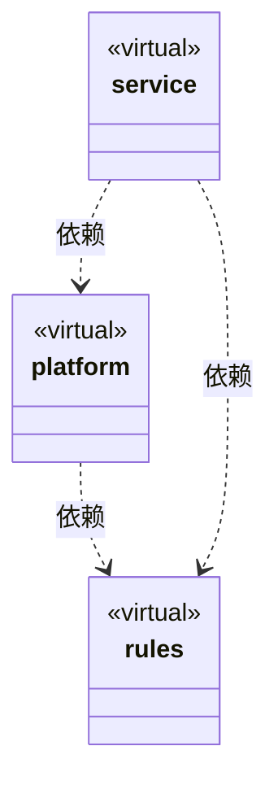

# src/logic/file-operations 架构

## 设计意图

封装有业务授权的文件操作与隔离执行。规则表达冻结范围和操作事实，服务组织可信流程，平台实现持有原生资源；底层完成不替代业务验收。

## 主要组成

本层由下列子模块组合，每个子模块作为独立的虚拟类封装参与本层协作。

<!-- architecture:generated:start -->

## 架构关系

标注为 `virtual` 的节点是直接子模块的虚拟类封装；内部设计沿下方入口阅读。

## 子模块

| 虚拟封装 | 整体职责 |
| --- | --- |
| [platform](platform/ARCHITECTURE.md) | 业务文件与隔离执行的平台实现；权限、占位、日志和恢复语义属于受控操作，不抽成通用 Core。 |
| [rules](rules/ARCHITECTURE.md) | 受控文件操作和隔离执行的冻结协议、规则与恢复状态。平台副作用经端口实现，不因物理目录聚合改变授权、路径校验或证据效力。 |
| [service](service/ARCHITECTURE.md) | 受控文件操作与隔离执行的应用服务，连接冻结授权、工作区身份与 platform 实现；不把底层完成当业务验收。 所有受控文件与删除/移动操作继续拒绝安装、用户及独立 R/E 缓存根。 |

[上层设计](../ARCHITECTURE.md)

<!-- architecture:generated:end -->
