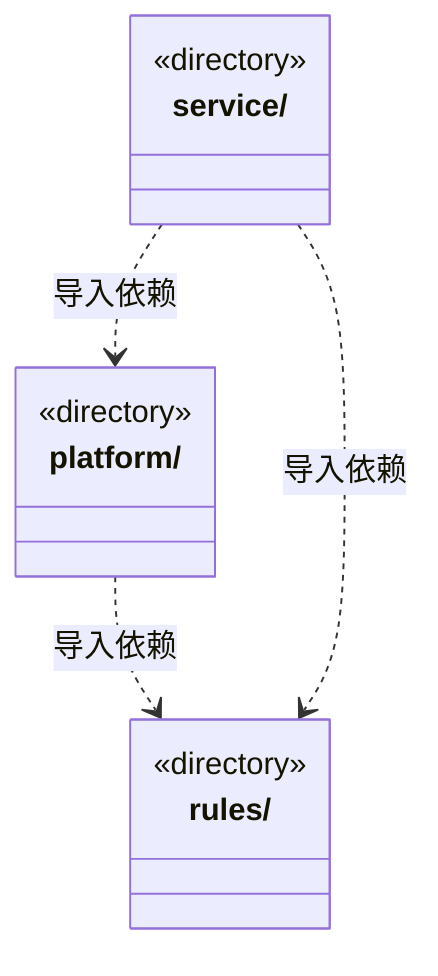

# src/logic/file-operations 架构

## 目录定位

受控文件效果、操作凭据和补偿规则；服务与规则分开归属，实际依赖通过明确入口验证。

本文描述当前实现。通过分析目录边界后维护的 [源码架构脚本](../../../scripts/source-architecture.mjs) 同步清单和声明；代码变更时仍须核对职责、关键成员与关系。

## 代码清单

本层无直接代码文件。

## 架构类图

各图中的同名节点表示同一目录边界；跨组及完整直接依赖如下（无边不代表继承）：

- `platform` → `rules`：导入。
- `service` → `platform`：导入。
- `service` → `rules`：导入。

## 子目录导航

- [platform/](platform/ARCHITECTURE.md)：业务文件与隔离执行的平台实现；权限、占位、日志和恢复语义属于受控操作，不抽成通用 Core。
- [rules/](rules/ARCHITECTURE.md)：受控文件操作和隔离执行的冻结协议、规则与恢复状态。平台副作用经端口实现，不因物理目录聚合改变授权、路径校验或证据效力。
- [service/](service/ARCHITECTURE.md)：受控文件操作与隔离执行的应用服务，连接冻结授权、工作区身份与 platform 实现；不把底层完成当业务验收。 所有受控文件与删除/移动操作继续拒绝安装、用户及独立 R/E 缓存根。

[返回上层](../ARCHITECTURE.md)。

每次修改本目录代码，同步维护文件头、关键契约说明及本图。未实现的治理、证据验收和自动编排能力不列入当前类图。
