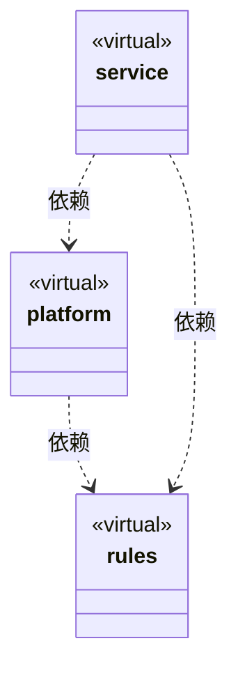

# src/logic/file-operations 架构

## 设计意图

对有明确业务授权的文件写入、删除移动和隔离执行提供完整的可信操作边界。

`rules` 定义冻结范围及操作阶段，`service` 组合工作区和持久事实，`platform` 实施真实文件与进程操作。业务许可、平台完成、证据保存和业务验收分别表达，不能因底层函数返回就合并为成功。

## 主要组成

本层没有直接产品实现，由下方子模块组成；每个直接子模块作为一个虚拟封装，只在本层呈现整体职责与协作。

<!-- architecture:generated:start -->

## 架构关系

标注为 `virtual` 的节点是直接子模块的虚拟类封装；内部设计沿下方入口阅读。

## 子模块

| 虚拟封装 | 整体职责 |
| --- | --- |
| [platform](platform/ARCHITECTURE.md) | 隔离受控文件和执行进程的操作系统实现，同时保留业务授权所要求的资源证据。 |
| [rules](rules/ARCHITECTURE.md) | 定义受控文件操作、隔离执行及其恢复的纯协议和不变量，统一实时提交与历史核验。 |
| [service](service/ARCHITECTURE.md) | 将工作区身份、运行许可、持久记录与平台操作连接成可信文件用例。 |

[上层设计](../ARCHITECTURE.md)

<!-- architecture:generated:end -->
