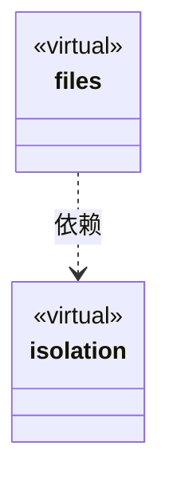

# src/logic/file-operations/platform 架构

## 设计意图

隔离受控文件和执行进程的操作系统实现，同时保留业务授权所要求的资源证据。

`files` 管理安全读取、写入字节、文件句柄和观察，`isolation` 管理冻结输入、LPAC/Job 及恢复清理。它们通过声明的端口向服务返回事实；Bridge 只提供宿主传输，不转移本域的范围与恢复责任。

## 主要组成

本层没有直接产品实现，由下方子模块组成；每个直接子模块作为一个虚拟封装，只在本层呈现整体职责与协作。

<!-- architecture:generated:start -->

## 架构关系

标注为 `virtual` 的节点是直接子模块的虚拟类封装；内部设计沿下方入口阅读。

## 子模块

| 虚拟封装 | 整体职责 |
| --- | --- |
| [files](files/ARCHITECTURE.md) | 在固定工作区范围内操作与观察真实文件，为受控写入、产物采集和验证提供同字节依据。 |
| [isolation](isolation/ARCHITECTURE.md) | 把冻结程序输入接到 Win32 隔离进程，并保存可用于退出后核实与清理的真实资源身份。 |

[上层设计](../ARCHITECTURE.md)

<!-- architecture:generated:end -->
