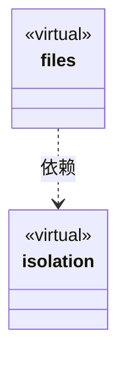

# src/logic/file-operations/platform 架构

## 设计意图

业务文件与隔离执行的平台实现；权限、占位、日志和恢复语义属于受控操作，不抽成通用 Core。

## 主要组成

本层由下列子模块组合，每个子模块作为独立的虚拟类封装参与本层协作。

<!-- architecture:generated:start -->

## 架构关系

标注为 `virtual` 的节点是直接子模块的虚拟类封装；内部设计沿下方入口阅读。

## 子模块

| 虚拟封装 | 整体职责 |
| --- | --- |
| [files](files/ARCHITECTURE.md) | 受控文件的 Win32 操作、子进程协议、冻结内容和产物读取验证；传输由 Bridge 注入，不能用取消代替物理退出。 |
| [isolation](isolation/ARCHITECTURE.md) | 隔离进程、冻结输入、Win32 Job 与 LPAC 恢复；核实原进程与日志，不重建未知执行。 |

[上层设计](../ARCHITECTURE.md)

<!-- architecture:generated:end -->
