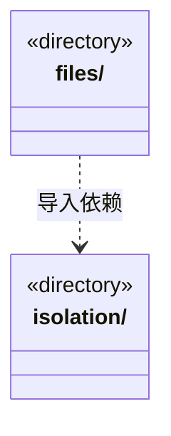

# src/logic/file-operations/platform 架构

## 目录定位

业务文件与隔离执行的平台实现；权限、占位、日志和恢复语义属于受控操作，不抽成通用 Core。

本文描述当前实现。通过分析目录边界后维护的 [源码架构脚本](../../../../scripts/source-architecture.mjs) 同步清单和声明；代码变更时仍须核对职责、关键成员与关系。

## 代码清单

本层无直接代码文件。

## 架构类图

各图中的同名节点表示同一目录边界；跨组及完整直接依赖如下（无边不代表继承）：

- `files` → `isolation`：导入。

## 子目录导航

- [files/](files/ARCHITECTURE.md)：受控文件的 Win32 操作、子进程协议、冻结内容和产物读取验证；传输由 Bridge 注入，不能用取消代替物理退出。
- [isolation/](isolation/ARCHITECTURE.md)：隔离进程、冻结输入、Win32 Job 与 LPAC 恢复；核实原进程与日志，不重建未知执行。

[返回上层](../ARCHITECTURE.md)。

每次修改本目录代码，同步维护文件头、关键契约说明及本图。未实现的治理、证据验收和自动编排能力不列入当前类图。
