# src/logic/file-operations/platform/files 架构

本目录只维护这一份说明。设计与契约直接编辑本文；文件清单、类图和导航由 [架构脚本](../../../../../scripts/source-architecture.mjs) 更新，生成区域之外的人工说明会保留。

## 封装意图

受控文件的 Win32 操作、子进程协议、冻结内容和产物读取验证；传输由 Bridge 注入，不能用取消代替物理退出。

## 类与模块的设计意图

下表依据源码声明及文件头说明定位封装。字段表示该实例持有的状态或协作引用，不表示它拥有被引用服务的生命周期；实际资源责任和调用限制见下文契约及源码注释。

| 类／模块 | 实现形式与实例字段 | 封装依据 |
| --- | --- | --- |
| [ArtifactFiles](artifact-files.ts) | 实例类；持有 `root`、`assert`、`secureRead` | 工作区所有者固定 root 和 assert；调用中的 paths 仍须全部通过平台检查，不能按来源回执跳过。 |
| [CodeCheckRunner](code-check-runner.ts) | 实例类；持有 `manifests`、`root`、`assertCurrent` | 每次调用均核实工作区实例；不继承模型传入的 cwd、环境变量或 shell 文本。 |
| [ControlledFileBlobs](controlled-file-blobs.ts) | 实例类；持有 `tail`、`directory` | 业务写之前两份字节必须 fsync；孤儿文件也占实际容量，不清理历史或把未知保存当未保存。 |
| [controlled-file-protocol.ts](controlled-file-protocol.ts) | 函数／契约模块 | 每个子进程只持有一次内容替换或文件删除/移动；打开时冻结操作种类，正文和句柄不进入公开 DTO，不能改用另一种副作用。 |
| [Win32ControlledFile](controlled-file-win32.ts) | 实例类；持有 `koffi`、`api`、`handles`、`file`、`applied`、`original`、`writeIssued`、`root`、`relativePath`、`namespaceChange`、`readOnly`、`directoryOnly` | 同一个对象只可 apply 一次；CloseHandle 失败保留句柄，进程退出由父级另行确认。 |
| [OutputManifestFiles](output-manifest-files.ts) | 实例类；持有 `files`、`root`、`assert`、`guarded` | 生命周期和工作区根由主进程冻结；调用者不能以工具参数更换根或略过条目。 |
| [png-validator.ts](png-validator.ts) | 函数／契约模块 | 签名或IHDR合法不代表文件可解码；只解释明确子集，未知扩展不能被静默忽略后签发通过。 |
| [ScopedExecutionFiles](scoped-execution-files.ts) | 实例类；持有 `scope`、`unsettled`、`cleanupRetries`、`koffiPath`、`root`、`assertCurrent`、`protectedRoots`、`lifecycle` | 每个成员 run 创建独立对象；scope 不向模型写入，调用前后均复核原工作区仍有效。 |

## 接口设计契约

- [artifact-files.ts](artifact-files.ts)：职责边界：不运行命令、不读取目录或知识库、不返回文件正文；外部并发修改仅尽力检测，不构成操作系统沙箱或原子快照。
- [code-check-runner.ts](code-check-runner.ts)：职责边界：这是需要 command 授权的宿主进程，不是沙箱；未知退出不产生成功证明。范围只覆盖显式声明的输入。
- [controlled-file-blobs.ts](controlled-file-blobs.ts)：保存受控写入的私有 before/intended-after 字节，公开回执只引用 UUID 与哈希。
- [controlled-file-protocol.ts](controlled-file-protocol.ts)：Main 与专用文件 utility 子进程之间的严格私有消息及不透明会话端口。
- [controlled-file-win32.ts](controlled-file-win32.ts)：写入边界：同句柄内容替换、删除标记或不覆盖移动均只发一次；命名空间操作另拒绝备用流，失败绝不自行恢复 before。
- [output-manifest-files.ts](output-manifest-files.ts)：职责边界：不忽略、不分页截断、不读取正文给模型；拒绝链接和特殊对象。前后检查尽力识别外部竞争，不是操作系统沙箱或原子快照。
- [png-validator.ts](png-validator.ts)：职责边界：不做文件I/O、图像显示、色彩转换或视觉判断；像素只留本次内存，平台调用方继续核停止与文件身份。
- [scoped-execution-files.ts](scoped-execution-files.ts)：职责边界：单文件1MiB、总输入8MiB；输出不回写。未知物理清理保留占用，不能用工具失败当作实际进程退出。

## 开闭边界

本目录的职责及允许协作由[封装意图](#封装意图)限定，输入输出、状态与失败语义以[接口设计契约](#接口设计契约)为准。扩展从已有公开入口及实际装配位置进入；没有明确可替换契约的部分按真实影响修改和验证，不预建未使用的基类或插件入口。

<!-- architecture:generated:start -->

## 文件清单

| 文件 | 形式 | 当前职责 |
| --- | --- | --- |
| [ARCHITECTURE.md](ARCHITECTURE.md) | 说明文档 | 本目录的文件清单、真实声明、依赖与子封装导航。 |
| [artifact-files.ts](artifact-files.ts) | 源码模块 | 在固定工作区根内安全读取业务文件，供指纹采集、复核、无基线观察及冻结 JSON/CSV/PNG 验证共用。 |
| [code-check-runner.ts](code-check-runner.ts) | 源码模块 | 在已打开的本地工作区执行冻结代码检查，复用完整目录枚举核实前后源码集合。 |
| [controlled-file-blobs.ts](controlled-file-blobs.ts) | 源码模块 | 保存受控写入的私有 before/intended-after 字节，公开回执只引用 UUID 与哈希。 |
| [controlled-file-protocol.ts](controlled-file-protocol.ts) | 源码模块 | Main 与专用文件 utility 子进程之间的严格私有消息及不透明会话端口。 |
| [controlled-file-win32.ts](controlled-file-win32.ts) | 源码模块 | 专用 utility 子进程的同步 Win32 单文件实现；全程拥有文件及目录句柄。 |
| [output-manifest-files.ts](output-manifest-files.ts) | 源码模块 | 在固定工作区内枚举声明范围的全部目录和普通文件，生成完整产物观察并按原集合复核。 |
| [png-validator.ts](png-validator.ts) | 源码模块 | 安全文件端口后的有界静态 PNG 解码器，核全部块及压缩数据并还原实际像素。 |
| [scoped-execution-files.ts](scoped-execution-files.ts) | 源码模块 | 正式成员冻结范围的实际 Win32 文件读取与 LPAC 执行端口。 |

## 架构类图

成员标记：`+` 公开、`-` 私有、`#` 受保护、`$` 静态；构造函数单独列出。文档和资源仅在文件清单中导航，不作为代码节点。

### artifact-files.ts

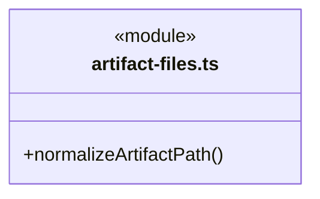

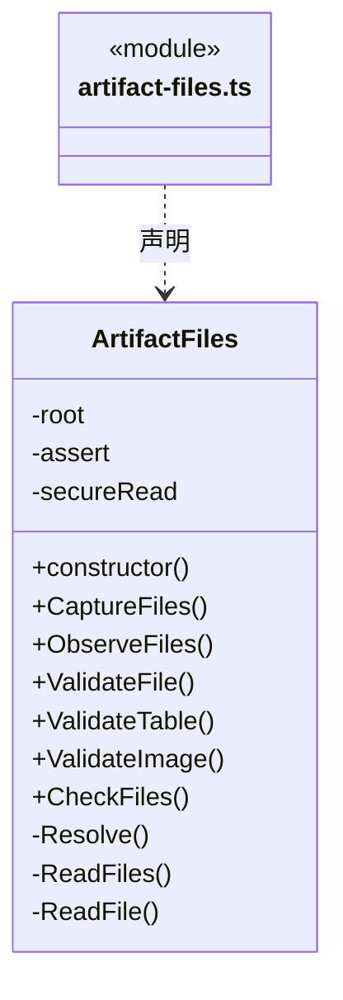

直接依赖：[../../../../core/errors.ts](../../../../core/errors.ts)、[../../../evidence/rules/artifact-baseline.ts](../../../evidence/rules/artifact-baseline.ts)、[../../../workspace/rules/json-validation-schema.ts](../../../workspace/rules/json-validation-schema.ts)、[../../../workspace/rules/csv-validation-schema.ts](../../../workspace/rules/csv-validation-schema.ts)、[../../../workspace/rules/png-validation-schema.ts](../../../workspace/rules/png-validation-schema.ts)、[png-validator.ts](png-validator.ts)、[../../../tasks/rules/effect-observation.ts](../../../tasks/rules/effect-observation.ts)。

### code-check-runner.ts

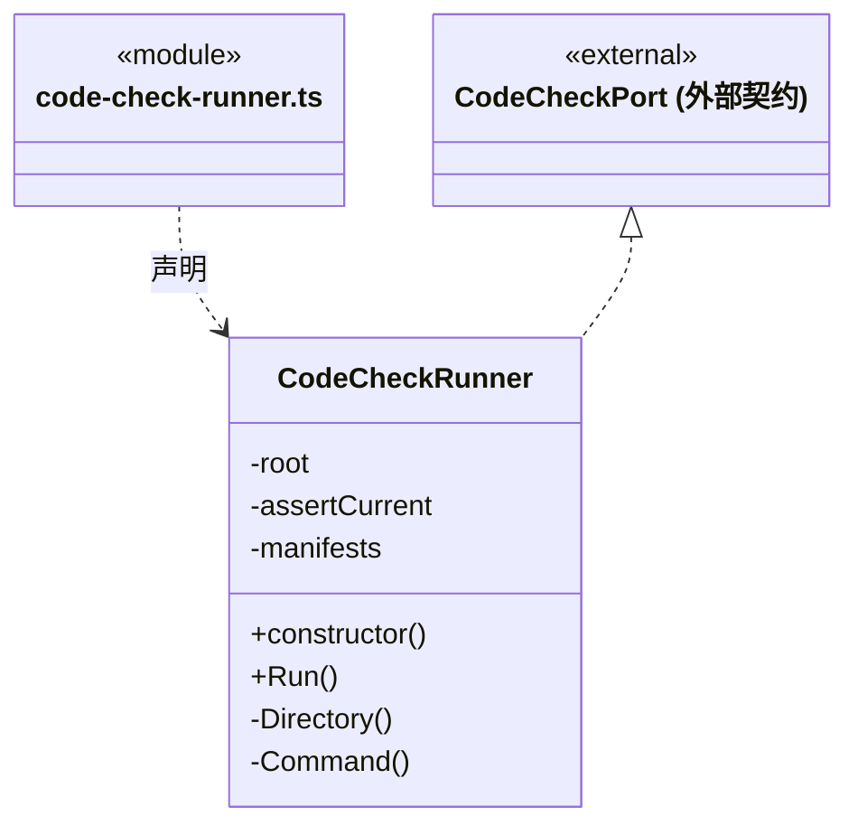

直接依赖：[../../../../core/platform/node/serialization.ts](../../../../core/platform/node/serialization.ts)、[../../../../core/errors.ts](../../../../core/errors.ts)、[../../../workspace/rules/code-check.ts](../../../workspace/rules/code-check.ts)、[../../../evidence/rules/code-check.ts](../../../evidence/rules/code-check.ts)、[../../../evidence/rules/output-manifest-evidence.ts](../../../evidence/rules/output-manifest-evidence.ts)、[output-manifest-files.ts](output-manifest-files.ts)。

### controlled-file-blobs.ts

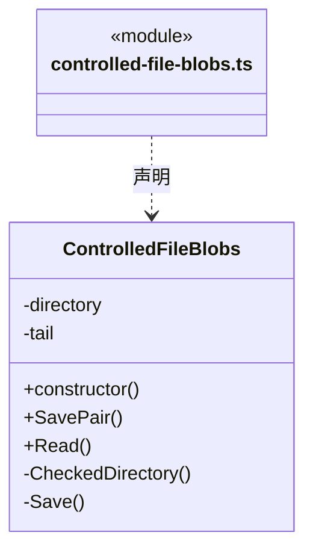

直接依赖：[../../../../core/errors.ts](../../../../core/errors.ts)、[../../rules/controlled-file-operation.ts](../../rules/controlled-file-operation.ts)、[../../rules/controlled-file-event.ts](../../rules/controlled-file-event.ts)。

### controlled-file-protocol.ts

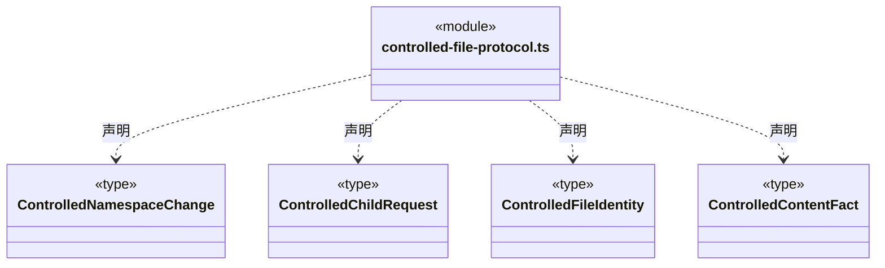

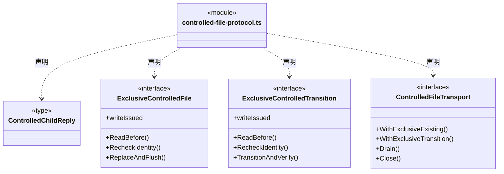

### controlled-file-win32.ts

成员 1/2（同名节点为同一声明，跨图合并阅读）。

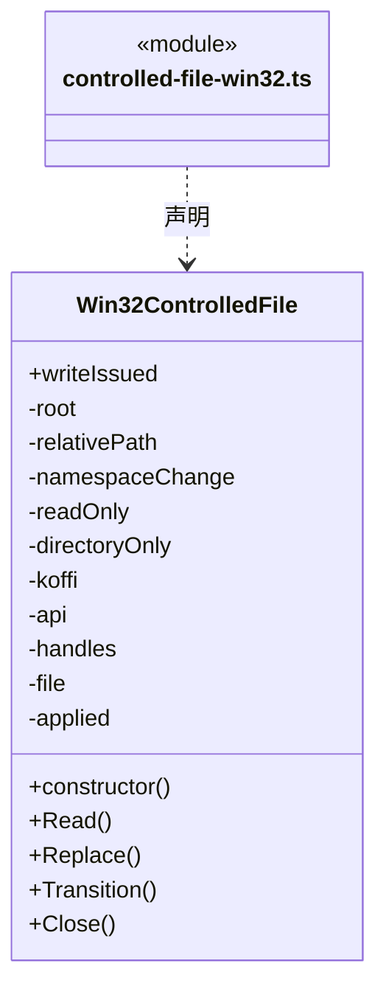

成员 2/2（同名节点为同一声明，跨图合并阅读）。

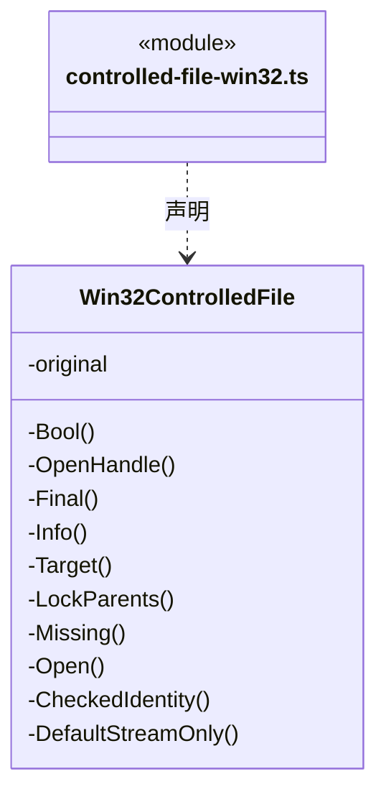

直接依赖：[controlled-file-protocol.ts](controlled-file-protocol.ts)。

### output-manifest-files.ts

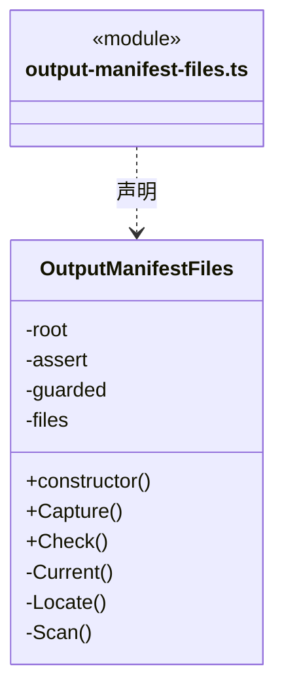

直接依赖：[../../../../core/errors.ts](../../../../core/errors.ts)、[../../../workspace/rules/artifact-scope.ts](../../../workspace/rules/artifact-scope.ts)、[../../../evidence/rules/output-manifest.ts](../../../evidence/rules/output-manifest.ts)、[../../../evidence/rules/output-manifest-evidence.ts](../../../evidence/rules/output-manifest-evidence.ts)、[artifact-files.ts](artifact-files.ts)。

### png-validator.ts

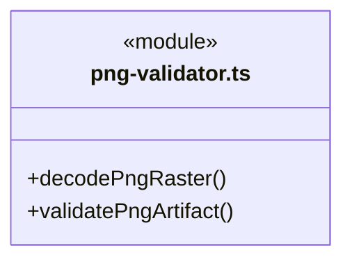

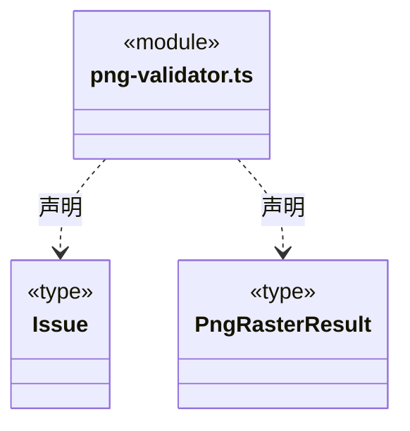

直接依赖：[../../../../core/errors.ts](../../../../core/errors.ts)、[../../../workspace/rules/png-validation-schema.ts](../../../workspace/rules/png-validation-schema.ts)。

### scoped-execution-files.ts

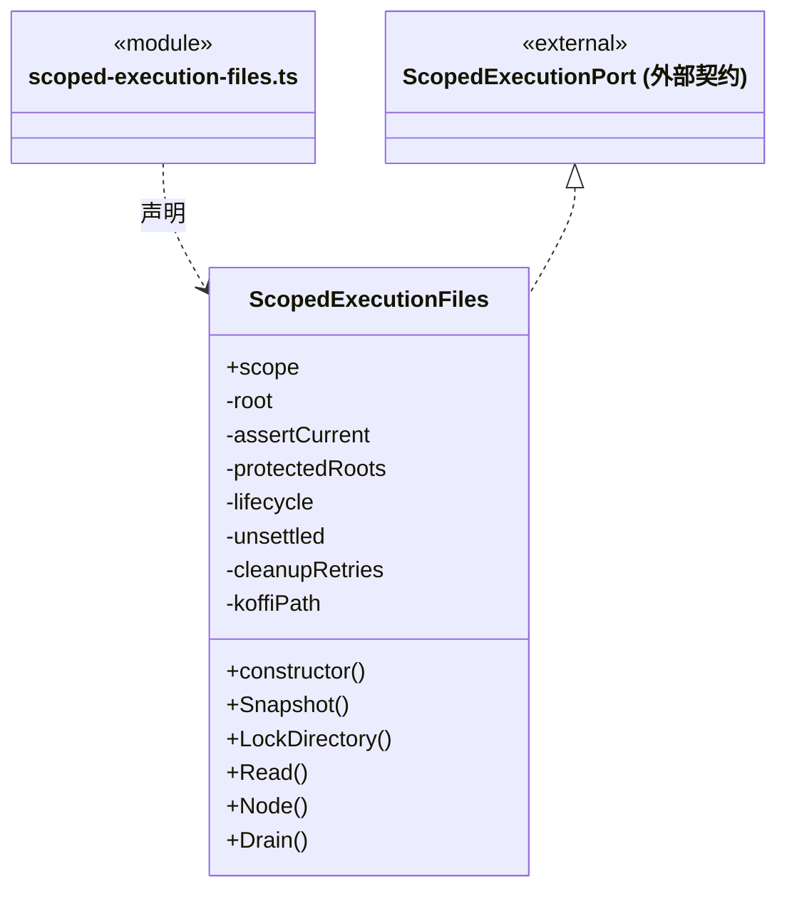

直接依赖：[../../../workspace/rules/execution-scope.ts](../../../workspace/rules/execution-scope.ts)、[../../rules/scoped-execution.ts](../../rules/scoped-execution.ts)、[../../../execution/rules/capabilities/run-scoped-execution.ts](../../../execution/rules/capabilities/run-scoped-execution.ts)、[controlled-file-win32.ts](controlled-file-win32.ts)、[../isolation/isolated-node.ts](../isolation/isolated-node.ts)、[../../../../core/errors.ts](../../../../core/errors.ts)、[../../rules/isolated-execution-recovery.ts](../../rules/isolated-execution-recovery.ts)、[../isolation/isolation-record.ts](../isolation/isolation-record.ts)。

### 本目录调用边界

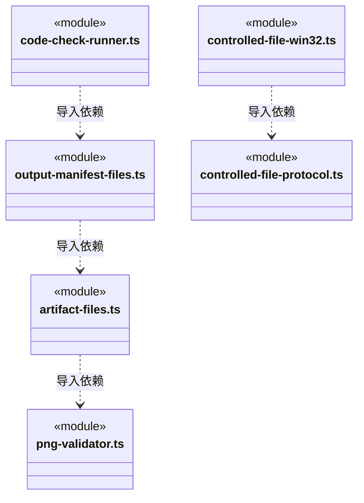

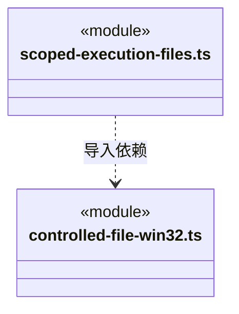

## 子目录导航

无子目录。

[返回上层](../ARCHITECTURE.md)。

每次修改本目录代码，同步维护文件头、关键契约说明及本图。未实现的治理、证据验收和自动编排能力不列入当前类图。

<!-- architecture:generated:end -->
