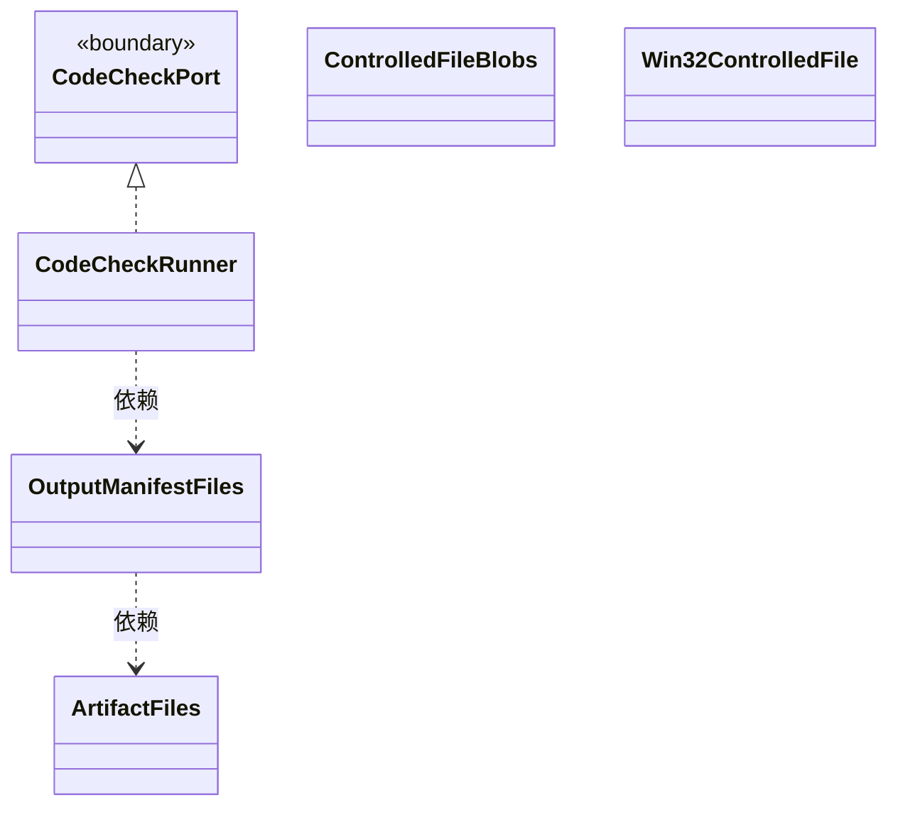
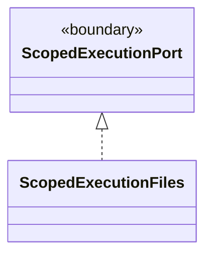

# src/logic/file-operations/platform/files 架构

## 设计意图

受控文件的 Win32 操作、子进程协议、冻结内容和产物读取验证；传输由 Bridge 注入，不能用取消代替物理退出。

## 主要组成

| 组成 | 定位 |
| --- | --- |
| [ArtifactFiles](artifact-files.ts) | 在固定工作区根内安全读取业务文件，供指纹采集、复核、无基线观察及冻结 JSON/CSV/PNG 验证共用。 |
| [CodeCheckRunner](code-check-runner.ts) | 在已打开的本地工作区执行冻结代码检查，复用完整目录枚举核实前后源码集合。 |
| [ControlledFileBlobs](controlled-file-blobs.ts) | 保存受控写入的私有 before/intended-after 字节，公开回执只引用 UUID 与哈希。 |
| [Win32ControlledFile](controlled-file-win32.ts) | 专用 utility 子进程的同步 Win32 单文件实现；全程拥有文件及目录句柄。 |
| [OutputManifestFiles](output-manifest-files.ts) | 在固定工作区内枚举声明范围的全部目录和普通文件，生成完整产物观察并按原集合复核。 |
| [ScopedExecutionFiles](scoped-execution-files.ts) | 正式成员冻结范围的实际 Win32 文件读取与 LPAC 执行端口。 |

<!-- architecture:generated:start -->

## 架构关系

### 关系组 1

### 关系组 2

### 跨图协作

- [ScopedExecutionFiles](scoped-execution-files.ts)（图 2）→ [Win32ControlledFile](controlled-file-win32.ts)（图 1）：依赖。

外部继承／实现边界：[CodeCheckPort](../../../evidence/rules/code-check.ts)、[ScopedExecutionPort](../../../execution/rules/capabilities/run-scoped-execution.ts)。

[上层设计](../ARCHITECTURE.md)

<!-- architecture:generated:end -->
