# src/logic/file-operations/platform/isolation 架构

本目录只维护这一份说明。设计与契约直接编辑本文；文件清单、类图和导航由 [架构脚本](../../../../../scripts/source-architecture.mjs) 更新，生成区域之外的人工说明会保留。

## 封装意图

隔离进程、冻结输入、Win32 Job 与 LPAC 恢复；核实原进程与日志，不重建未知执行。

## 类与模块的设计意图

下表依据源码声明及文件头说明定位封装。字段表示该实例持有的状态或协作引用，不表示它拥有被引用服务的生命周期；实际资源责任和调用限制见下文契约及源码注释。

| 类／模块 | 实现形式与实例字段 | 封装依据 |
| --- | --- | --- |
| [isolated-node-protocol.ts](isolated-node-protocol.ts) | 函数／契约模块 | 传入已读取的字节快照而非业务路径，避免原工程 ACL 被扩权；本协议不签发任务权限或业务验证通过。 |
| [Win32IsolatedNode](isolated-node-win32.ts) | 实例类；持有 `k`、`api`、`sid`、`capability`、`allocated`、`handles`、`attributes`、`job`、`process`、`thread`、`pipe`、`writePipe`、`profileCreated`、`used`、`resumed`、`pins`、`jobName`、`capabilityName`、`ownerSid`、`packageSid`、`profileName` | 一个实例只启动一次；close 只收束原 Job，不启动替代进程，失败可对同实例重试清理。 |
| [isolated-node.ts](isolated-node.ts) | 函数／契约模块 | 原工程不授予沙箱权限；输出只在全部进程退出后读取，异常不重试，清理不明确时不能交付成功。 |
| [isolation-record.ts](isolation-record.ts) | 函数／契约模块 | 原路径、宿主创建时间及所有权随机值不能进入公开工具回包；生命周期必须先落盘再启动脚本。 |
| [FileIsolationRecords](isolation-records.ts) | 实例类；持有 `tail`、`failure`、`directory` | 宿主崩溃后仍须区分原任务资源和同名临时目录；fsync 后才允许下一项外部操作。 |
| [Win32IsolationRecovery](isolation-recovery-win32.ts) | 实例类；持有 `k`、`api` | 按需装配固定第三方库；所有私有路径与名称必须来自原可靠记录。 |

## 接口设计契约

- [isolated-node-protocol.ts](isolated-node-protocol.ts)：声明平台隔离执行器的有界输入与返回事实，供可信装配和独立平台验收使用。
- [isolated-node-win32.ts](isolated-node-win32.ts)：支持范围：Windows x64，固定 registryRead capability，禁止网络 capabilities；仅给调用方新建的私有暂存目录赋权。
- [isolated-node.ts](isolated-node.ts)：职责边界：本文件不签发模型工具或任务权限；允许系统 LPAC 资源及 registryRead，不宣称完全隔绝所有 Windows 对象或磁盘硬配额。
- [isolation-record.ts](isolation-record.ts)：Main 私有的隔离资源身份和生命周期协议，连接执行器、可靠记录与核实平台。
- [isolation-records.ts](isolation-records.ts)：职责边界：工作区唯一锁由上层持有；读取不创建目录、修复尾部或重放程序，损坏日志保持不可核实。
- [isolation-recovery-win32.ts](isolation-recovery-win32.ts)：职责边界：不终止按 PID 查到的进程、不创建 profile、不重跑程序；目录链接或扫描超限均拒绝清理。

## 开闭边界

本目录的职责及允许协作由[封装意图](#封装意图)限定，输入输出、状态与失败语义以[接口设计契约](#接口设计契约)为准。扩展从已有公开入口及实际装配位置进入；没有明确可替换契约的部分按真实影响修改和验证，不预建未使用的基类或插件入口。

<!-- architecture:generated:start -->

## 文件清单

| 文件 | 形式 | 当前职责 |
| --- | --- | --- |
| [ARCHITECTURE.md](ARCHITECTURE.md) | 说明文档 | 本目录的文件清单、真实声明、依赖与子封装导航。 |
| [isolated-node-protocol.ts](isolated-node-protocol.ts) | 源码模块 | 声明平台隔离执行器的有界输入与返回事实，供可信装配和独立平台验收使用。 |
| [isolated-node-win32.ts](isolated-node-win32.ts) | 源码模块 | 以 Win32 LPAC Token、显式 ACL 和 Job Object 启动并收束真实程序，属于 Main 平台边界。 |
| [isolated-node.ts](isolated-node.ts) | 源码模块 | 复制可信字节快照与本机执行器到私有目录，用宿主预置标准流执行有界 LPAC 程序并返回真实平台事实。 |
| [isolation-record.ts](isolation-record.ts) | 源码模块 | Main 私有的隔离资源身份和生命周期协议，连接执行器、可靠记录与核实平台。 |
| [isolation-records.ts](isolation-records.ts) | 源码模块 | 原隔离执行的私有追加记录，保存启动前来源与资源清理阶段。 |
| [isolation-recovery-win32.ts](isolation-recovery-win32.ts) | 源码模块 | 核实原宿主创建身份、命名 Job 和自有目录，并以固定 Win32 句柄回收残留。 |

## 架构类图

成员标记：`+` 公开、`-` 私有、`#` 受保护、`$` 静态；构造函数单独列出。文档和资源仅在文件清单中导航，不作为代码节点。

### isolated-node-protocol.ts

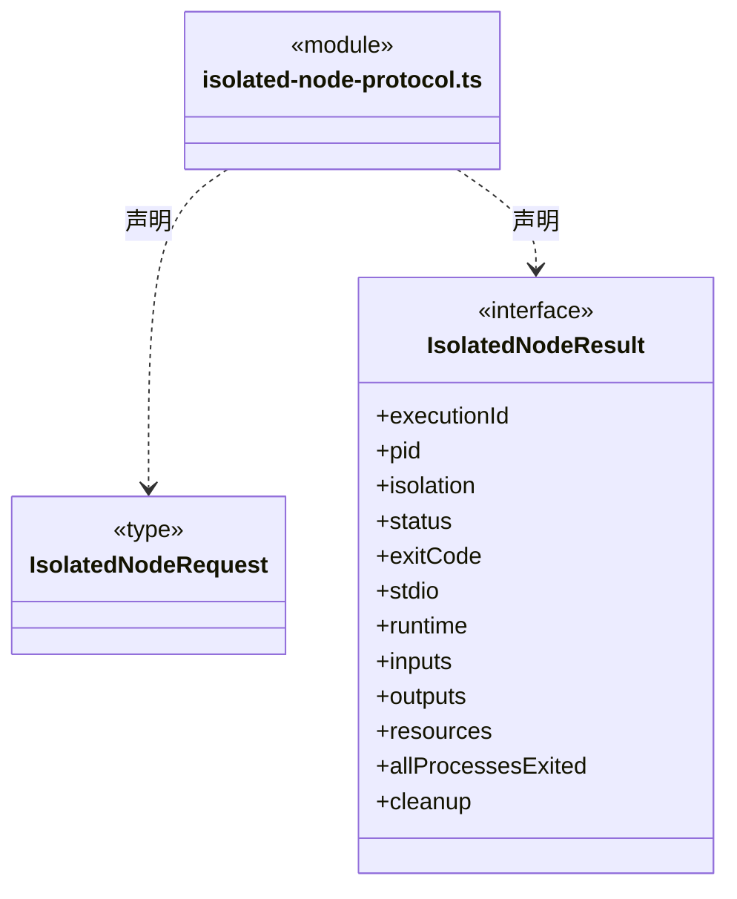

### isolated-node-win32.ts

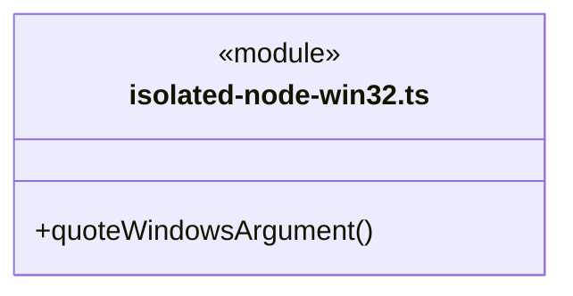

成员 1/3（同名节点为同一声明，跨图合并阅读）。

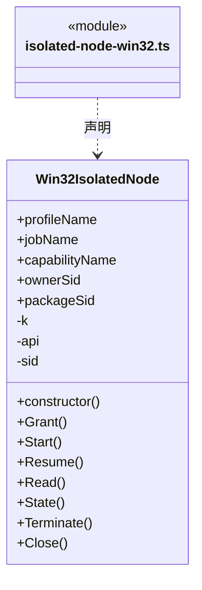

成员 2/3（同名节点为同一声明，跨图合并阅读）。

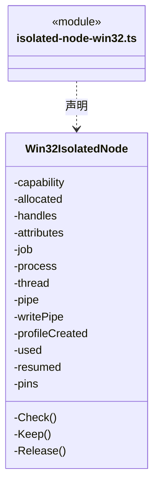

成员 3/3（同名节点为同一声明，跨图合并阅读）。

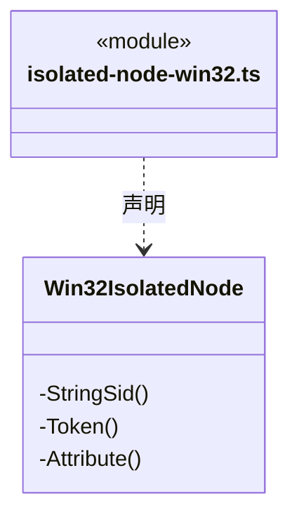

### isolated-node.ts

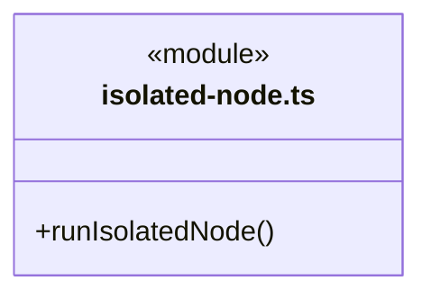

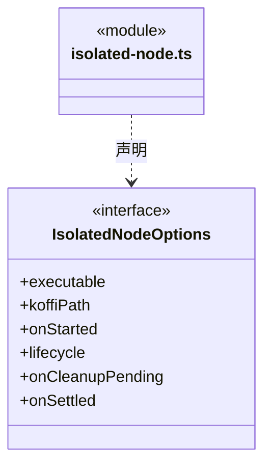

直接依赖：[isolated-node-win32.ts](isolated-node-win32.ts)、[isolation-recovery-win32.ts](isolation-recovery-win32.ts)、[isolation-record.ts](isolation-record.ts)、[isolated-node-protocol.ts](isolated-node-protocol.ts)。

### isolation-record.ts

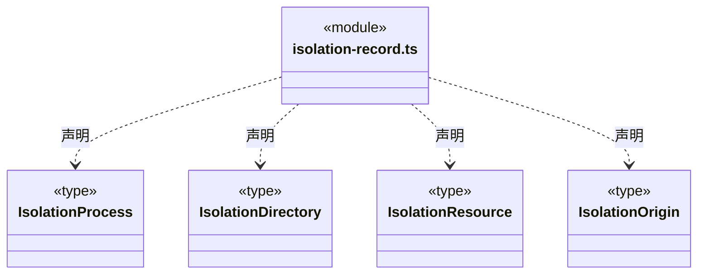

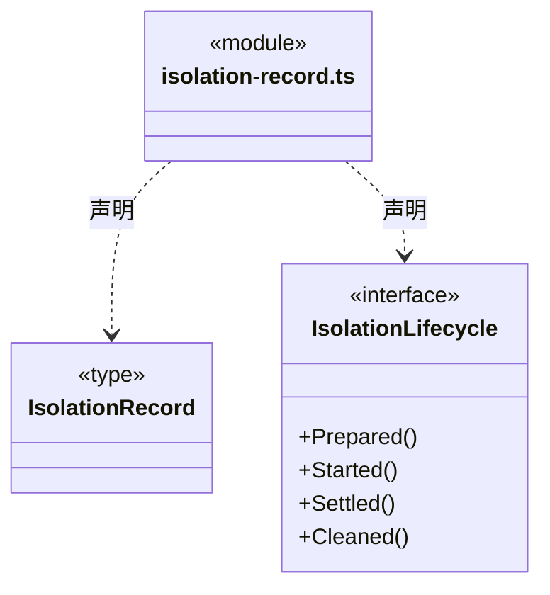

直接依赖：[../../rules/controlled-file-operation.ts](../../rules/controlled-file-operation.ts)、[../../rules/isolated-execution-recovery.ts](../../rules/isolated-execution-recovery.ts)。

### isolation-records.ts

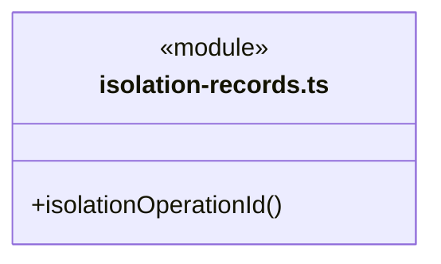

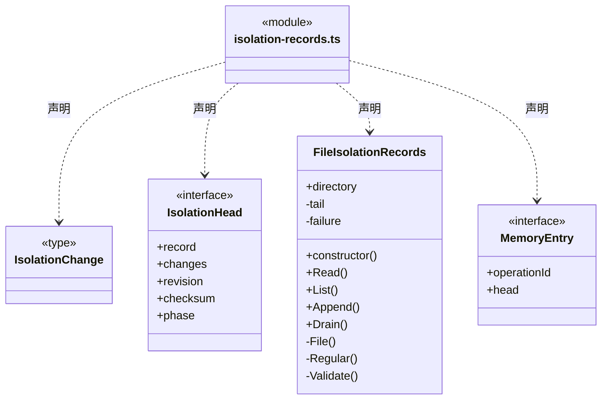

直接依赖：[../../../../core/platform/node/serialization.ts](../../../../core/platform/node/serialization.ts)、[../../../execution/ports/identity.ts](../../../execution/ports/identity.ts)、[../../../../core/errors.ts](../../../../core/errors.ts)、[isolation-record.ts](isolation-record.ts)。

### isolation-recovery-win32.ts

成员 1/2（同名节点为同一声明，跨图合并阅读）。

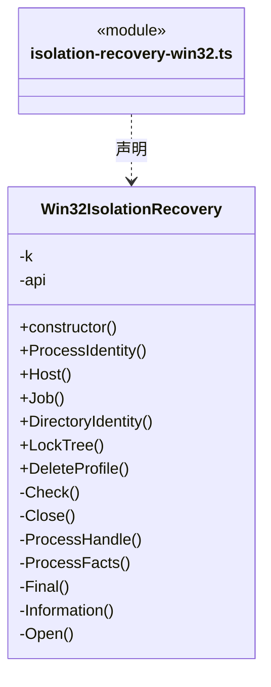

成员 2/2（同名节点为同一声明，跨图合并阅读）。

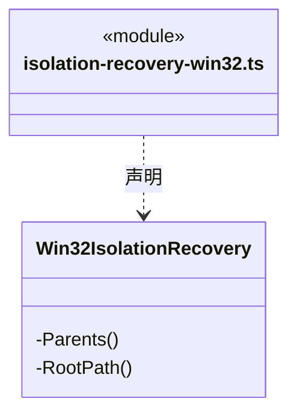

直接依赖：[isolation-record.ts](isolation-record.ts)。

### 本目录调用边界

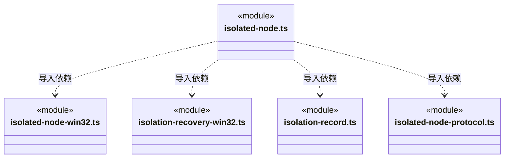

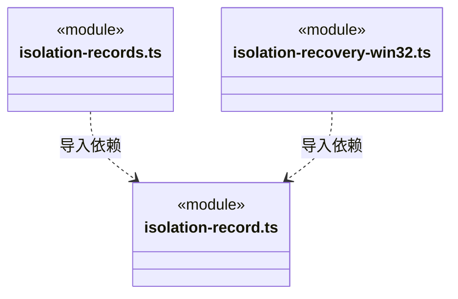

## 子目录导航

无子目录。

[返回上层](../ARCHITECTURE.md)。

每次修改本目录代码，同步维护文件头、关键契约说明及本图。未实现的治理、证据验收和自动编排能力不列入当前类图。

<!-- architecture:generated:end -->
