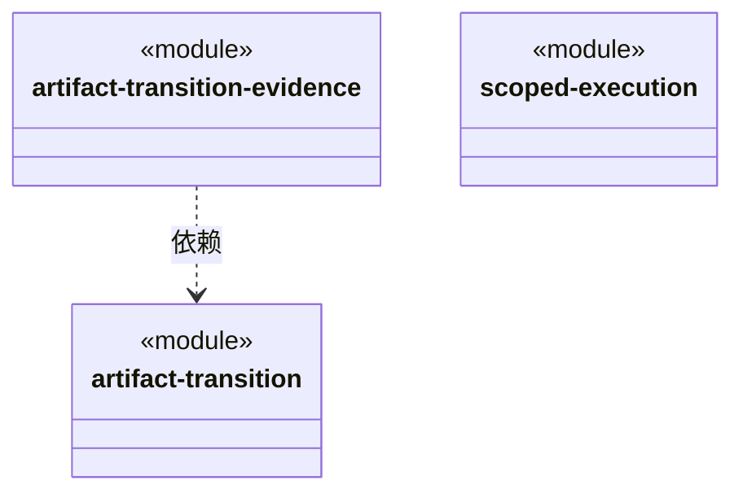

# src/logic/file-operations/rules 架构

## 设计意图

保存工具协议引用的文件操作与受控执行声明。实际 Office 文件和命令入口位于 Bridge 桌面工具，声明本身不授予权限。

## 主要组成

| 组成 | 定位 |
| --- | --- |
| [artifact-transition-evidence](artifact-transition-evidence.ts) | 从原完整清单、实际操作阶段与成功工具回执重建文件删除/移动证明，供采集及验收共用。 |
| [artifact-transition](artifact-transition.ts) | 受控产物删除/移动的严格输入、原操作阶段和可公开证明协议，供运行、清单及界面共用。 |
| [scoped-execution](scoped-execution.ts) | 冻结范围成员的受控读取与固定 Node 执行协议，供 Runtime 和平台共享。 |

<!-- architecture:generated:start -->

## 架构关系

[上层设计](../ARCHITECTURE.md)

<!-- architecture:generated:end -->
