# src/logic/file-operations/rules 架构

## 目录定位

受控文件操作和隔离执行的冻结协议、规则与恢复状态。平台副作用经端口实现，不因物理目录聚合改变授权、路径校验或证据效力。

本文描述当前实现。通过分析目录边界后维护的 [源码架构脚本](../../../../scripts/source-architecture.mjs) 同步清单和声明；代码变更时仍须核对职责、关键成员与关系。

## 代码清单

| 文件 | 当前职责 |
| --- | --- |
| [artifact-transition-evidence.ts](artifact-transition-evidence.ts) | 从原完整清单、实际操作阶段与成功工具回执重建文件删除/移动证明，供采集及验收共用。 |
| [artifact-transition.ts](artifact-transition.ts) | 受控产物删除/移动的严格输入、原操作阶段和可公开证明协议，供运行、清单及界面共用。 |
| [controlled-file-event.ts](controlled-file-event.ts) | 保存受控文件操作的私有来源、备份引用及不可变阶段事件。 |
| [controlled-file-invariants.ts](controlled-file-invariants.ts) | 唯一派发 Store 在提交及重放时校验受控文件附录的身份、阶段、回执和容量。 |
| [controlled-file-operation.ts](controlled-file-operation.ts) | 受控单文件写入、原操作报告和本机补偿的公共纯协议，供运行时与 Bridge 共用。 |
| [controlled-file-rules.ts](controlled-file-rules.ts) | 统一受控写与补偿的稳定身份、指纹、阶段回执及公共摘要投影。 |
| [isolated-execution-recovery.ts](isolated-execution-recovery.ts) | 隔离执行的可信调用授权与桌面核实、清理公开协议。 |
| [scoped-execution.ts](scoped-execution.ts) | 冻结范围成员的受控读取与固定 Node 执行协议，供 Runtime 和平台共享。 |

## 架构类图

### artifact-transition-evidence.ts

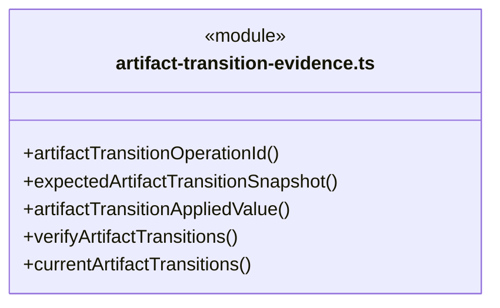

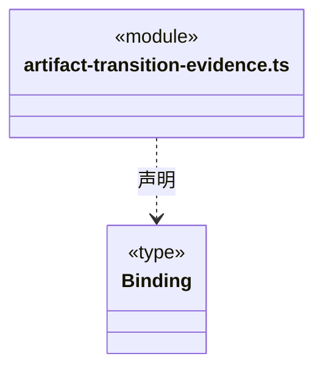

直接依赖：[../../../core/platform/node/serialization.ts](../../../core/platform/node/serialization.ts)、[../../workspace/rules/artifact-scope.ts](../../workspace/rules/artifact-scope.ts)、[../../evidence/rules/artifact-evidence.ts](../../evidence/rules/artifact-evidence.ts)、[../../evidence/rules/output-manifest-identity.ts](../../evidence/rules/output-manifest-identity.ts)、[../../evidence/rules/output-manifest.ts](../../evidence/rules/output-manifest.ts)、[artifact-transition.ts](artifact-transition.ts)。

### artifact-transition.ts

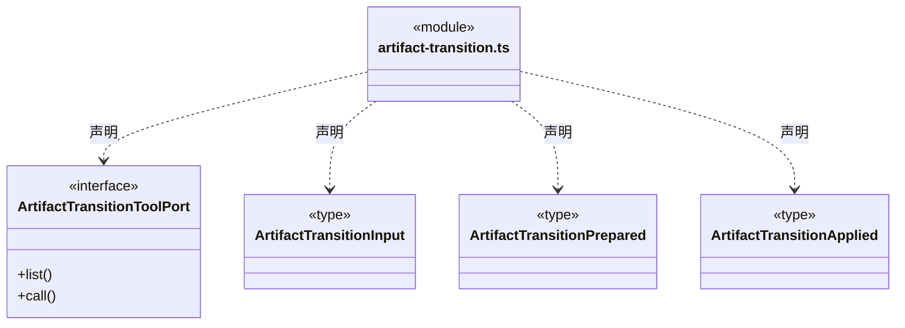

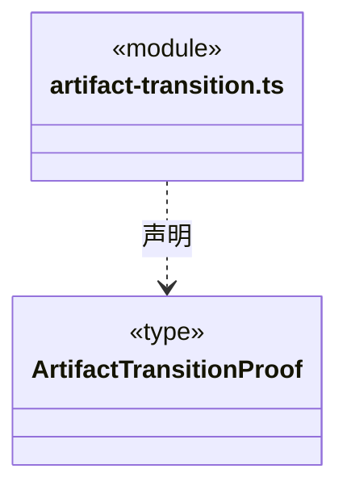

直接依赖：[../../workspace/rules/artifact-scope.ts](../../workspace/rules/artifact-scope.ts)、[../../evidence/rules/artifact-baseline.ts](../../evidence/rules/artifact-baseline.ts)。

### controlled-file-event.ts

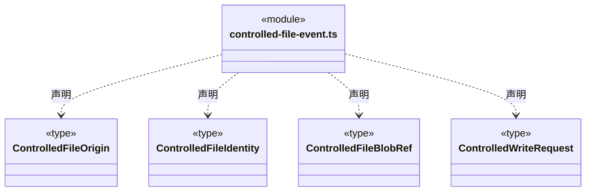

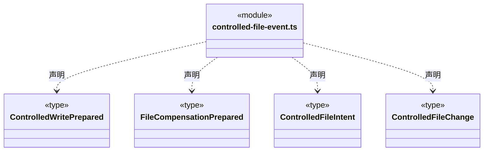

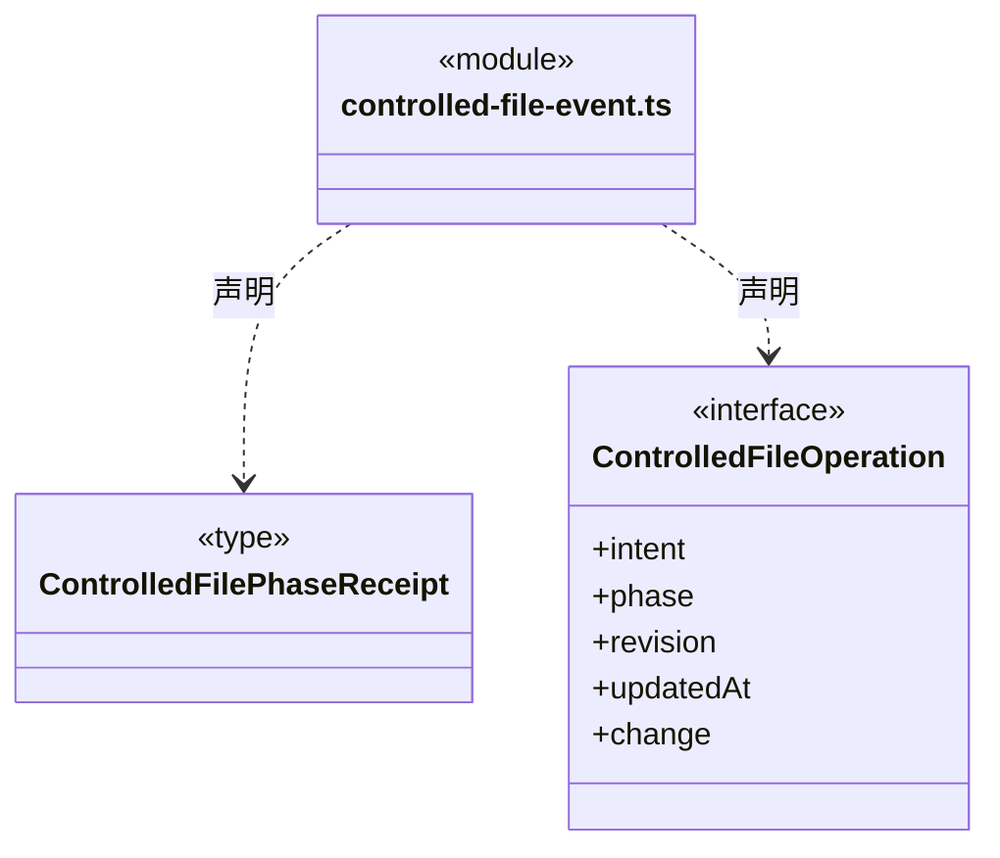

直接依赖：[controlled-file-operation.ts](controlled-file-operation.ts)。

### controlled-file-invariants.ts

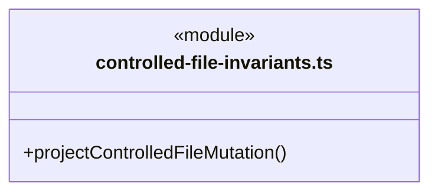

直接依赖：[../../../core/errors.ts](../../../core/errors.ts)、[controlled-file-operation.ts](controlled-file-operation.ts)、[controlled-file-event.ts](controlled-file-event.ts)、[controlled-file-rules.ts](controlled-file-rules.ts)、[../../dispatch/rules/dispatch-storage.ts](../../dispatch/rules/dispatch-storage.ts)。

### controlled-file-operation.ts

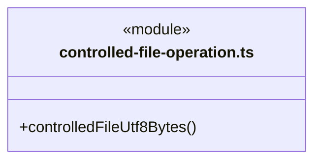

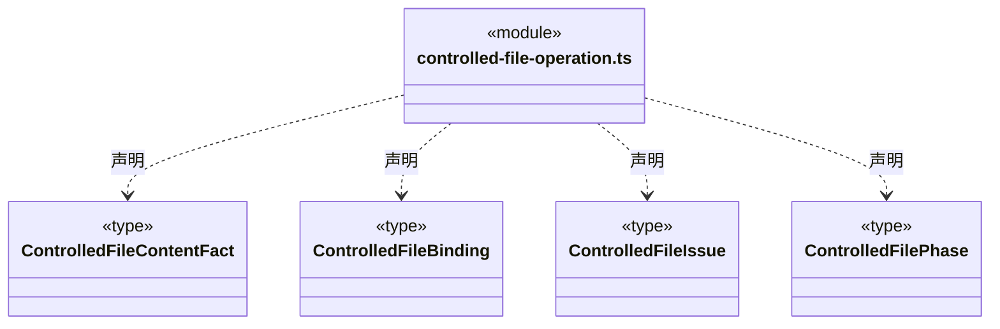

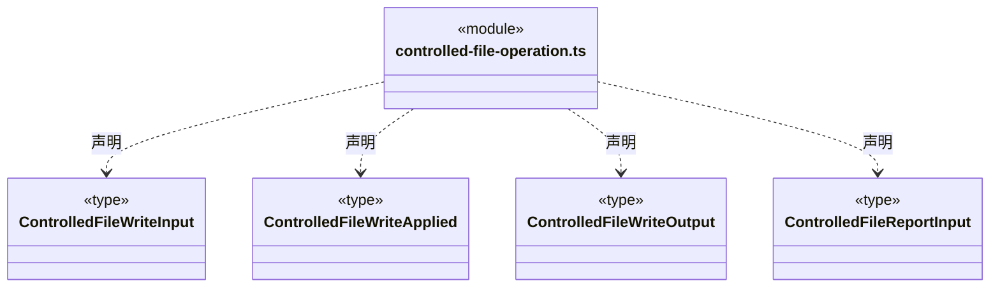

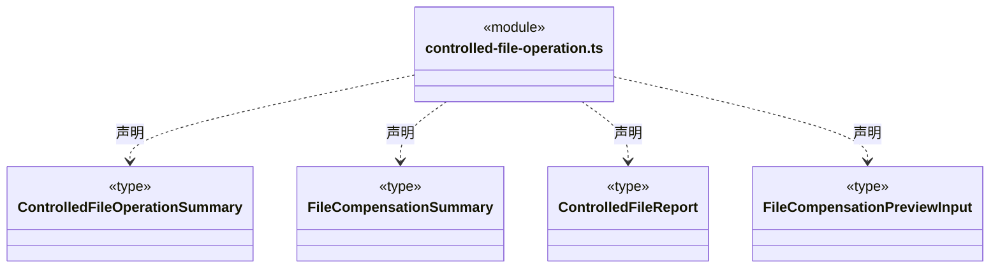

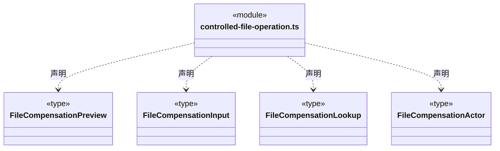

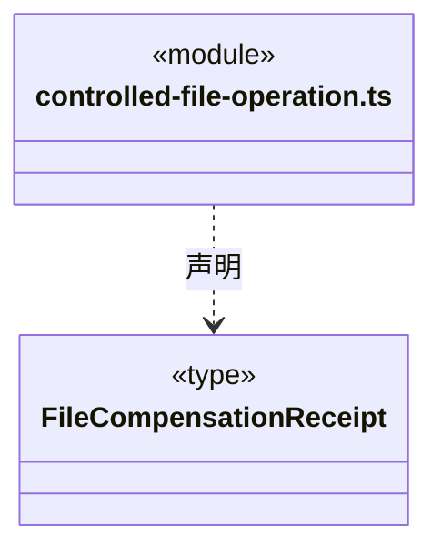


### controlled-file-rules.ts

公开入口 1/2（同一模块）。

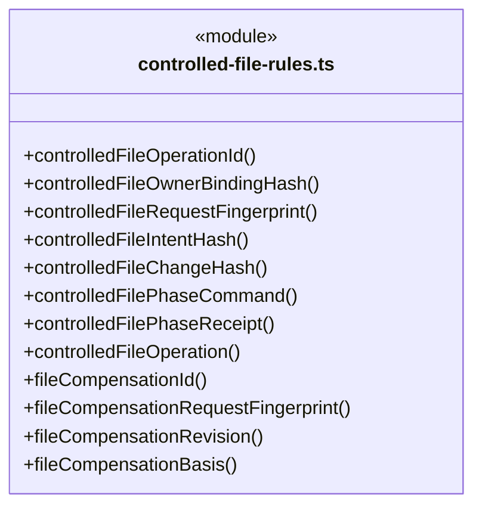

公开入口 2/2（同一模块）。

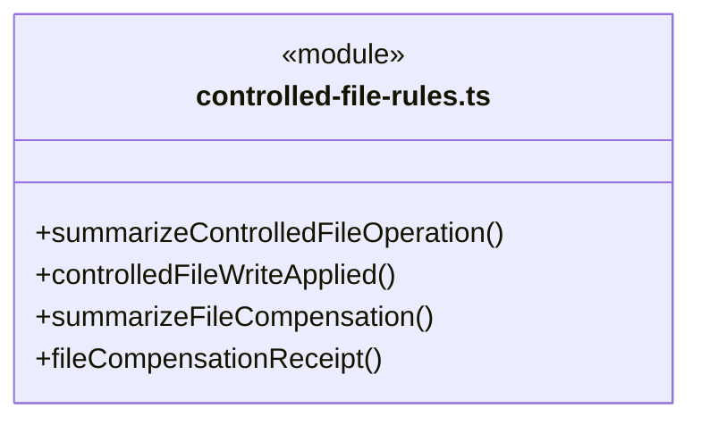

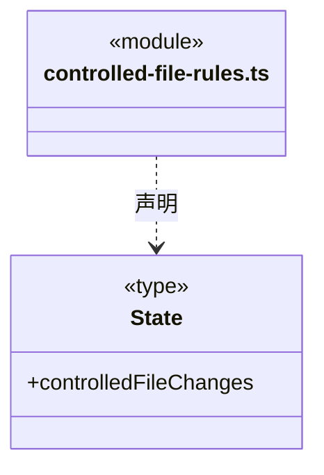

直接依赖：[../../team/rules/automatic-execution.ts](../../team/rules/automatic-execution.ts)、[../../../core/platform/node/serialization.ts](../../../core/platform/node/serialization.ts)、[../../../core/errors.ts](../../../core/errors.ts)、[../../team/rules/member-execution-binding.ts](../../team/rules/member-execution-binding.ts)、[controlled-file-operation.ts](controlled-file-operation.ts)、[controlled-file-event.ts](controlled-file-event.ts)。

### isolated-execution-recovery.ts

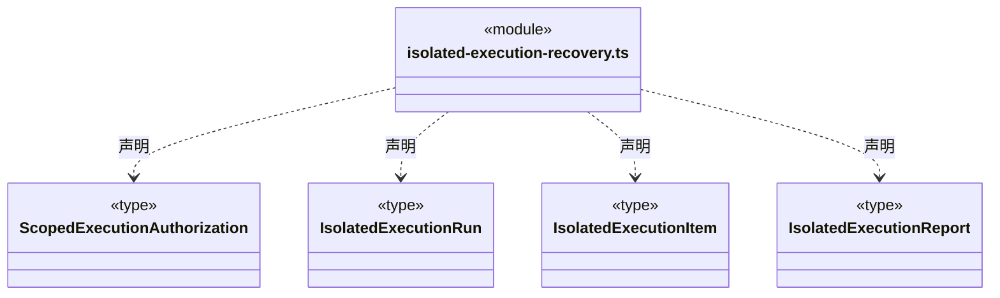

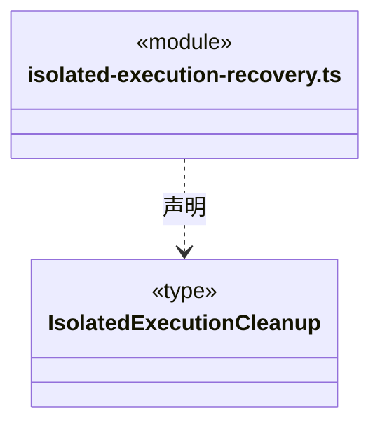


### scoped-execution.ts

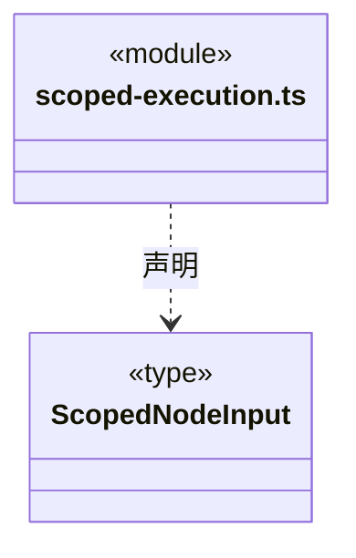

直接依赖：[../../workspace/rules/execution-scope.ts](../../workspace/rules/execution-scope.ts)。

### 本目录调用边界

```mermaid
classDiagram
class N_src_logic_file_operations_rules_artifact_transition_evidence_ts["artifact-transition-evidence.ts"] {
  <<module>>
}
class N_src_logic_file_operations_rules_artifact_transition_ts["artifact-transition.ts"] {
  <<module>>
}
class N_src_logic_file_operations_rules_controlled_file_event_ts["controlled-file-event.ts"] {
  <<module>>
}
class N_src_logic_file_operations_rules_controlled_file_operation_ts["controlled-file-operation.ts"] {
  <<module>>
}
class N_src_logic_file_operations_rules_controlled_file_invariants_ts["controlled-file-invariants.ts"] {
  <<module>>
}
N_src_logic_file_operations_rules_artifact_transition_evidence_ts ..> N_src_logic_file_operations_rules_artifact_transition_ts : 导入依赖
N_src_logic_file_operations_rules_controlled_file_event_ts ..> N_src_logic_file_operations_rules_controlled_file_operation_ts : 导入依赖
N_src_logic_file_operations_rules_controlled_file_invariants_ts ..> N_src_logic_file_operations_rules_controlled_file_operation_ts : 导入依赖
N_src_logic_file_operations_rules_controlled_file_invariants_ts ..> N_src_logic_file_operations_rules_controlled_file_event_ts : 导入依赖
```

```mermaid
classDiagram
class N_src_logic_file_operations_rules_controlled_file_invariants_ts["controlled-file-invariants.ts"] {
  <<module>>
}
class N_src_logic_file_operations_rules_controlled_file_rules_ts["controlled-file-rules.ts"] {
  <<module>>
}
class N_src_logic_file_operations_rules_controlled_file_operation_ts["controlled-file-operation.ts"] {
  <<module>>
}
class N_src_logic_file_operations_rules_controlled_file_event_ts["controlled-file-event.ts"] {
  <<module>>
}
N_src_logic_file_operations_rules_controlled_file_invariants_ts ..> N_src_logic_file_operations_rules_controlled_file_rules_ts : 导入依赖
N_src_logic_file_operations_rules_controlled_file_rules_ts ..> N_src_logic_file_operations_rules_controlled_file_operation_ts : 导入依赖
N_src_logic_file_operations_rules_controlled_file_rules_ts ..> N_src_logic_file_operations_rules_controlled_file_event_ts : 导入依赖
```


## 子目录导航

无子目录。

[返回上层](../ARCHITECTURE.md)。

每次修改本目录代码，同步维护文件头、关键契约说明及本图。未实现的治理、证据验收和自动编排能力不列入当前类图。
